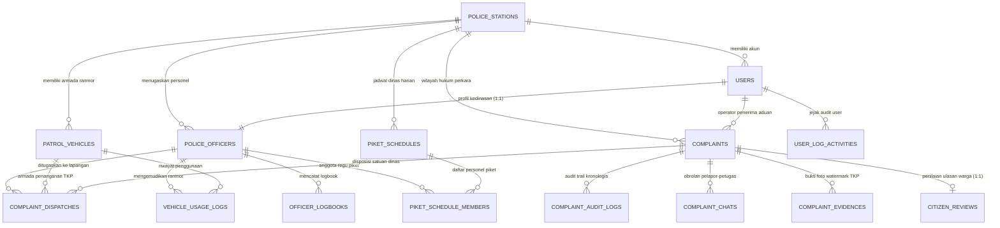

# 🗄️ SPESIFIKASI SKEMA DATABASE DAN RELASI ENTITAS (DATA DICTIONARY)
## SISTEM MANAJEMEN OPERASIONAL PRESISI 110 (SIMAPRES 110)
### KEPOLISIAN NEGARA REPUBLIK INDONESIA – POLRES PEKALONGAN

Dokumen ini merupakan referensi teknis resmi mengenai arsitektur basis data relasional aplikasi **SIMAPRES 110**, yang disusun 100% berlandaskan definisi skema nyata pada [`prisma/schema.prisma`](file:///c:/Users/Pongo/Downloads/SIMAPRES/prisma/schema.prisma).

- **Database Engine Target:** MySQL 8.0+ / MariaDB / TiDB Cloud (`simapres_110_spkt_db`)
- **ORM Provider:** Prisma Client v5.22.0
- **Total Model Terdaftar:** 44 Model (Lookups, Entitas Inti Operasional, Audit, Piket & Logistik)
- **Konvensi Penamaan:** Standar *Clean English Domain Naming*, tabel menggunakan `snake_case`, model Prisma menggunakan `PascalCase`.

---

# DAFTAR ISI

1. [Topologi Relasi Antar-Entitas (Mermaid ERD)](#1-topologi-relasi-antar-entitas-mermaid-erd)
2. [Tabel-Tabel Operasional Inti (Core Transactional)](#2-tabel-tabel-operasional-inti-core-transactional)
   - [2.1 Tabel `complaints` (Tiket Aduan Warga 110)](#21-tabel-complaints)
   - [2.2 Tabel `complaint_dispatches` (Penugasan & Pergerakan Armada)](#22-tabel-complaint_dispatches)
   - [2.3 Tabel `complaint_audit_logs` (Audit Trail Kronologis Perkara)](#23-tabel-complaint_audit_logs)
   - [2.4 Tabel `complaint_evidences` (Bukti Foto Watermark TKP)](#24-tabel-complaint_evidences)
   - [2.5 Tabel `complaint_chats` (Percakapan Darurat Warga-Petugas)](#25-tabel-complaint_chats)
   - [2.6 Tabel `citizen_reviews` (Indeks Kepuasan Masyarakat / IKM)](#26-tabel-citizen_reviews)
3. [Tabel Identitas, Personel, & Markas Komando](#3-tabel-identitas-personel--markas-komando)
   - [3.1 Tabel `police_stations` (Mako Polres & Polsek Jajaran)](#31-tabel-police_stations)
   - [3.2 Tabel `users` (Kredensial Autentikasi Pengguna)](#32-tabel-users)
   - [3.3 Tabel `police_officers` (Profil Personel & Live Telemetri GPS)](#33-tabel-police_officers)
4. [Tabel Manajemen Armada Kendaraan Dinas & QR Token](#4-tabel-manajemen-armada-kendaraan-dinas--qr-token)
   - [4.1 Tabel `patrol_vehicles` (Kendaraan Dinas Patroli)](#41-tabel-patrol_vehicles)
   - [4.2 Tabel `vehicle_usage_logs` (Sesi Berkendara Petugas)](#42-tabel-vehicle_usage_logs)
5. [Tabel SOP Jaga Mako, Roster Piket & Inventaris Senpi](#5-tabel-sop-jaga-mako-roster-piket--inventaris-senpi)
   - [5.1 Tabel `piket_schedules` (Sprin & Roster Piket Dinas Mako)](#51-tabel-piket_schedules)
   - [5.2 Tabel `piket_schedule_members` (Plotting Anggota Regu Piket)](#52-tabel-piket_schedule_members)
6. [Tabel Buku Saku Petugas & Titik Rawan (Hotspots)](#6-tabel-buku-saku-petugas--titik-rawan-hotspots)
   - [6.1 Tabel `officer_logbooks` (Catatan Kegiatan Harian & GPS Audit)](#61-tabel-officer_logbooks)
   - [6.2 Tabel `hotspot_locations` (Titik Rawan Kamtibmas / 3C)](#62-tabel-hotspot_locations)
   - [6.3 Tabel `user_log_activities` (Audit Jejak Akses Sistem)](#63-tabel-user_log_activities)
7. [Tabel Master Lookup Terpusat (26 Master Lookups - Zero-Hardcode)](#7-tabel-master-lookup-terpusat)

---

## 1. TOPOLOGI RELASI ANTAR-ENTITAS (MERMAID ERD)

---

## 2. TABEL-TABEL OPERASIONAL INTI (CORE TRANSACTIONAL)

### 2.1 Tabel `complaints`
Tabel pusat yang mencatat seluruh siklus hidup pengaduan darurat masyarakat dari awal panggilan 110 hingga penutupan resmi.

| Nama Kolom | Tipe Data Prisma | Tipe MySQL | Keterangan & Batasan |
| :--- | :--- | :--- | :--- |
| `id` | `BigInt` | `BIGINT` | Primary Key, Auto Increment |
| `nomor_tiket` | `String` | `VARCHAR(35)` | Unique, Kode resmi laporan kedinasan (misal: `C110-20261027-0001`) |
| `pelapor_nama` | `String` | `VARCHAR(120)` | Nama lengkap warga yang melapor |
| `pelapor_hp` | `String` | `VARCHAR(50)` | Nomor telepon / WhatsApp warga (format Indonesia) |
| `jenis_kejadian` | `String` | `VARCHAR(255)` | Judul rincian perkara aduan |
| `urgency_id` | `Int?` | `INT NULL` | Foreign Key ke `master_urgency_levels.id` |
| `urgensi` | `String` | `VARCHAR(30)` | Default `'SEDANG'` (`DARURAT`, `SEDANG`, `NORMAL`) |
| `tkp_alamat_teks` | `String` | `VARCHAR(255)` | Alamat jalan / patokan fisik lokasi kejadian |
| `tkp_lat` | `Decimal` | `DECIMAL(10,8)` | Koordinat Latitude TKP |
| `tkp_lng` | `Decimal` | `DECIMAL(11,8)` | Koordinat Longitude TKP |
| `ringkasan_keterangan` | `String` | `TEXT` | Narasi kronologis peristiwa |
| `status_id` | `Int?` | `INT NULL` | Foreign Key ke `master_complaint_statuses.id` |
| `status` | `String` | `VARCHAR(50)` | Default `'MENUNGGU'` (`MENUNGGU`, `DIPROSES`, `MENUNGGU_PENGESAHAN`, `SELESAI`, `DITOLAK`, `DISPOSISI_LINTAS_WILAYAH`) |
| `tahap` | `Int` | `INT` | Default `1` (1=Input, 2=Meluncur/Ditangani, 3=Validasi Pawas, 4=Selesai Sah, 5=Selesai Meja Operator) |
| `alasan_tolak` | `String?` | `TEXT NULL` | Catatan alasan pembatalan / penolakan laporan palsu |
| `category_id` | `Int?` | `INT NULL` | Foreign Key ke `master_incident_categories.id` |
| `kategori_key` | `String?` | `VARCHAR(255) NULL` | Key kategori (misal: `KRIMINALITAS`, `KAMTIBMAS`, `LAKALANTAS`) |
| `subcategory_id` | `Int?` | `INT NULL` | Foreign Key ke `master_incident_subcategories.id` |
| `source_id` | `Int?` | `INT NULL` | Foreign Key ke `master_report_sources.id` |
| `platform_key` | `String?` | `VARCHAR(50) NULL` | Saluran aduan (`CALL_110`, `PORTAL_WARGA`) |
| `station_id` | `Int?` | `INT NULL` | Foreign Key ke `police_stations.id` (Mako pengampu perkara) |
| `operator_id` | `BigInt?` | `BIGINT NULL` | Foreign Key ke `users.id` (Petugas operator penerima aduan) |
| `resolution_location_id`| `Int?` | `INT NULL` | Foreign Key ke `master_resolution_location_types.id` |
| `resolution_location_key`| `String?` | `VARCHAR(50) NULL` | Key lokasi penyelesaian (`TKP`, `KANTOR_POLISI`, `RUMAH_SAKIT`, `KANTOR_KELURAHAN`) |
| `resolution_document_id`| `Int?` | `INT NULL` | Foreign Key ke `master_resolution_document_types.id` |
| `resolution_document_key`| `String?` | `VARCHAR(50) NULL` | Key bukti dokumen (`BAP_DAMAI`, `SERAH_TERIMA_BB`, `DOKUMENTASI_KONDUSIF`) |
| `created_at` | `DateTime` | `DATETIME(3)` | Default `now()` |
| `updated_at` | `DateTime` | `DATETIME(3)` | Auto-update timestamp |

**Indeks Kinerja:**
- `idx_complaints_status_created` (`status`, `created_at`)
- `idx_complaints_status_id` (`status_id`)
- `idx_complaints_scene_coords` (`tkp_lat`, `tkp_lng`)
- `idx_complaints_reporter_created` (`pelapor_hp`, `created_at`)
- `idx_complaints_category_key` (`kategori_key`)
- `idx_complaints_resolution_location` (`resolution_location_key`)
- `idx_complaints_resolution_doc` (`resolution_document_key`)

---

### 2.2 Tabel `complaint_dispatches`
Mencatat rincian penugasan regu dinas, alokasi armada patroli, audit waktu tanggap pergerakan, dan perhitungan logistik bahan bakar.

| Nama Kolom | Tipe Data Prisma | Tipe MySQL | Keterangan & Batasan |
| :--- | :--- | :--- | :--- |
| `id` | `BigInt` | `BIGINT` | Primary Key, Auto Increment |
| `complaint_id` | `BigInt` | `BIGINT` | Foreign Key ke `complaints.id` (`onDelete: Cascade`) |
| `unit_id` | `Int` | `INT` | Foreign Key ke `master_operational_units.id` (Samapta, Lantas, Reskrim, dll) |
| `officer_id` | `BigInt?` | `BIGINT NULL` | Foreign Key ke `police_officers.id` (`onDelete: SetNull`) |
| `is_primary_unit` | `Boolean` | `TINYINT(1)` | Default `true` (Penanggung jawab utama di TKP) |
| `personnel_quota` | `Int` | `INT` | Default `4` (Kebutuhan personel regu penindak) |
| `tactical_orders` | `String?` | `TEXT NULL` | Perintah taktis khusus dari Operator CAD / Pawas |
| `dispatch_status_id` | `Int?` | `INT NULL` | Foreign Key ke `master_dispatch_statuses.id` |
| `dispatch_status` | `String` | `VARCHAR(30)` | Default `'DISPATCHED'` (`DISPATCHED`, `DEPARTED`, `ARRIVED`, `REPORT_SUBMITTED`, `COMPLETED`) |
| `dispatched_at` | `DateTime` | `DATETIME(3)` | Waktu penugasan diterbitkan |
| `accepted_at` | `DateTime?` | `DATETIME(3) NULL` | Waktu personel mengonfirmasi penerimaan tugas |
| `departed_at` | `DateTime?` | `DATETIME(3) NULL` | Waktu personel meluncur dari pos/mako |
| `arrived_at` | `DateTime?` | `DATETIME(3) NULL` | Waktu personel tiba di lokasi perkara |
| `completed_at` | `DateTime?` | `DATETIME(3) NULL` | Waktu penanganan di TKP selesai |
| `station_id` | `Int?` | `INT NULL` | Foreign Key ke `police_stations.id` (Mako satuan bertugas) |
| `wa_officer_status` | `String?` | `VARCHAR(30)` | Status WA personel (`NONE`, `SENT`, `FAILED`) |
| `wa_polsek_status` | `String?` | `VARCHAR(30)` | Status WA ke nomor dinas Mako Polsek |
| `escalation_deadline_at`| `DateTime?`| `DATETIME(3) NULL` | Batas SLA respon Mako tujuan (5 menit) |
| `is_escalated` | `Boolean` | `TINYINT(1)` | Default `false` (Flag alarm merah eskalasi aktif) |
| `assigned_vehicle_id` | `Int?` | `INT NULL` | Foreign Key ke `patrol_vehicles.id` (Hasil scan stiker QR armada) |
| `crew_leader_nrp` | `String?` | `VARCHAR(50) NULL` | NRP Komandan Regu Patroli |
| `crew_leader_name` | `String?` | `VARCHAR(120) NULL`| Nama Lengkap Komandan Regu |
| `crew_partner_nrp` | `String?` | `VARCHAR(50) NULL` | NRP Rekan Pendamping (Buddy System) |
| `crew_partner_name` | `String?` | `VARCHAR(120) NULL`| Nama Rekan Pendamping Lapangan |
| `mako_start_lat` | `Decimal?` | `DECIMAL(10,8)` | Koordinat Latitude Mako Keberangkatan |
| `mako_start_lng` | `Decimal?` | `DECIMAL(11,8)` | Koordinat Longitude Mako Keberangkatan |
| `round_trip_km` | `Decimal?` | `DECIMAL(8,2)` | Total jarak tempuh PP Mako-TKP x 1.25x kelokan jalan |
| `fuel_liters_used` | `Decimal?` | `DECIMAL(6,2)` | Estimasi volume bahan bakar terpakai (Liter) |
| `fuel_cost_estimated` | `Decimal?` | `DECIMAL(12,2)`| Estimasi biaya bahan bakar riil DIPA (Rupiah) |
| `fuel_claim_status_id`| `Int?` | `INT NULL` | Foreign Key ke `master_fuel_claim_statuses.id` |
| `fuel_claim_notes` | `String?` | `TEXT NULL` | Catatan audit kas keuangan Seksi Keuangan (Si-Keu) |

---

### 2.3 Tabel `complaint_audit_logs`
Mencatat kronologis lengkap seluruh peristiwa, mutasi status, dan tindakan pejabat/petugas secara anti-tamper.

| Nama Kolom | Tipe Data Prisma | Tipe MySQL | Keterangan & Batasan |
| :--- | :--- | :--- | :--- |
| `id` | `BigInt` | `BIGINT` | Primary Key, Auto Increment |
| `complaint_id` | `BigInt` | `BIGINT` | Foreign Key ke `complaints.id` (`onDelete: Cascade`) |
| `actor_name` | `String` | `VARCHAR(120)` | Nama lengkap pejabat / petugas |
| `actor_role` | `String` | `VARCHAR(50)` | Peran aktor (`SUPERADMIN`, `OPERATOR`, `PAWAS`, `PERSONIL`, `WARGA`) |
| `action` | `String` | `VARCHAR(150)` | Kode aksi (`CREATED`, `DISPATCHED`, `CROSS_JURISDICTION_ACCEPTED`, `ARRIVED_TKP`, dll.) |
| `notes` | `String?` | `TEXT NULL` | Uraian narasi detail hasil tindakan |
| `action_lat` | `Decimal?` | `DECIMAL(10,8)` | Koordinat Latitude saat aksi dilakukan |
| `action_lng` | `Decimal?` | `DECIMAL(11,8)` | Koordinat Longitude saat aksi dilakukan |
| `created_at` | `DateTime` | `DATETIME(3)` | Default `now()` |

---

### 2.4 Tabel `complaint_evidences`
Menyimpan berkas foto situasi TKP yang telah dicap dengan watermark digital permanen anti-fraud.

| Nama Kolom | Tipe Data Prisma | Tipe MySQL | Keterangan & Batasan |
| :--- | :--- | :--- | :--- |
| `id` | `BigInt` | `BIGINT` | Primary Key, Auto Increment |
| `complaint_id` | `BigInt` | `BIGINT` | Foreign Key ke `complaints.id` (`onDelete: Cascade`) |
| `incident_phase` | `String` | `VARCHAR(50)` | Fase penanganan (`TIBA_TKP`, `PENANGANAN`, `SELESAI_KONDUSIF`) |
| `file_url` | `String` | `VARCHAR(255)` | Path penyimpanan berkas foto bukti di server |
| `caption` | `String?` | `VARCHAR(255) NULL`| Deskripsi singkat peristiwa pada foto |
| `watermark_text` | `String?` | `VARCHAR(255) NULL`| Teks stempel watermark legal (NRP, Waktu, Koordinat) |
| `exif_lat` | `Decimal?` | `DECIMAL(10,8)` | Koordinat Latitude hardware kamera |
| `exif_lng` | `Decimal?` | `DECIMAL(11,8)` | Koordinat Longitude hardware kamera |
| `uploaded_at` | `DateTime` | `DATETIME(3)` | Default `now()` |

---

### 2.5 Tabel `complaint_chats`
Mencatat pertukaran pesan darurat dua arah antara warga pelapor dan petugas lapangan yang sedang meluncur.

| Nama Kolom | Tipe Data Prisma | Tipe MySQL | Keterangan & Batasan |
| :--- | :--- | :--- | :--- |
| `id` | `BigInt` | `BIGINT` | Primary Key, Auto Increment |
| `complaint_id` | `BigInt` | `BIGINT` | Foreign Key ke `complaints.id` (`onDelete: Cascade`) |
| `sender_role` | `String` | `VARCHAR(20)` | Peran pengirim (`WARGA` atau `PERSONIL`) |
| `sender_name` | `String` | `VARCHAR(120)` | Nama pengirim pesan |
| `officer_nrp` | `String?` | `VARCHAR(50) NULL` | NRP petugas jika pengirim adalah personel |
| `message_text` | `String` | `TEXT` | Isi pesan teks darurat |
| `created_at` | `DateTime` | `DATETIME(3)` | Default `now()` |

---

### 2.6 Tabel `citizen_reviews`
Mencatat survei Indeks Kepuasan Masyarakat (IKM) atas pelayanan penanganan perkara 110.

| Nama Kolom | Tipe Data Prisma | Tipe MySQL | Keterangan & Batasan |
| :--- | :--- | :--- | :--- |
| `id` | `BigInt` | `BIGINT` | Primary Key, Auto Increment |
| `complaint_id` | `BigInt` | `BIGINT` | Unique, Foreign Key ke `complaints.id` (`onDelete: Cascade`) |
| `star_rating` | `Int` | `INT` | Skala penilaian 1 sampai 5 bintang |
| `feedback_tags` | `String?` | `VARCHAR(255) NULL`| Tag pilihan kepuasan (misal: `"Respon Cepat, Sangat Ramah"`) |
| `review_text` | `String?` | `TEXT NULL` | Komentar ulasan warga pelapor |
| `reporter_name` | `String?` | `VARCHAR(120) NULL`| Nama pelapor pengisi ulasan |
| `created_at` | `DateTime` | `DATETIME(3)` | Default `now()` |

---

## 3. TABEL IDENTITAS, PERSONEL, & MARKAS KOMANDO

### 3.1 Tabel `police_stations` (Mako Kantor Polisi)
Mendefinisikan hierarki markas komando kepolisian (Mabes, Polda, Polres, Polsek, Pospol) beserta koordinat sentral geofence wilayah.

| Nama Kolom | Tipe Data Prisma | Tipe MySQL | Keterangan & Batasan |
| :--- | :--- | :--- | :--- |
| `id` | `Int` | `INT` | Primary Key, Auto Increment |
| `station_code` | `String` | `VARCHAR(30)` | Unique (misal: `POLRES-PEKALONGAN`, `POLSEK-KEDUNGWUNI`) |
| `station_name` | `String` | `VARCHAR(100)` | Nama lengkap Mako (misal: `Polres Pekalongan`) |
| `station_level_id` | `Int?` | `INT NULL` | Foreign Key ke `master_station_levels.id` |
| `station_level` | `String` | `VARCHAR(30)` | Default `'POLRES'` (`POLRES`, `POLSEK`, `POSPOL`) |
| `parent_station_id`| `Int?` | `INT NULL` | Self-relation ke `police_stations.id` (Induk Mako) |
| `address` | `String` | `VARCHAR(255)` | Alamat jalan kantor polisi |
| `office_lat` | `Decimal` | `DECIMAL(10,8)` | Koordinat Latitude Markas Komando |
| `office_lng` | `Decimal` | `DECIMAL(11,8)` | Koordinat Longitude Markas Komando |
| `geofence_radius_meters`| `Int` | `INT` | Default `500` (Radius geofence Mako dalam meter) |
| `phone_piket` | `String?` | `VARCHAR(30) NULL` | Nomor WhatsApp / Telepon Meja Piket SPKT Mako |
| `phone_kapolsek` | `String?` | `VARCHAR(30) NULL` | Nomor kontak pimpinan Kapolres / Kapolsek |
| `is_active` | `Boolean` | `TINYINT(1)` | Default `true` |

---

### 3.2 Tabel `users` (Kredensial Login Sistem)

| Nama Kolom | Tipe Data Prisma | Tipe MySQL | Keterangan & Batasan |
| :--- | :--- | :--- | :--- |
| `id` | `BigInt` | `BIGINT` | Primary Key, Auto Increment |
| `identifier` | `String` | `VARCHAR(50)` | Unique, NRP Petugas atau Username Administrator |
| `password_hash` | `String` | `VARCHAR(255)` | Hash password bcrypt anti-bruteforce |
| `full_name` | `String` | `VARCHAR(120)` | Nama lengkap beserta gelar kedinasan |
| `phone_number` | `String` | `VARCHAR(30)` | Nomor telepon aktif WhatsApp |
| `email` | `String?` | `VARCHAR(100) NULL`| Alamat email kedinasan |
| `role_id` | `Int?` | `INT NULL` | Foreign Key ke `master_roles.id` |
| `role` | `String` | `VARCHAR(50)` | Role kedinasan (`SUPERADMIN`, `PAWAS`, `OPERATOR`, `PERSONIL`, `LOGISTIK`) |
| `station_id` | `Int?` | `INT NULL` | Foreign Key ke `police_stations.id` |
| `is_active` | `Boolean` | `TINYINT(1)` | Default `true` |
| `last_login_at` | `DateTime?` | `DATETIME(3) NULL` | Waktu login terakhir pengguna |

---

### 3.3 Tabel `police_officers` (Profil Personel & Telemetri GPS)

| Nama Kolom | Tipe Data Prisma | Tipe MySQL | Keterangan & Batasan |
| :--- | :--- | :--- | :--- |
| `id` | `BigInt` | `BIGINT` | Primary Key, Auto Increment |
| `user_id` | `BigInt` | `BIGINT` | Unique, Foreign Key ke `users.id` (`onDelete: Cascade`) |
| `nrp` | `String` | `VARCHAR(20)` | Unique, Nomor Registrasi Pokok kepolisian |
| `rank_pangkat` | `String` | `VARCHAR(50)` | Pangkat (misal: `Aipda`, `Bripka`, `Iptu`, `Kompol`) |
| `jabatan` | `String` | `VARCHAR(100)` | Jabatan dinas (misal: `Ba Turjawali Samapta`, `Pawas Piket`) |
| `station_id` | `Int?` | `INT NULL` | Foreign Key ke `police_stations.id` |
| `unit_id` | `Int?` | `INT NULL` | Foreign Key ke `master_operational_units.id` |
| `duty_status_id` | `Int?` | `INT NULL` | Foreign Key ke `master_duty_statuses.id` |
| `duty_status` | `String` | `VARCHAR(50)` | Default `'LEPAS_DINAS'` (`DINAS_PATROLI`, `PIKET_SPKT`, `LEPAS_DINAS`) |
| `current_gps_lat` | `Decimal?` | `DECIMAL(10,8)` | Koordinat Latitude posisi live personel |
| `current_gps_lng` | `Decimal?` | `DECIMAL(11,8)` | Koordinat Longitude posisi live personel |
| `last_gps_heartbeat_at`| `DateTime?`| `DATETIME(3) NULL`| Waktu ping telemetri GPS terakhir |
| `kpi_score` | `Decimal` | `DECIMAL(5,2)` | Default `100.00` (Skor kinerja akumulatif) |
| `device_id` | `String?` | `VARCHAR(64) NULL` | ID hardware perangkat resmi Polri yang terikat |

---

## 4. TABEL MANAJEMEN ARMADA KENDARAAN DINAS & QR TOKEN

### 4.1 Tabel `patrol_vehicles` (Kendaraan Dinas Patroli)

| Nama Kolom | Tipe Data Prisma | Tipe MySQL | Keterangan & Batasan |
| :--- | :--- | :--- | :--- |
| `id` | `Int` | `INT` | Primary Key, Auto Increment |
| `nomor_lambung` | `String` | `VARCHAR(50)` | Unique (misal: `R4-SAMAPTA-81`, `SEDAN-LANTAS-01`) |
| `nama_armada` | `String` | `VARCHAR(100)` | Label nama armada patroli |
| `jenis_kendaraan` | `String` | `VARCHAR(30)` | Default `'RODA_4'` (`RODA_4`, `RODA_2`, `MINIBUS`) |
| `plat_nomor_polisi` | `String?` | `VARCHAR(30) NULL` | Plat nopol resmi dinas Polri (misal: `1001-VII`) |
| `qr_token` | `String` | `VARCHAR(64)` | Unique, Token kriptografis stiker fisik kendaraan |
| `station_id` | `Int?` | `INT NULL` | Foreign Key ke `police_stations.id` |
| `unit_id` | `Int?` | `INT NULL` | Foreign Key ke `master_operational_units.id` |
| `current_lat` | `Decimal?` | `DECIMAL(10,8)` | Koordinat Latitude posisi armada |
| `current_lng` | `Decimal?` | `DECIMAL(11,8)` | Koordinat Longitude posisi armada |
| `speed_kmh` | `Int` | `INT` | Default `0` (Kecepatan kendaraan km/jam) |
| `status_operasional`| `String` | `VARCHAR(50)` | Default `'SIAGA'` (`SIAGA`, `PATROLI`, `MENUJU_TKP`) |
| `fuel_type_id` | `Int?` | `INT NULL` | Foreign Key ke `master_fuel_types.id` |
| `fuel_ratio_km_per_liter`| `Decimal`| `DECIMAL(5,2)` | Default `8.00` (Efisiensi rasio km per 1 liter bahan bakar) |

### 4.2 Tabel `vehicle_usage_logs` (Sesi Penggunaan Ranmor)
Mencatat riwayat check-in dan check-out pengemudi kendaraan dinas berbasis pemindaian QR Code.

| Nama Kolom | Tipe Data Prisma | Tipe MySQL | Keterangan & Batasan |
| :--- | :--- | :--- | :--- |
| `id` | `BigInt` | `BIGINT` | Primary Key, Auto Increment |
| `vehicle_id` | `Int` | `INT` | Foreign Key ke `patrol_vehicles.id` (`onDelete: Cascade`) |
| `officer_id` | `BigInt` | `BIGINT` | Foreign Key ke `police_officers.id` (`onDelete: Cascade`) |
| `check_in_at` | `DateTime` | `DATETIME(3)` | Default `now()` (Waktu mulai dinas berkendara) |
| `check_in_lat` | `Decimal` | `DECIMAL(10,8)` | Koordinat GPS saat mulai berkendara |
| `check_in_lng` | `Decimal` | `DECIMAL(11,8)` | Koordinat GPS saat mulai berkendara |
| `check_out_at` | `DateTime?` | `DATETIME(3) NULL` | Waktu selesai dinas berkendara |
| `status_sesi` | `String` | `VARCHAR(30)` | Default `'ACTIVE'` (`ACTIVE`, `COMPLETED`, `AUTO_TERMINATED`) |
| `catatan_kondisi` | `String?` | `TEXT NULL` | Kondisi fisik kendaraan sebelum dan sesudah dinas |

---

## 5. TABEL SOP JAGA MAKO, ROSTER PIKET & INVENTARIS SENPI

### 5.1 Tabel `piket_schedules` (Sprin & Roster Piket Dinas Mako)

| Nama Kolom | Tipe Data Prisma | Tipe MySQL | Keterangan & Batasan |
| :--- | :--- | :--- | :--- |
| `id` | `Int` | `INT` | Primary Key, Auto Increment |
| `station_id` | `Int` | `INT` | Foreign Key ke `police_stations.id` (`onDelete: Cascade`) |
| `sprint_number` | `String` | `VARCHAR(100)` | Nomor Sprin dinas (misal: `Sprin/124/X/HUK.6.6./2026/Polsek`) |
| `sprint_date` | `DateTime` | `DATETIME(3)` | Tanggal penerbitan Surat Perintah |
| `schedule_date` | `DateTime` | `DATE` | Tanggal pelaksanaan dinas piket |
| `regu` | `String` | `VARCHAR(50)` | Nama Regu Jaga (`Regu A`, `Regu B`, `Regu C`) |
| `shift_type` | `String` | `VARCHAR(50)` | Default `'1X24_JAM'` (`1X24_JAM`, `SHIFT_PAGI`, `SHIFT_MALAM`) |
| `pawas_id` | `BigInt?` | `BIGINT NULL` | Foreign Key ke `police_officers.id` (Perwira Pengawas) |
| `padal_id` | `BigInt?` | `BIGINT NULL` | Foreign Key ke `police_officers.id` (Perwira Pengendali) |
| `ka_spkt_id` | `BigInt?` | `BIGINT NULL` | Foreign Key ke `police_officers.id` (Kepala SPKT) |
| `status` | `String` | `VARCHAR(50)` | Default `'TERJADWAL'` (`TERJADWAL`, `BERJALAN`, `SERAH_TERIMA`, `SELESAI`) |
| `tahanan_laki` | `Int` | `INT` | Default `0` (Jumlah tahanan pria di rutan Mako) |
| `tahanan_wanita` | `Int` | `INT` | Default `0` (Jumlah tahanan wanita di rutan Mako) |
| `tahanan_anak` | `Int` | `INT` | Default `0` (Jumlah tahanan anak di rutan Mako) |
| `tahanan_titipan` | `Int` | `INT` | Default `0` (Jumlah tahanan titipan kejaksaan/pengadilan) |
| `kondisi_tahanan` | `String?` | `VARCHAR(255) NULL`| Audit kondisi kesehatan tahanan dan gembok teralis |
| `senpi_inventaris` | `String?` | `TEXT NULL` | Audit kelayakan senjata api inventaris penjagaan |
| `amunisi_inventaris`| `String?` | `TEXT NULL` | Audit butir peluru tajam dan karet inventaris |
| `ranmor_inventaris` | `String?` | `TEXT NULL` | Audit kesiapsiagaan kendaraan dinas inventaris |
| `rompi_borgol_ht` | `String?` | `TEXT NULL` | Audit kelayakan rompi level III-A, borgol, dan HT |

### 5.2 Tabel `piket_schedule_members` (Plotting Anggota Regu Piket)

| Nama Kolom | Tipe Data Prisma | Tipe MySQL | Keterangan & Batasan |
| :--- | :--- | :--- | :--- |
| `id` | `Int` | `INT` | Primary Key, Auto Increment |
| `schedule_id` | `Int` | `INT` | Foreign Key ke `piket_schedules.id` (`onDelete: Cascade`) |
| `officer_id` | `BigInt` | `BIGINT` | Foreign Key ke `police_officers.id` (`onDelete: Cascade`) |
| `role_piket` | `String` | `VARCHAR(50)` | Fungsi piket (`PAWAS`, `KA_SPKT`, `PIKET_SABHARA`, `PIKET_LANTAS`, `PIKET_RESKRIM`, `PIKET_INTELKAM`, `PIKET_OPERATOR_CAD`) |
| `pos_penugasan` | `String?` | `VARCHAR(120) NULL`| Lokasi pos jaga (misal: `"Sentra Penjagaan Mako"`, `"Patroli R4 Unit 01"`) |
| `status_kehadiran` | `String` | `VARCHAR(50)` | Default `'BELUM_HADIR'` (`HADIR_DINAS`, `BELUM_HADIR`, `LEPAS_PIKET`, `IZIN`, `SAKIT`) |
| `jam_masuk` | `DateTime?` | `DATETIME(3) NULL` | Timestamp presensi jam masuk dinas |
| `jam_pulang` | `DateTime?` | `DATETIME(3) NULL` | Timestamp presensi jam selesai dinas |

---

## 6. TABEL BUKU SAKU PETUGAS & TITIK RAWAN (HOTSPOTS)

### 6.1 Tabel `officer_logbooks` (Catatan Patroli & Audit Deviasi GPS)

| Nama Kolom | Tipe Data Prisma | Tipe MySQL | Keterangan & Batasan |
| :--- | :--- | :--- | :--- |
| `id` | `BigInt` | `BIGINT` | Primary Key, Auto Increment |
| `officer_id` | `BigInt` | `BIGINT` | Foreign Key ke `police_officers.id` (`onDelete: Cascade`) |
| `complaint_id` | `BigInt?` | `BIGINT NULL` | Foreign Key ke `complaints.id` (`onDelete: SetNull`) |
| `action_type` | `String` | `VARCHAR(50)` | Tipe kegiatan (`PATROLI`, `TPTKP`, `SAMBANG`) |
| `claimed_lat` | `Decimal` | `DECIMAL(10,8)` | Koordinat yang diklaim petugas |
| `actual_lat` | `Decimal` | `DECIMAL(10,8)` | Koordinat GPS riil yang terbaca sensor |
| `deviation_meters` | `Decimal` | `DECIMAL(10,2)`| Selisih jarak klaim vs sensor riil (Meter) |
| `is_deviation_flagged`| `Boolean`| `TINYINT(1)` | Default `false` (Flag audit jika deviasi > 100m) |
| `activity_description`| `String` | `TEXT` | Deskripsi uraian kegiatan lapangan |
| `validation_status` | `String` | `VARCHAR(50)` | Default `'BELUM_DIVALIDASI'` (`VALID`, `FLAGGED_AUDIT`, `DITOLAK`) |

### 6.2 Tabel `hotspot_locations` (GIS Titik Rawan Kamtibmas / 3C)

| Nama Kolom | Tipe Data Prisma | Tipe MySQL | Keterangan & Batasan |
| :--- | :--- | :--- | :--- |
| `id` | `BigInt` | `BIGINT` | Primary Key, Auto Increment |
| `key` | `String` | `VARCHAR(64)` | Unique, Kode unik lokasi rawan |
| `title` | `String` | `VARCHAR(120)` | Nama titik rawan (misal: `"Jembatan Curug - Rawan Tawuran"`) |
| `police_sector` | `String` | `VARCHAR(100)` | Sektor wilayah Polsek pengampu |
| `category` | `String` | `VARCHAR(50)` | Kategori kerawanan (`TAWURAN`, `BALAP_LIAR`, `TIGA_C`, `NARKOBA`) |
| `danger_level` | `String` | `VARCHAR(50)` | Tingkat bahaya (`PENGAWASAN_PRIORITAS`, `SIAGA_BLUE_LIGHT`, `DARURAT_110`) |
| `lat` | `Decimal` | `DECIMAL(10,8)` | Titik Latitude kerawanan |
| `lng` | `Decimal` | `DECIMAL(11,8)` | Titik Longitude kerawanan |
| `active_start` | `String` | `VARCHAR(10)` | Default `'23:00'` (Jam mulai waktu rawan) |
| `active_end` | `String` | `VARCHAR(10)` | Default `'04:30'` (Jam selesai waktu rawan) |

---

## 7. TABEL MASTER LOOKUP TERPUSAT (26 MASTER LOOKUPS)

Seluruh variabel operasional kepolisian pada aplikasi SIMAPRES 110 diisolasi dalam tabel lookup mandiri agar sistem bersifat **Zero-Hardcode**:

1. `master_roles`: Peran pengguna (`SUPERADMIN`, `PAWAS`, `OPERATOR`, `PERSONIL`, `LOGISTIK`).
2. `master_station_levels`: Tingkatan Mako (`MABES`, `POLDA`, `POLRES`, `POLSEK`, `POSPOL`).
3. `master_operational_units`: 5 Satuan fungsi dinas (`sabhara`, `lantas`, `reskrim`, `intel`, `binmas`).
4. `master_duty_statuses`: Status dinas personel (`DINAS_PATROLI`, `PIKET_SPKT`, `LEPAS_DINAS`).
5. `master_incident_categories`: Kategori besar aduan (`KRIMINALITAS`, `KAMTIBMAS`, `LAKALANTAS`, `BENCANA`).
6. `master_incident_subcategories`: Rincian kasus spesifik per fungsi (`CURANMOR`, `TAWURAN`, `BALAP_LIAR`, dll.).
7. `master_report_sources`: Saluran pelaporan (`CALL_110`, `WHATSAPP_PRESISI`, `PORTAL_WARGA`).
8. `master_complaint_statuses`: Status aduan (`MENUNGGU`, `DIPROSES`, `MENUNGGU_PENGESAHAN`, `SELESAI`, `DITOLAK`, `DISPOSISI_LINTAS_WILAYAH`).
9. `master_urgency_levels`: Tingkat urgensi aduan (`DARURAT`, `SEDANG`, `NORMAL`).
10. `master_activity_types`: Tipe tugas personel (`PATROLI`, `TPTKP`, `SAMBANG`, `PENGAMANAN`).
11. `master_validation_statuses`: Status audit logbook (`BELUM_DIVALIDASI`, `VALID`, `FLAGGED_AUDIT`, `DITOLAK`).
12. `master_hotspot_categories`: Kategori titik rawan kriminalitas.
13. `master_hotspot_danger_levels`: Level kesiapsiagaan patroli blue-light.
14. `master_ranks`: Pangkat anggota Polri (`BRIPDA` s.d. `KOMBES`).
15. `master_rejection_reasons`: Alasan penolakan aduan palsu.
16. `master_dispatch_statuses`: Status penugasan armada (`DISPATCHED`, `DEPARTED`, `ARRIVED`, `COMPLETED`).
17. `master_vehicle_types`: Jenis ranmor dinas (`RODA_4`, `RODA_2`, `MINIBUS`).
18. `master_vehicle_statuses`: Status kesiapan armada (`SIAGA`, `PATROLI`, `MENUJU_TKP`).
19. `master_resolution_location_types`: Lokasi penyelesaian perkara (`TKP`, `KANTOR_POLISI`, `RUMAH_SAKIT`, `KANTOR_KELURAHAN`).
20. `master_resolution_document_types`: Jenis dokumen legalitas perkara (`BAP_DAMAI`, `SERAH_TERIMA_BB`, `DOKUMENTASI_KONDUSIF`).
21. `master_knowledge_faqs`: Katalog dokumen SOP dinas & script panduan operator.
22. `master_knowledge_faq_categories`: Kategori dokumen SOP (`LANTAS_SIM`, `SAMSAT_STNK_BPKB`, dll.).
23. `master_fuel_types`: Pagu harga BBM subsidi dinas DIPA (`SOLAR_DIPA`, `PERTALITE`, `PERTAMAX`).
24. `master_fuel_claim_statuses`: Alur klaim SPJ BBM (`UNCLAIMED`, `DIAJUKAN_BAGLOG`, `DISETUJUI_BAGLOG`, `DICAIRKAN`, `DITOLAK`).
25. `master_patrol_crew_roles`: Peran anggota regu patroli dinas (`KATIM_REGU`, `DRIVER_ARMADA`, `BINTARA_PENINDAK`).
26. `master_dispatch_modes`: Moda penugasan dinas (`UNIT_PIKET_POLSEK`, `PATROLI_PRESISI_MAKO`, `GABUNGAN_RAYON`).
