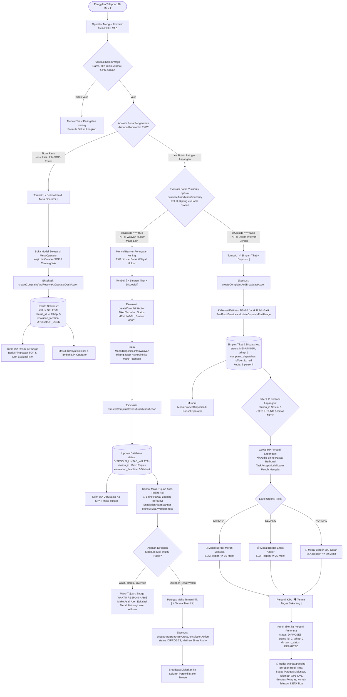
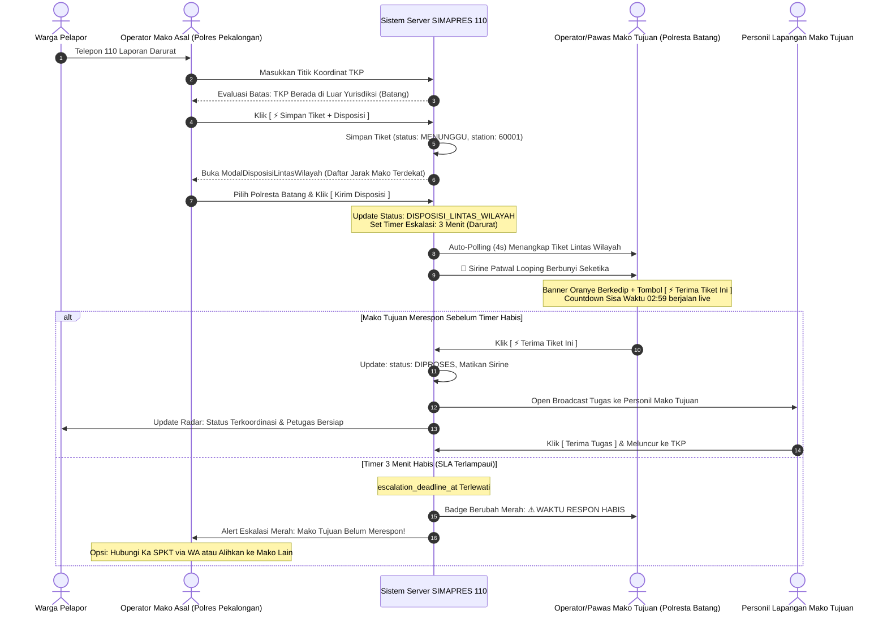

# 📘 DOKUMENTASI TEKNIS & STANDAR OPERASIONAL PROSEDUR (SOP)
## Modul Pembuatan Tiket 110 & Arsitektur 3 Cabang Alur Kerja (End-to-End)
### Sistem Manajemen Operasional Presisi 110 (SIMAPRES 110)
**Kepolisian Resor Pekalongan – Sentra Pelayanan Kepolisian Terpadu (SPKT) & Command Center 110**

---

## 1. Landasan Operasional & Tujuan Sistem

Berdasarkan **Undang-Undang Nomor 2 Tahun 2002 tentang Kepolisian Negara Republik Indonesia** dan **Standar Operasional Prosedur Layanan Contact Center 110 Polri**, setiap panggilan masuk dari masyarakat wajib direspon secara terukur, akuntabel, dan transparan.

Modul pembuatan tiket pengaduan pada konsol operator Computer-Aided Dispatch (CAD) 110 ([`TabOperatorCadPawas.tsx`](file:///c:/Users/Pongo/Downloads/SIMAPRES/src/components/console/pawas/tabs/TabOperatorCadPawas.tsx)) didesain dengan prinsip **Ketepatan Jalur Respon (Right-Routing Principle)**. Sistem tidak memperlakukan seluruh panggilan secara seragam, melainkan membaginya ke dalam **3 (tiga) cabang alur kerja (*workflow*) yang saling berkaitan dengan fungsi, validasi logika, dan dampak hilir (*downstream*) yang sangat berbeda**:

1. **Cabang 1 (Selesaikan di Meja Operator / Konseling 110):** Kasus non-lapangan (konsultasi, informasi SOP, prank call) yang tuntas melalui telepon tanpa menggerakkan armada ranmor patroli.
2. **Cabang 2 (Disposisi Lintas Wilayah / E-Routing Boundary):** Kasus darurat yang masuk ke 110 Mako Asal, namun titik TKP terdeteksi secara spasial berada di luar yurisdiksi operasional (wilayah Polres/Polsek tetangga).
3. **Cabang 3 (Disposisi Siaga / Open Broadcast Lokal):** Kasus kedaruratan standar di wilayah hukum sendiri yang memerlukan tindakan cepat TPTKP oleh armada patroli lokal (Samapta, Lantas, Polsek).

---

## 2. Diagram Alur Keputusan Induk (Master Decision Flowchart)

Diagram berikut memvisualisasikan seluruh percabangan logika, syarat kondisi (*conditional gates*), server actions, hingga dampak ke gawai personel lapangan dan radar pelacakan warga:



---

## 3. Matriks Perbandingan Komprehensif 3 Cabang Alur Kerja

| Parameter Pembanding | Cabang 1: Meja Operator (Desk Resolution) | Cabang 2: Lintas Wilayah (Cross-Jurisdiction) | Cabang 3: Disposisi Broadcast Lokal |
| :--- | :--- | :--- | :--- |
| **Kriteria Kasus** | Informasi publik, syarat SIM/SKCK, mediasi telepon, laporan non-darurat, prank call. | Kedaruratan lapangan, namun TKP berada di luar yurisdiksi Mako operator (misal di Batang/Kota). | Kedaruratan lapangan di wilayah hukum Mako operator sendiri (Kabupaten Pekalongan). |
| **Pemicu Tombol UI** | `[ 📞 Selesaikan di Meja Operator / Konseling 110 ]` | `[ ⚡ Simpan Tiket + Disposisi ]` saat `isOutside === true` | `[ ⚡ Simpan Tiket + Disposisi ]` saat `isOutside === false` |
| **Pengecekan Yurisdiksi** | Diabaikan (tidak relevan dengan pengerahan mobil). | `evaluateJurisdictionBoundary` mendeteksi jarak TKP ke Mako tetangga lebih dekat. | `evaluateJurisdictionBoundary` mengonfirmasi TKP di dalam batas radius operasional Mako. |
| **Server Action Utama** | [`createComplaintAndResolveAtOperatorDeskAction`](file:///c:/Users/Pongo/Downloads/SIMAPRES/src/app/actions/complaint.actions.ts#L733) | [`createComplaintAction`](file:///c:/Users/Pongo/Downloads/SIMAPRES/src/app/actions/complaint.actions.ts#L92) ➔ [`transferComplaintCrossJurisdictionAction`](file:///c:/Users/Pongo/Downloads/SIMAPRES/src/app/actions/complaint.actions.ts#L1724) | [`createComplaintAndBroadcastAction`](file:///c:/Users/Pongo/Downloads/SIMAPRES/src/app/actions/complaint.actions.ts#L406) |
| **Status Database Awal** | **`SELESAI`** (`status_id: 4`, `tahap: 5`) | **`DISPOSISI_LINTAS_WILAYAH`** (`status_id: 2`, `tahap: 2`) | **`MENUNGGU`** (`status_id: 1`, `tahap: 1`) |
| **Penugasan Armada** | Tidak ada record `complaint_dispatches` (0 mobil). | Diteruskan ke stasiun tujuan (`station_id = targetStation.id`). | Record `complaint_dispatches` terbuka (`officer_id: null`, kuota: 1). |
| **Timer Eskalasi Respon** | Tidak ada timer eskalasi. | **3 Menit** (Darurat) atau **5 Menit** (Sedang). | **3 Menit** (Darurat) atau **5 Menit** (Sedang). |
| **Notifikasi WhatsApp** | Kirim ringkasan arahan & tautan kuesioner mutu operator ke warga. | Kirim pesan darurat ke ponsel dinas Ka SPKT Mako Tujuan. | Kirim pesan penugasan ke Ka SPKT / Petugas Piket SPKT hari ini. |
| **Respon Gawai Personel** | Tidak berbunyi (menghemat kuota BBM & logistik patroli). | Belum berbunyi di personil lokal; berbunyi di personil tujuan setelah diterima operator tujuan. | **Sirine patwal berbunyi & TaskAcceptModal menyala seketika** di HP personel dinas aktif. |
| **Tampilan Radar Warga** | Ditutup dengan kesimpulan *"Tuntas Dilayani di Meja Operator 110"* + formulir evaluasi bintang. | Menampilkan koordinasi antar-kesatuan kepolisian dan nama Mako penanggung jawab secara transparan. | Menampilkan gelombang sonar radar, telemetri live posisi GPS mobil polisi, foto petugas, dan ETA. |

---

## 4. Bedah Teknis Cabang 1: Selesaikan di Meja Operator (Desk Resolution)

### 4.1 Prosedur Kerja & Logika Formulir
1. Operator menerima telepon 110 dan mengidentifikasi bahwa laporan tidak memerlukan kehadiran personel di TKP (contoh: warga menanyakan prosedur izin keramaian atau syarat laporan kehilangan).
2. Operator dapat membuka tab **Buku Pintar SOP** ([`TabBukuPintarSop.tsx`](file:///c:/Users/Pongo/Downloads/SIMAPRES/src/components/console/pawas/tabs/TabBukuPintarSop.tsx)) untuk memberikan panduan legalitas resmi dan membagikan syarat via WhatsApp.
3. Operator mengklik tombol `[ 📞 Selesaikan di Meja Operator / Konseling 110 ]`.
4. Dialog modal penyelesaian meja ([`TabOperatorCadPawas.tsx:2378`](file:///c:/Users/Pongo/Downloads/SIMAPRES/src/components/console/pawas/tabs/TabOperatorCadPawas.tsx#L2378)) muncul di layar:
   - Menampilkan ringkasan nomor tiket, nama pelapor, nomor telepon, dan kategori laporan.
   - Wajib mengisi **Catatan Penjelasan / Petunjuk SOP** yang telah diberikan kepada warga (minimal 5 karakter).
   - Centang opsi **Kirim Konfirmasi WhatsApp & Tautan Kuesioner Warga** (default: aktif).
5. Operator menekan tombol `[ ✅ Konfirmasi & Selesaikan di Meja ]`.

### 4.2 Alur Transaksi Database & Eksekusi Server
```typescript
// Transaksi atomik pada createComplaintAndResolveAtOperatorDeskAction
await prisma.$transaction(async (tx) => {
  await tx.complaint.update({
    where: { id: complaintIdBig },
    data: {
      status: 'SELESAI',
      status_id: 4,
      tahap: 5,
      operator_id: auth.user.userId ? BigInt(auth.user.userId) : null,
      station_id: auth.user.stationId ? Number(auth.user.stationId) : 60001,
      resolution_location_key: 'OPERATOR_DESK',
      resolution_location_name: 'Meja Operator CAD 110',
      resolution_document_key: 'KONSULTASI_SELESAI',
      resolution_document_name: 'Layanan Informasi / Konsultasi SOP 110',
    },
  });

  await tx.complaintAuditLog.create({
    data: {
      complaint_id: complaintIdBig,
      actor_name: actorName,
      actor_role: actorRole,
      action: 'RESOLVED_AT_OPERATOR_DESK',
      notes: cleanNotes,
    },
  });
});
```

### 4.3 Instrumen Evaluasi Mutu Warga (IKM 5 Dimensi)
Warga secara otomatis menerima pesan WhatsApp resmi berisi tautan survei penilaian operator dengan 5 dimensi standar pelayanan publik kepolisian:
1. **Kecepatan Respon:** Kecepatan operator menjawab panggilan 110.
2. **Keramahan Suara:** Kesopanan dan etika tutur kata operator.
3. **Kejelasan Informasi SOP:** Kemudahan pemahaman panduan yang diberikan.
4. **Sikap Empati:** Perhatian operator terhadap aduan masyarakat.
5. **Solutif:** Efektivitas arahan dalam menyelesaikan persoalan penelepon.

---

## 5. Bedah Teknis Cabang 2: Tiket Lintas Wilayah (Cross-Jurisdiction E-Routing)

### 5.1 Diagram Sekuens Pertukaran Antar-Mako (Sequence Diagram)



### 5.2 Aturan Kunci & Jaminan Integritas Spasial
* **Prinsip Anti-Drop (Single Source of Truth):** Tiket di luar yurisdiksi **DILARANG LANGSUNG HILANG** atau langsung dialihkan tanpa persetujuan operator. Tiket dicatat terlebih dahulu menginduk ke Mako Asal (Polres Pekalongan, `station_id: 60001`).
* **Kalkulasi Radius Spasial Otomatis:** Sistem menyortir seluruh Mako tetangga menggunakan formula Haversine jarak terpendek (km) dari titik TKP.
* **Respon Seketika di Mako Tujuan:** Polling interval 4 detik pada [`OperatorConsoleView.tsx`](file:///c:/Users/Pongo/Downloads/SIMAPRES/src/components/console/OperatorConsoleView.tsx) menjamin sirine dan banner muncul di komputer Mako Tujuan tanpa perlu refresh manual peramban.

---

## 6. Bedah Teknis Cabang 3: Disposisi Siaga / Open Broadcast Lokal

### 6.1 Prosedur Kerja & Logika Broadcast
1. Titik TKP terkonfirmasi berada di dalam yurisdiksi Mako operator sendiri (`isOutside === false`).
2. Operator memverifikasi data dan menekan tombol emas:
   $$\mathbf{[\ ⚡\ Simpan\ Tiket\ +\ Disposisi\ ]}$$
3. Server Action [`createComplaintAndBroadcastAction`](file:///c:/Users/Pongo/Downloads/SIMAPRES/src/app/actions/complaint.actions.ts#L406) mengeksekusi langkah-langkah terpadu:
   - Menyimpan pengaduan dengan status `MENUNGGU` (Tahap 1), `status_id: 1`.
   - Mengalkulasi estimasi bahan bakar pulang-pergi TKP via [`FuelAuditService.calculateDispatchFuelUsage`](file:///c:/Users/Pongo/Downloads/SIMAPRES/src/infrastructure/services/fuel-audit.service.ts).
   - Menetapkan timer eskalasi respon Mako (3 menit Darurat / 5 menit Sedang).
   - Menerbitkan baris penugasan terbuka `complaint_dispatches` dengan `officer_id: null` dan `personnel_quota: 1` (*first-come, first-served*).
   - Mengirimkan pesan notifikasi WhatsApp taktis ke Ka SPKT / Petugas Piket SPKT hari ini.

### 6.2 Respon Reaktif Gawai Personel Lapangan (Mobile Console)
Di sisi personel lapangan ([`PersonilConsoleView.tsx`](file:///c:/Users/Pongo/Downloads/SIMAPRES/src/components/console/PersonilConsoleView.tsx)):
1. Kueri `findAssignedToOfficer` pada repositori mengembalikan tiket broadcast terbuka bagi seluruh personel pada `station_id` yang sama.
2. Syarat aktivasi alert di HP personel:
   - Perangkat berstatus **`• TERHUBUNG`** (`isPairedDevice === true`).
   - Saklar dinas berstatus **`AKTIF`** (`dutyStatus !== 'LEPAS_DINAS'`).
3. Begitu tiket terdeteksi:
   - Pemutar audio darurat secara otomatis memutar suara sirine patwal looping.
   - Dialog layar penuh **[`TaskAcceptModal.tsx`](file:///c:/Users/Pongo/Downloads/SIMAPRES/src/components/console/personil/components/TaskAcceptModal.tsx)** seketika muncul otomatis menutupi layar HP dengan kode warna urgensi:
     - 🔴 **DARURAT (Merah Menyala):** Border merah berdenyut, ditujukan untuk tindak pidana kekerasan, laka lantas berat, kebakaran, atau ancaman jiwa.
     - 🟡 **SEDANG (Kuning/Emas Amber):** Border emas amber, ditujukan untuk kemacetan, gangguan ketertiban umum, atau miras.
     - 🔵 **NORMAL (Biru Cerah):** Border biru cerah, ditujukan untuk aduan kamtibmas ringan.
4. Personel menekan tombol:
   $$\mathbf{[\ 🛡️\ Terima\ Tugas\ Sekarang\ ]}$$
5. Status tiket beralih ke **`DIPROSES` (Tahap 2: Menuju TKP)**, status dispatch menjadi **`DEPARTED`**, dan tiket terkunci (*locked*) secara eksklusif ke personel penerima.
6. Entri broadcast belum terisi lainnya dibersihkan secara otomatis, menghentikan sirine di HP personel lain.

### 6.3 Respon Real-Time Radar Warga (`/tracking`)
Di peramban warga pelapor ([`CitizenLiveRadarTracker.tsx`](file:///c:/Users/Pongo/Downloads/SIMAPRES/src/components/tracking/CitizenLiveRadarTracker.tsx)):
* Sebelum diterima: Radar memancarkan sonar hijau dengan status *"MENCARI PETUGAS TERDEKAT"*.
* Setelah diterima personel: Radar langsung memperbarui tampilan secara live:
  - Identitas personel yang meluncur (foto resmi, nama lengkap, pangkat/NRP, dan kesatuan).
  - Titik koordinat GPS mobil polisi yang bergerak mendekat ke arah TKP.
  - Jarak tempuh dinamis dalam satuan meter / kilometer (kalkulasi Haversine setiap 5 detik).
  - Estimasi Waktu Tiba (ETA) hitung mundur menit.
  - Tombol telepon cepat dan obrolan darurat 2-arah (*Live Chat*).

---

## 7. Matriks State Database, Audit Log & Trigger Terkait

| Tahapan Operasional | Status Kolom `complaint` | Status Kolom `dispatch` | Aksi Audit Log (`complaint_audit_logs`) | Catatan Log Kedinasan |
| :--- | :--- | :--- | :--- | :--- |
| **Cabang 1: Selesai di Meja** | `status = 'SELESAI'`<br/>`status_id = 4`<br/>`tahap = 5` | *(Tidak ada dispatch)* | `RESOLVED_AT_OPERATOR_DESK` | Dicatat catatan petunjuk SOP operator dan identitas operator penerima. |
| **Cabang 2: Masuk Lintas Wilayah** | `status = 'DISPOSISI_LINTAS_WILAYAH'`<br/>`status_id = 2`<br/>`tahap = 2` | `dispatch_status = 'DISPATCHED'`<br/>`officer_id = null` | `DISPOSISI_LINTAS_WILAYAH` | Dicatat Mako Asal, Mako Tujuan, petugas piket Mako Tujuan, dan batas expired. |
| **Cabang 2: Diterima Mako Tujuan** | `status = 'DIPROSES'`<br/>`status_id = 2`<br/>`tahap = 2` | `dispatch_status = 'DISPATCHED'`<br/>`station_id = targetStation` | `CROSS_JURISDICTION_ACCEPTED` | Dicatat identitas operator penerima Mako Tujuan dan konfirmasi siaran ke personel. |
| **Cabang 3: Broadcast Lokal** | `status = 'MENUNGGU'`<br/>`status_id = 1`<br/>`tahap = 1` | `dispatch_status = 'DISPATCHED'`<br/>`officer_id = null`<br/>`quota = 1` | `BROADCAST_DISPATCH` | Dicatat wilayah Mako, estimasi BBM, timer eskalasi, dan mode broadcast. |
| **Cabang 3: Diambil Personel** | `status = 'DIPROSES'`<br/>`status_id = 2`<br/>`tahap = 2` | `dispatch_status = 'DEPARTED'`<br/>`officer_id = personel.id` | `OFFICER_DEPARTED` | Dicatat nama & pangkat personel pengunci tugas, ranmor patroli, dan waktu meluncur. |

---

## 8. Panduan Penanganan Kendala (Troubleshooting & Edge Cases)

### Kasus 1: Tiket Lintas Wilayah Tidak Merespon Lebih dari 3 Menit
* **Gejala:** Hitung mundur di banner Mako Tujuan menyentuh `00:00` dan berubah menjadi `⚠️ WAKTU RESPON HABIS`.
* **Solusi Kedinasan:**
  1. Operator CAD Mako Asal (Polres Pekalongan) melihat alert eskalasi merah pada konsol.
  2. Tekan tombol **[ Hubungi Ka SPKT via WhatsApp ]** untuk melakukan *cross-check* panggilan darurat via saluran sekunder.
  3. Jika Mako Tujuan mengalami gangguan jaringan total, operator Mako Asal dapat mengklik **[ Tarik Kembali ke Mako Asal ]** untuk mendisposisikan tugas ke regu patroli cadangan Mako sendiri.

### Kasus 2: Personel Lapangan Tidak Menerima Popup Sirine Tugas Broadcast
* **Pemeriksaan:**
  1. Pastikan gawai HP personel telah terpasangkan (*paired*) melalui scan QR Ranmor Patroli atau registrasi gawai kedinasan.
  2. Pastikan saklar status dinas personel disetel ke **`AKTIF`** (bukan `LEPAS_DINAS`).
  3. Pastikan peramban HP telah diberikan izin pemutaran audio otomatis (*Sound / Autoplay Permission* di Chrome/Safari).

### Kasus 3: Penelepon 110 Hanya Meminta Informasi Prosedural
* **Tindakan:**
  1. Jangan gunakan tombol *Simpan Tiket + Disposisi* (agar tidak membunyikan sirine personel lapangan).
  2. Gunakan tombol **`[ 📞 Selesaikan di Meja Operator / Konseling 110 ]`**.
  3. Isi uraian SOP yang telah disampaikan dan centang opsi pengiriman WhatsApp agar warga memperoleh dokumen bukti panduan resmi kepolisian.
