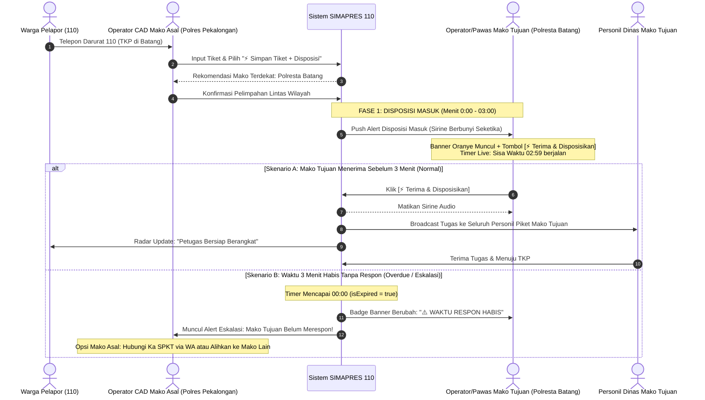

# DOKUMENTASI STANDAR OPERASIONAL PROSEDUR (SOP)
## Alur Disposisi Lintas Wilayah, Notifikasi Sirine & Eskalasi SLA (SIMAPRES 110)

Dokumen ini menjelaskan secara terstruktur seluruh alur kerja (*end-to-end workflow*) penanganan laporan darurat 110 yang berada di luar batas yurisdiksi mako asal dan dilimpahkan ke kesatuan kewilayahan tetangga (*Cross-Jurisdiction Dispatch*).

---

### 1. Landasan Hukum & Operasional
* **UU No. 2 Tahun 2002 tentang Kepolisian Negara Republik Indonesia.**
* **SOP Layanan Polisi Presisi 110:** Target Respon Cepat (*Quick Response*) maksimal 10 menit tiba di TKP, dengan SLA penerimaan disposisi mako maksimal 3 menit.
* **Prinsip Pelayanan Prima:** Tidak ada laporan warga yang ditolak karena alasan yurisdiksi; sistem secara otomatis merekomendasikan mako terdekat berdasarkan titik koordinat GPS TKP.

---

### 2. Aktor yang Terlibat
1. **Operator CAD Mako Asal (misal Polres Pekalongan):** Penerima telepon 110 awal, menginput tiket, mendeteksi yurisdiksi, dan mengirim disposisi lintas wilayah.
2. **Operator / Pawas Mako Tujuan (misal Polresta Batang):** Menerima alert pelimpahan darurat, menekan tombol `[ ⚡ Terima & Disposisikan ]`.
3. **Personil Lapangan Mako Tujuan:** Menerima siaran tugas (*broadcast dispatch*) pada konsol personil dan bergerak ke TKP.
4. **Warga Pelapor:** Memantau pergerakan respon kepolisian secara *real-time* via radar pelacakan citizen link.

---

### 3. Diagram Alur Kerja Terstruktur (*Workflow Diagram*)

---

### 4. Rincian Fase & Logika Sistem

#### Fase 1: Disposisi Masuk (*Incoming Dispatch*) — Menit 0:00 s.d. 03:00
* **Status Tiket:** `DISPOSISI_LINTAS_WILAYAH`
* **Status Tenggat:** `isTargetMako: true`, `isOverdue: false` (Waktu masih berjalan).
* **Audio Sirine:** **LANGSUNG BERBUNYI SEKETIKA** di konsol Mako Tujuan (`/audio/nada_dering_suara_mobil_patwal_viral_tiktok.mp3`).
* **Visual Banner:** Banner Oranye Disposisi Masuk langsung tampil di bagian atas konsol.
* **Indikator SLA:** Menampilkan badge countdown live `⏱️ Sisa Waktu: mm:ss` yang menghitung mundur setiap detik.
* **Aksi Tersedia:** Tombol **`[ ⚡ Terima & Disposisikan ]`** aktif sejak detik pertama tanpa harus menunggu waktu habis.

#### Fase 2: Konfirmasi Penerimaan & Penyiaran Tugas
* **Trigger:** Petugas Mako Tujuan menekan tombol **`[ ⚡ Terima & Disposisikan ]`**.
* **Eksekusi Server Action:** `acceptAndBroadcastCrossJurisdictionAction(complaintId, actorName, actorRole)`.
* **Dampak Sistem:**
  1. Suara sirine di Mako Tujuan langsung **dimatikan**.
  2. Banner pelimpahan di Mako Tujuan **dihilangkan** dari konsol.
  3. Status tiket berubah menjadi `MENUNGGU` di stasiun tujuan.
  4. Sistem membuat rekaman `complaintDispatch` terbuka untuk `station_id` Mako Tujuan.
  5. Seluruh personil piket di Mako Tujuan menerima disposisi tugas masuk di aplikasi patroli mereka.
  6. Citizen Tracking Link pelapor beralih dari radar pencarian ke status kesiapsiagaan personil.

#### Fase 3: Eskalasi Batas Waktu Terlampaui (*Overdue SLA*) — Jika Melewati 3 Menit
* **Trigger:** `nowTime >= escalationDeadlineAt` (hitung mundur menyentuh `00:00`) dan belum ada petugas yang mengklik tombol terima.
* **Status Tenggat:** `isOverdue: true`.
* **Dampak di Mako Tujuan:**
  * Badge timer berubah menjadi merah pekat: `⚠️ WAKTU RESPON HABIS`.
  * Sirine patwal tetap berbunyi mendesak tindakan petugas.
* **Dampak di Mako Asal (Polres Pekalongan):**
  * Alert eskalasi merah muncul di konsol Operator CAD Mako Asal.
  * Tampil tombol cepat koordinasi WhatsApp ke Ka SPKT Mako Tujuan.
  * Tampil tombol pengalihan untuk memindahkan tiket ke Mako alternatif lain jika Mako Tujuan mengalami kendala darurat internal.

---

### 5. Komponen Kode yang Bertanggung Jawab

| Komponen / File | Peran & Tanggung Jawab |
| :--- | :--- |
| [`src/components/console/pawas/components/EscalationAlarmBanner.tsx`](file:///c:/Users/Pongo/Downloads/SIMAPRES/src/components/console/pawas/components/EscalationAlarmBanner.tsx) | Mengatur deteksi status Mako Tujuan (`isTargetMako`), pemutaran audio sirine, visualisasi banner oranye, badge countdown live, dan tombol Terima. |
| [`src/app/actions/complaint.actions.ts`](file:///c:/Users/Pongo/Downloads/SIMAPRES/src/app/actions/complaint.actions.ts) | Memproses aksi pelimpahan (`transferComplaintAction`), penerimaan pelimpahan (`acceptAndBroadcastCrossJurisdictionAction`), serta pencatatan audit log mutasi tiket. |
| [`src/infrastructure/repositories/prisma-complaint.repository.ts`](file:///c:/Users/Pongo/Downloads/SIMAPRES/src/infrastructure/repositories/prisma-complaint.repository.ts) | Mengelola query tiket masuk Mako dan memastikan broadcast tiket mencapai seluruh personil stasiun tujuan. |
| [`src/components/console/OperatorConsoleView.tsx`](file:///c:/Users/Pongo/Downloads/SIMAPRES/src/components/console/OperatorConsoleView.tsx) | Konsol Operator CAD SPKT 110: Mengelola live polling (interval 4s), antrean tiket, penangkapan alarm lintas wilayah, dan audio sirine secara otomatis tanpa reload browser. |
| [`src/components/console/PersonilConsoleView.tsx`](file:///c:/Users/Pongo/Downloads/SIMAPRES/src/components/console/PersonilConsoleView.tsx) | Menampilkan tugas masuk darurat pada konsol gawai personil di lapangan. |

---

### 6. Mekanisme Sinkronisasi Real-Time (*Silent Auto-Polling*)
Agar Mako Tujuan tidak perlu melakukan *manual page reload / refresh* (F5) untuk mendeteksi tiket masuk, diimplementasikan arsitektur *Silent Auto-Polling*:

1. **Frekuensi Sinkronisasi:** Polling berjalan setiap **4 detik** di latar belakang saat tab browser aktif (`!document.hidden`).
2. **Instant Wake/Focus:** Saat operator berpindah kembali ke tab SIMAPRES (`visibilitychange` atau `window.focus`), sistem melakukan *immediate check* dalam 3 detik untuk menarik data terbaru seketika.
3. **Isolasi Form (*Non-Destructive*):** Polling menggunakan mode `silent = true`, sehingga:
   - State `loading` tidak diaktifkan (mencegah tombol berkedip atau form non-aktif).
   - Input formulir yang sedang diketik oleh operator (`simCaller`: nama, nomor telepon, TKP, uraian) **100% aman dan tidak ter-reset**.
   - Modal kerja yang sedang terbuka tetap aktif tanpa gangguan.
4. **Respon Cepat:** Begitu Mako Asal melimpahkan tiket lintas wilayah, banner oranye dan sirine patwal akan muncul secara otomatis di konsol Mako Tujuan maksimal dalam 4 detik.

---

### 7. Siklus Status Kedinasan Otomatis & Pemicu Reaktif Modal Popup Urgensi Lapangan
Untuk memastikan kesiapan penerimaan penugasan darurat 110 secara terpadu di lapangan:

1. **Siklus Otomatis Status Kedinasan (Login / Logout):**
   * **Login (`loginAction`):** Saat personil login, sistem secara otomatis mengaktifkan status kedinasan di database menjadi **`DINAS_PATROLI`**. Saklar *Dinas* di tab Profil otomatis berada pada posisi **`AKTIF`** (Hijau: *"Siap siaga & dapat menerima tiket penugasan"*).
   * **Logout (`logoutAction`):** Saat personil logout atau sesi berakhir (*inactivity timeout*), sistem otomatis mengubah status kedinasan di database menjadi **`LEPAS_DINAS`**.
   * **Saklar Manual Profil:** Personil dapat menonaktifkan atau mengaktifkan kembali kesiapan dinas secara mandiri melalui menu *Dinas* di tab Profil.
   * **Payload Profil (`getOfficerProfileByNrpAction`):** Mengembalikan properti `dutyStatus: officerProfile?.duty_status || 'LEPAS_DINAS'` untuk menjamin sinkronisasi antara database dan antarmuka HP.

2. **Pemicu Reaktif Modal Popup Berdasarkan Tingkat Urgensi (`TaskAcceptModal`):**
   * **Kondisi Pemicu Otomatis:**
     - Gawai berstatus terikat/sah (**`• TERHUBUNG`**).
     - Status kedinasan personil **`AKTIF`** (`dutyStatus !== 'LEPAS_DINAS'`).
     - Terdapat penugasan darurat masuk yang belum dikonfirmasi (`pendingAcceptTask`).
   * **Visualisasi Tema Warna Berdasarkan Urgensi:**
     - 🔴 **DARURAT (Merah Menyala):** Border merah, *glow shadow* merah pekat, ikon peringatan bahaya, dan audio sirine patwal darurat (contoh: pengendalian massa, tawuran, kejahatan dengan kekerasan).
     - 🟡 **SEDANG (Kuning/Emas Amber):** Border emas, *amber glow*, dan tombol siaga taktis.
     - 🔵 **NORMAL (Biru Cerah):** Border biru, *blue glow*, dan tombol pelayanan prima.
   * **Reaktivitas Tanpa Refresh:** Pemanggilan dikendalikan secara deklaratif melalui `useEffect` reaktif di [`PersonilConsoleView.tsx`](file:///c:/Users/Pongo/Downloads/SIMAPRES/src/components/console/PersonilConsoleView.tsx), sehingga begitu tiket masuk ke antrean, modal popup darurat langsung muncul di layar gawai personil seketika tanpa perlu menekan tombol apapun.

