# 📘 BUKU PANDUAN INDUK OPERASIONAL PENGGUNA (MASTER USER MANUAL END-TO-END)
## SISTEM MANAJEMEN OPERASIONAL PRESISI 110 (SIMAPRES 110)
### KEPOLISIAN NEGARA REPUBLIK INDONESIA – POLRES PEKALONGAN
**Pusat Komando & Pengendalian Operasional (Command Center 110 Presisi)**  
*Dokumen Resmi Kedinasan Kepolisian Negara Republik Indonesia*

---

# LEMBAR PENGESAHAN DOKUMEN KEDINASAN

Buku Panduan Induk Operasional Pengguna (*Master User Manual End-to-End*) Sistem Manajemen Operasional Presisi 110 (SIMAPRES 110) ini disusun dan disahkan sebagai pedoman operasional baku bagi seluruh jajaran personel kepolisian di lingkungan Kepolisian Resor Pekalongan beserta 20 Polsek jajaran, Sentra Pelayanan Kepolisian Terpadu (SPKT), Satuan Fungsi Operasional, Perwira Pengawas (Pawas), Bagian Logistik, Seksi Keuangan (Si-Keu), hingga unsur pimpinan (Kapolres dan Wakapolres).

**Dasar Hukum dan Rujukan Kebijakan Kedinasan:**
1. Undang-Undang Republik Indonesia Nomor 2 Tahun 2002 tentang Kepolisian Negara Republik Indonesia.
2. Peraturan Kepala Kepolisian Negara Republik Indonesia (Perkap) tentang Manajemen Operasional Kepolisian.
3. Program Prioritas Kapolri **"PRESISI"** (Prediktif, Responsibilitas, Transparansi Berkeadilan) dalam pelayanan publik berbasis teknologi informasi.
4. Standar Operasional Prosedur (SOP) Layanan Panggilan Darurat Kepolisian Call Center 110 Mabes Polri.

Ditetapkan dan disahkan di Kajen, Pekalongan pada tanggal 27 Oktober 2026.

---

# DAFTAR ISI LENGKAP

1. [BAB 1: Arsitektur Sistem, Persyaratan Perangkat & Akses Resmi](#bab-1-arsitektur-sistem-persyaratan-perangkat--akses-resmi)
2. [BAB 2: Manajemen Autentikasi, Hak Akses (RBAC) & Keamanan Akun](#bab-2-manajemen-autentikasi-hak-akses-rbac--keamanan-akun)
3. [BAB 3: Panduan Lengkap Konsol Super Administrator (Superadmin)](#bab-3-panduan-lengkap-konsol-super-administrator-superadmin)
4. [BAB 4: Panduan Lengkap Portal Warga & Live Tracking Radar (`/warga` & `/tracking`)](#bab-4-panduan-lengkap-portal-warga--live-tracking-radar)
5. [BAB 5: Panduan Lengkap Konsol Operator CAD 110 (Penerimaan, E-Routing & SOP Meja)](#bab-5-panduan-lengkap-konsol-operator-cad-110)
6. [BAB 6: Panduan Respon Cepat SPKT Polsek Kewilayahan (Penerima Limpahan Lintas Wilayah)](#bab-6-panduan-respon-cepat-spkt-polsek-kewilayahan)
7. [BAB 7: Panduan Personel Patroli Lapangan (Quick Accept, Scan QR Ranmor, Watermark & BAP)](#bab-7-panduan-personel-patroli-lapangan)
8. [BAB 8: Panduan Perwira Pengawas Komando (Pawas) & Validasi Dossier 4-Fase](#bab-8-panduan-perwira-pengawas-komando-pawas--validasi-dossier-4-fase)
9. [BAB 9: Panduan Biro Logistik & Seksi Keuangan (Audit BBM DIPA & Cetak SPJ A4 Sah)](#bab-9-panduan-biro-logistik--seksi-keuangan-audit-bbm-dipa--cetak-spj-a4-sah)
10. [BAB 10: Panduan Pimpinan (Kapolres & Wakapolres) untuk Audit Kinerja Bawahan](#bab-10-panduan-pimpinan-kapolres--wakapolres-untuk-audit-kinerja-bawahan)
11. [BAB 11: Panduan Penanganan Kendala Operasional (User Troubleshooting & FAQ)](#bab-11-panduan-penanganan-kendala-operasional-user-troubleshooting--faq)
12. [LAMPIRAN: Direktori Kontak Dinas 20 Polsek Jajaran & Matriks SLA Presisi](#lampiran-direktori-kontak-dinas-20-polsek-jajaran--matriks-sla-presisi)

---

## BAB 1: ARSITEKTUR SISTEM, PERSYARATAN PERANGKAT & AKSES RESMI

### 1.1 Tautan Akses Resmi (Production & Intranet)
Aplikasi SIMAPRES 110 berbasis teknologi komputasi awan modern (*Progressive Web App / PWA*) yang dapat diakses dari mana saja secara aman:

| Saluran Layanan | Alamat Tautan Resmi (URL) | Sasaran Pengguna |
| :--- | :--- | :--- |
| **Akses Produksi Cloud Utama** | `https://simapres-nu.vercel.app/` | Seluruh Anggota Polri & Pimpinan |
| **Portal Pengaduan Mandiri Warga** | `https://simapres-nu.vercel.app/warga` | Masyarakat Umum (Pelapor 110) |
| **Konsol Operasional Kedinasan** | `https://simapres-nu.vercel.app/console` | Petugas SPKT, Operator, Pawas, Logistik |
| **Radar Pelacakan Publik Tiket** | `https://simapres-nu.vercel.app/tracking` | Pelapor Memantau Armada Polisi |
| **Server Cadangan / Intranet Mako** | `http://localhost:3000` | Jaringan Lokal Command Center |

### 1.2 Standar Spesifikasi Perangkat Keras Kedinasan
Agar seluruh fitur taktis (peta 3D, radar live, sirine audio, dan kamera watermark) beroperasi optimal, berikut standar perangkat yang digunakan:

1. **Komputer Meja SPKT / Workstation Operator CAD 110:**
   - Prosesor minimal Intel Core i3 / AMD Ryzen 3 (Disarankan Core i5).
   - Memori RAM minimal 8 GB.
   - Layar monitor minimal resolusi Full HD (1920x1080) — *Disarankan Dual Monitor* (Monitor 1: Peta Taktis CAD, Monitor 2: Formulir Fast-Intake).
   - Headset PTT (*Push-To-Talk*) terhubung audio untuk komunikasi telepon 110.
2. **Layar Utama Command Center Pawas (Large Display / Video Wall):**
   - Komputer Controller terhubung ke layar monitor LED/TV Video Wall resolusi 4K.
   - Audio Soundbar aktif untuk mendengarkan alarm eskalasi sirine patwal darurat.
3. **Ponsel Pintar Lapangan Personel Patroli:**
   - Smartphone Android versi 9.0+ atau Apple iOS 14.0+.
   - Sensor GPS terintegrasi (Wajib mendukung *High-Accuracy Mode*).
   - Kamera belakang minimal 12 MP dengan sensor *autofocus* untuk foto watermark anti-fraud.
   - Sambungan internet seluler stabil minimal 4G LTE.

### 1.3 Pengaturan Izin Peramban Wajib (*Browser Permissions*)
Ketika pertama kali membuka peramban Google Chrome atau Microsoft Edge, sistem akan meminta 3 izin keamanan. Pengguna **WAJIB** menekan tombol **[ Allow / Izinkan ]**:
- **Location (Lokasi / GPS):** Menentukan posisi markas komando, keberadaan armada mobil patroli, dan titik penanganan TKP.
- **Sound (Suara / Audio):** Memungkinkan sirine alarm patwal berbunyi kencang secara otomatis saat ada aduan darurat masuk.
- **Camera (Kamera):** Memungkinkan personel memindai stiker fisik QR token mobil patroli dan mengambil foto bukti TKP.

---

## BAB 2: MANAJEMEN AUTENTIKASI, HAK AKSES (RBAC) & KEAMANAN AKUN

Autentikasi SIMAPRES 110 menggunakan enkripsi kriptografis tingkat tinggi dengan perlindungan cookie *HttpOnly* berbasis peran (*Role-Based Access Control*).

  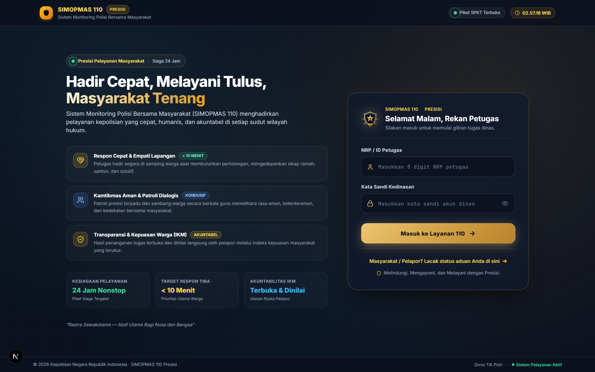

### 2.1 Prosedur Masuk Sistem (Login)
1. Buka peramban dan akses alamat `https://simapres-nu.vercel.app/`.
2. Pada kolom **NRP / ID Petugas**, masukkan 8 digit Nomor Registrasi Pokok anggota Polri (contoh: `88010234`, `78091122`, `04011662`, `85071199`, `92031145`).
3. Pada kolom **Kata Sandi Kedinasan**, ketikkan kata sandi resmi Anda (kata sandi default pelatihan: `polripresisi2026`).
4. Tekan tombol emas: **[ Masuk ke Konsol Operasional ]**.
5. Sistem secara otomatis membaca identitas kepangkatan, kesatuan fungsi, dan markas komando Anda, kemudian langsung mengarahkan Anda ke konsol kerja yang berwenang.

### 2.2 Penjelasan Perilaku Sistem pada Kondisi Khusus Autentikasi:
- **Jika NRP tidak terdaftar di database:**  
  *Muncul Alert Merah:* `"Akses Ditolak: Akun dengan NRP / ID [NRP] tidak terdaftar dalam pangkalan data SIMOPMAS 110!"`. Petugas tidak dapat masuk.
- **Jika Kata Sandi salah:**  
  *Muncul Alert Merah:* `"Kata sandi kedinasan yang Anda masukkan salah. Silakan periksa kembali!"`.
- **Jika Akun dalam status Nonaktif (`is_active: false`):**  
  *Muncul Alert Oranye:* `"Akun Anda sedang dinonaktifkan oleh administrator. Silakan hubungi Bag Renmin / Operator TI Mako!"`.
- **Jika Personel mencoba membuka URL konsol di luar wewenangnya (misal Personil mengakses `/console/operator`):**  
  *Muncul Layar Peringatan RBAC:* `"Hak Akses Ditolak (RBAC Presisi): Peran Anda (PERSONIL) tidak berwenang membuka halaman tersebut (Khusus peran OPERATOR)"`. Sistem otomatis mengembalikan pengguna ke konsol mobile personel.
- **Jika Sesi tidak aktif selama > 8 Jam (Idle Timeout):**  
  Cookie kedaluwarsa secara otomatis dan sistem menampilkan pesan: `"Sesi kedinasan Anda telah berakhir demi keamanan. Silakan login kembali"`.

---

## BAB 3: PANDUAN LENGKAP KONSOL SUPER ADMINISTRATOR (SUPERADMIN)

Konsol Super Administrator merupakan pusat komando tata kelola sistem terpadu, manajemen pangkalan data akun personel kepolisian se-kabupaten, pendaftaran armada kendaraan dinas patroli, generator stiker fisik QR token, serta isolasi konfigurasi variabel master data (Zero-Hardcode).

  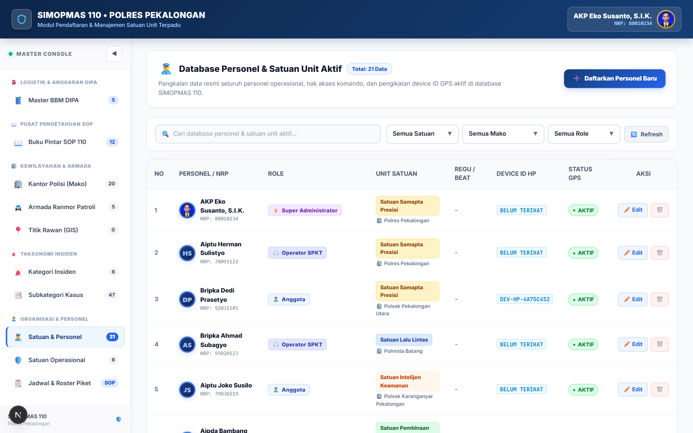

Bilah sisi (*sidebar*) **MASTER CONSOLE** Superadmin menyajikan tepat **14 Menu Navigasi Utama** yang dikelompokkan ke dalam **6 Kategori/Grup Modul**. Di bawah ini adalah penjelasan mendalam mengenai fungsi, tutorial penggunaan langkah demi langkah, kamus isian formulir (field dictionary & validation), serta logika kondisional sistem ("Jika begini maka jadinya apa, jika begitu munculin apa") untuk setiap menu:

---

### 3.1 Menu 1: Master BBM DIPA (`/console/fuel_type`)

  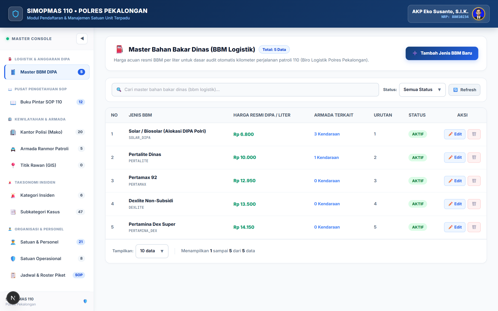

- **Fungsi & Kegunaan:** Mengelola daftar jenis bahan bakar minyak resmi dinas Polri dan mengunci tarif pagu rupiah per liter berdasarkan acuan anggaran DIPA Polres Pekalongan.
- **Tutorial Penggunaan Langkah Demi Langkah:**
  1. Klik menu **Master BBM DIPA** pada bilah sisi grup *Logistik & Anggaran DIPA*.
  2. Layar menampilkan tabel jenis BBM aktif beserta harga per liter terkini (misal Solar Subsidi DIPA, Pertalite Dinas, Pertamax).
  3. Untuk memperbarui harga atau menambah bahan bakar, klik tombol **[+ Tambah Jenis BBM]** atau tombol **[Edit]** pada baris bahan bakar terkait.
  4. Periksa nominal rupiah, lalu tekan tombol **[Simpan]**.
- **Bedah Formulir Input & Validasi:**
  - **Nama Bahan Bakar (Wajib):** Teks nama bahan bakar dinas (misal: `Solar Subsidi DIPA`, `Pertalite`).
  - **Kode Singkat (Wajib unik):** Kode alfanumerik tanpa spasi (misal: `SOLAR_DIPA`, `PERTALITE`).
  - **Harga Resmi per Liter (Rp) (Wajib numerik):** Angka nominal rupiah pagu DIPA (misal: `6800`, `10000`).
- **Logika Kondisional & Konsekuensi Sistem:**
  - *Jika harga per liter diubah oleh Superadmin (misal Solar dari Rp 6.800 menjadi Rp 7.200):* Seluruh komputasi otomatis jarak tempuh pada Modul Logistik & Seksi Keuangan seketika menggunakan acuan harga Rp 7.200 per liter untuk penugasan baru.
  - *Jika jenis BBM dinonaktifkan (`is_active: false`):* Jenis BBM tersebut seketika hilang dari pilihan dropdown formulir pendaftaran mobil dinas patroli.

---

### 3.2 Menu 2: Buku Pintar SOP 110 (`/console/knowledge_faq`)

  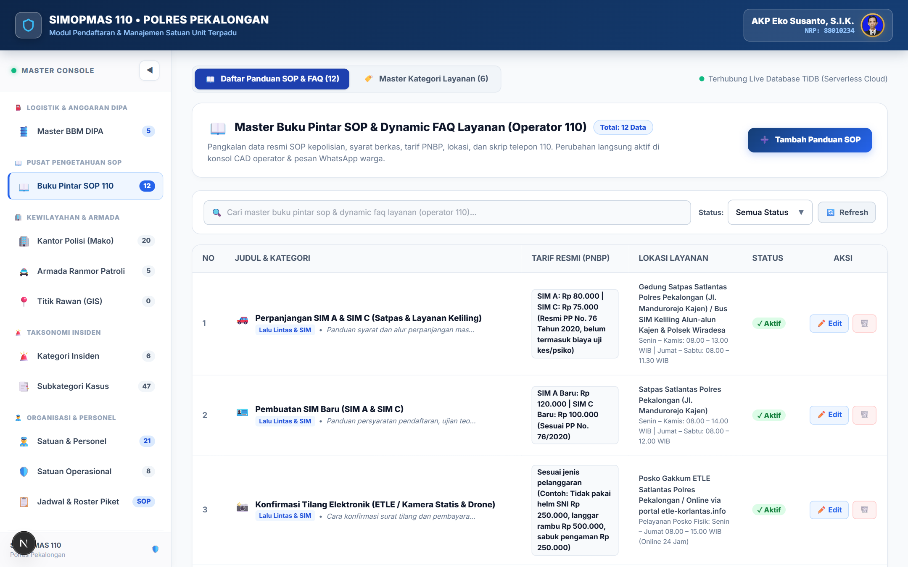

- **Fungsi & Kegunaan:** Mengelola pangkalan data katalog standar operasional prosedur pelayanan kepolisian untuk mendukung fitur *"Selesai di Meja Operator (Poin 4.E)"* tanpa memboroskan armada/BBM dinas.
- **Tutorial Penggunaan Langkah Demi Langkah:**
  1. Klik menu **Buku Pintar SOP 110** pada bilah sisi.
  2. Pilih kategori SOP (SIM, SKCK, Tilang ETLE, Izin Keramaian, Surat Kehilangan).
  3. Klik tombol **[+ Tambah Panduan SOP]** untuk menambah dokumen baru, atau klik **[Edit]** pada SOP yang sudah ada.
  4. Tuliskan ringkasan persyaratan dan susun draf template pesan WhatsApp resmi yang akan diterima warga.
  5. Tekan tombol **[Simpan SOP]**.
- **Bedah Formulir Input & Validasi:**
  - **Kategori Layanan (Dropdown Wajib):** `LANTAS_SIM`, `INTELKAM_SKCK`, `LANTAS_ETLE`, `SABHARA_IZIN`, `SPKT_HILANG`, `PNBP_TARIF`.
  - **Judul Panduan Layanan (Wajib):** Judul resmi panduan (misal: *Syarat Penerbitan SIM C Baru & Perpanjangan*).
  - **Ringkasan Persyaratan Dokumen (Textarea):** Rincian syarat KTP, surat kesehatan, tes psikologi, dll.
  - **Teks Draf WhatsApp Siap Kirim (`wa_template_text`) (Wajib):** Pesan teks resmi berformat rapi dengan poin-poin yang akan diteruskan ke ponsel pelapor.
  - **Biaya PNBP Resmi PP 76/2020 (Rp):** Tarif PNBP resmi negara (misal: SIM C Baru Rp 100.000, Perpanjangan Rp 75.000, SKCK Rp 30.000).
- **Logika Kondisional & Konsekuensi Sistem:**
  - *Jika Operator CAD menekan tombol [Bagikan via WhatsApp] pada aduan informasi:* Sistem otomatis mengambil teks dari field `wa_template_text` ini dan mengirimkannya ke WhatsApp pelapor dalam hitungan detik.
  - *Jika Superadmin mengubah rincian syarat atau tarif PNBP:* Pesan yang dibagikan operator seketika ter-update sesuai perubahan terbaru.

---

### 3.3 Menu 3: Kantor Polisi Mako (`/console/station`)

  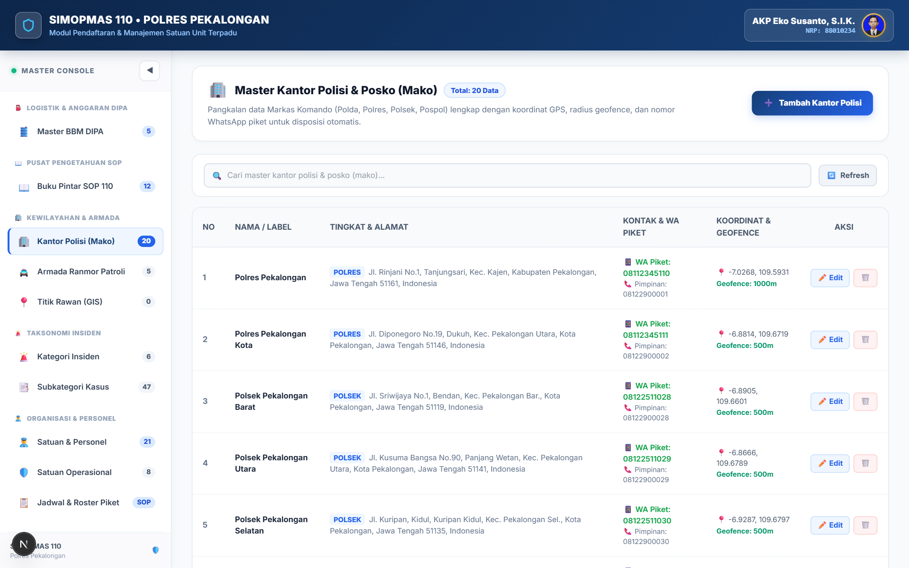

- **Fungsi & Kegunaan:** Mengelola pangkalan data Markas Komando Polres Pekalongan beserta 20 Polsek jajaran, titik koordinat geografis presisi, radius batas toleransi geofence, dan kontak nomor telepon meja piket SPKT.
- **Tutorial Penggunaan Langkah Demi Langkah:**
  1. Klik menu **Kantor Polisi (Mako)** pada bilah sisi.
  2. Tabel menampilkan 20 Polsek jajaran lengkap dengan koordinat GPS dan nomor telepon piket.
  3. Klik tombol **[Edit]** pada Polsek terkait jika ada mutasi nomor telepon dinas Ka SPKT atau pergeseran titik koordinat Mako.
  4. Periksa titik latitude dan longitude, lalu klik **[Simpan Perubahan]**.
- **Bedah Formulir Input & Validasi:**
  - **Kode Stasiun (Wajib unik):** Kode singkatan resmi Mako (misal: `POLRES_PEKALONGAN`, `POLSEK_KAJEN`, `POLSEK_SELATAN`).
  - **Nama Markas Komando (Wajib):** Nama kantor resmi (misal: *Polsek Pekalongan Selatan*).
  - **Tingkat Kantor (Dropdown):** Pilihan `POLRES` atau `POLSEK`.
  - **Titik Koordinat GPS Lintang (`office_lat`) & Bujur (`office_lng`):** Koordinat sentral Mako untuk acuan jarak spasial.
  - **Radius Geofence (Meter):** Radius zona batas markas (standar: `500` meter).
  - **Nomor WhatsApp Meja Piket SPKT (`phone_piket`):** Nomor dinas penerima pesan limpahan darurat (format standar: `628...`).
  - **Nomor Telepon Kapolsek (`phone_kapolsek`):** Nomor kontak langsung pimpinan Polsek.
- **Logika Kondisional & Konsekuensi Sistem:**
  - *Peran Spasial Titik Koordinat GPS:* Titik ini menjadi pusat perhitungan radius terpendek pada algoritma E-Routing Operator CAD saat ada insiden di perbatasan.
  - *Peran Nomor WhatsApp Piket:* Nomor ini menjadi tujuan mutlak pengiriman notifikasi darurat saat Polres melimpahkan tiket ke Polsek.
  - *Jika status Mako dinonaktifkan:* Mako tersebut seketika dikeluarkan dari rekomendasi E-Routing operator.

---

### 3.4 Menu 4: Armada Ranmor Patroli (`/console/armada`)

  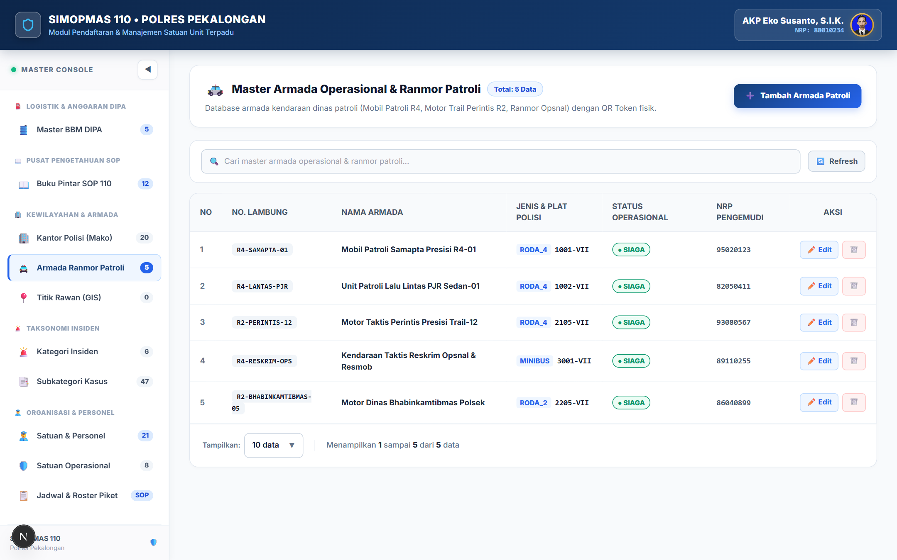

- **Fungsi & Kegunaan:** Mengelola pendaftaran seluruh kendaraan dinas mobil patroli R4 dan motor R2 patroli presisi se-kabupaten, mengatur profil efisiensi km/liter, dan menerbitkan stiker fisik QR token mobil dinas.
- **Tutorial Penggunaan Langkah Demi Langkah:**
  1. Klik menu **Armada Ranmor Patroli** pada bilah sisi.
  2. Klik tombol **[+ Daftarkan Armada Baru]**.
  3. Masukkan nomor lambung mobil (contoh: `R4-SAMAPTA-81`), plat nopol dinas, pilih jenis kendaraan, satuan pemilik, dan tetapkan rasio konsumsi bahan bakar (misal: `8.0` km/L).
  4. Tekan tombol **[Simpan Armada]**.
  5. Klik ikon **QR Code** pada baris kendaraan baru tersebut. Jendela pop-up menampilkan QR Code beresolusi tinggi siap cetak.
  6. Tekan tombol **[Cetak Stiker QR]**, cetak pada stiker vinyl tahan air, lalu tempelkan di dashboard mobil patroli.
- **Bedah Formulir Input & Validasi:**
  - **Nomor Lambung Kendaraan (Wajib unik):** Identitas fisik ranmor (contoh: `R4-SAMAPTA-81`, `SEDAN-LANTAS-01`).
  - **Nomor Polisi Dinas Polri (Wajib):** Plat nopol dinas (contoh: `1001-VII`).
  - **Jenis Kendaraan (Dropdown):** `RODA_4`, `RODA_2`, atau `MINIBUS`.
  - **Mako Pengampu (Dropdown):** Penempatan Mako pangkalan kendaraan.
  - **Satuan Fungsi (Dropdown):** Samapta, Lantas, Reskrim.
  - **Jenis BBM (Dropdown dari Master BBM):** Solar DIPA, Pertalite, Pertamax.
  - **Rasio Konsumsi BBM (KM per Liter) (Wajib numerik desimal):** Standar rasio bahan bakar (contoh: `8.0` km/L untuk mobil bensin, `10.0` km/L untuk mobil diesel).
- **Logika Kondisional & Konsekuensi Sistem:**
  - *Keterikatan Lapangan:* Saat personel patroli memindai stiker fisik QR Code di dashboard, kendaraan tersebut langsung terkunci pada nomor tiket penugasan.
  - *Perhitungan BBM Otomatis:* Nilai rasio KM/L ini menjadi pembagi wajib dalam rumus klaim BBM Seksi Keuangan: $\\text{Volume Liter} = \\text{Jarak Tempuh KM} / \\text{Rasio KM/L}$.
  - *Jika status kendaraan disetel `RUSAK` atau `BENGKEL`:* Kendaraan tersebut tidak akan dapat dipilih saat personel melakukan scan QR check-in.

---

### 3.5 Menu 5: Titik Rawan GIS (`/console/hotspot`)

  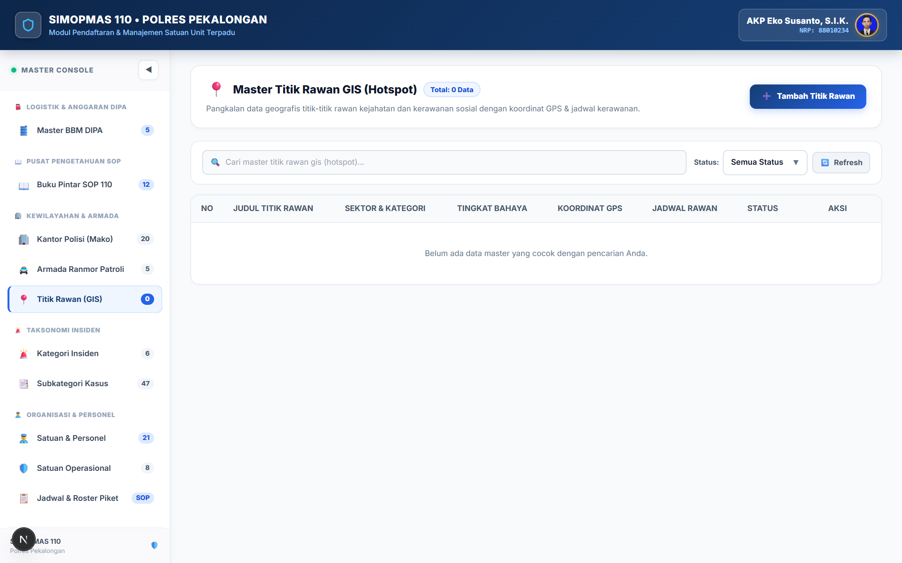

- **Fungsi & Kegunaan:** Memetakan titik-titik rawan tindak pidana 3C (Curat, Curas, Curanmor), tawuran pelajar, balap liar, dan narkoba di seluruh wilayah hukum Polres Pekalongan pada peta GIS taktis.
- **Tutorial Penggunaan Langkah Demi Langkah:**
  1. Klik menu **Titik Rawan (GIS)** pada bilah sisi.
  2. Klik tombol **[+ Tambah Titik Rawan]**.
  3. Masukkan nama lokasi (misal: *Simpang 4 Gumawang*, *Jembatan Pencongan*), pilih Polsek pengampu, kategori kerawanan, level bahaya, koordinat GPS, dan rentang jam rawan.
  4. Tekan tombol **[Simpan Titik Rawan]**.
- **Bedah Formulir Input & Validasi:**
  - **Nama Titik Rawan / Lokasi (Wajib):** Nama jalan, persimpangan, atau batas desa yang rawan kriminalitas.
  - **Sektor Polsek Yurisdiksi (Dropdown):** Polsek yang bertanggung jawab membina wilayah tersebut.
  - **Kategori Kerawanan (Dropdown):** Tawuran, Balap Liar, 3C, Narkoba.
  - **Level Bahaya (Dropdown):** `SIAGA_1` (Merah / Sangat Rawan), `SIAGA_2` (Oranye / Rawan), `SIAGA_3` (Kuning / Waspada).
  - **Koordinat GPS Lintang & Bujur (`lat`, `lng`):** Titik episentrum lokasi rawan.
  - **Rentang Jam Rawan (Time picker):** Jam mulai s.d. jam selesai rawan (contoh: `23:00` s.d. `04:00` WIB).
- **Logika Kondisional & Konsekuensi Sistem:**
  - *Aktivasi Jam Rawan di Peta Taktis:* Saat jam sistem berada dalam rentang jam rawan (misal pukul 01.30 WIB dini hari), titik tersebut pada Peta Taktis Pawas otomatis berkedip merah dan memancarkan lingkaran radius bahaya.
  - Sistem otomatis menyarankan rute patroli blue-light mobil Samapta untuk menyambangi lokasi tersebut.

---

### 3.6 Menu 6: Kategori Insiden (`/console/kategori`)

  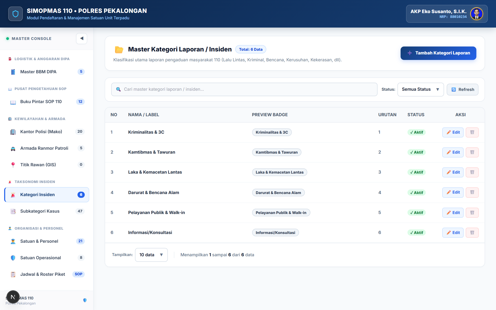

- **Fungsi & Kegunaan:** Mengatur klasifikasi tingkat pertama untuk seluruh panggilan darurat dan laporan masyarakat 110.
- **Tutorial Penggunaan Langkah Demi Langkah:**
  1. Klik menu **Kategori Insiden** pada bilah sisi.
  2. Layar menyajikan kategori induk: *Kriminalitas, Gangguan Kamtibmas, Kecelakaan Lalu Lintas, Darurat Medis / Bencana Alam*.
  3. Klik tombol **[+ Tambah Kategori]** untuk mendaftarkan kategori baru atau klik **[Edit]** untuk memperbarui deskripsi dan warna lencana.
  4. Tekan tombol **[Simpan]**.
- **Bedah Formulir Input & Validasi:**
  - **Kode Kategori (Wajib unik):** Huruf kapital tanpa spasi (misal: `KRIMINALITAS`, `KAMTIBMAS`, `LAKALANTAS`).
  - **Nama Kategori Publik (Wajib):** Label yang tampil di portal warga dan formulir operator CAD.
  - **Tingkat Urgensi Bawaan (Dropdown):** `DARURAT` (Merah), `SEDANG` (Oranye), `NORMAL` (Biru).
  - **Warna Tema Lencana (Dropdown):** Red, Amber, Blue, Emerald.
- **Logika Kondisional & Konsekuensi Sistem:**
  - Kategori yang didaftarkan di sini seketika muncul sebagai pilihan utama pada formulir pelaporan mandiri warga (`/warga`) dan formulir Fast-Intake Operator CAD.
  - Jika kategori diatur dengan urgensi bawaan `DARURAT`, setiap laporan baru yang masuk dengan kategori ini otomatis mendapatkan batas waktu respon SLA tercepat ($\\le 10$ menit).

---

### 3.7 Menu 7: Subkategori Kasus (`/console/subkategori`)

  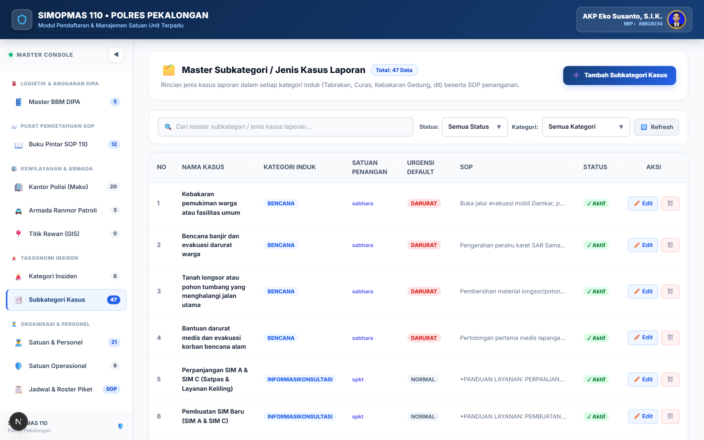

- **Fungsi & Kegunaan:** Mengelola perincian 47 jenis tindak pidana spesifik, pelanggaran, atau kejadian terperinci yang terikat langsung ke kategori induk.
- **Tutorial Penggunaan Langkah Demi Langkah:**
  1. Klik menu **Subkategori Kasus** pada bilah sisi.
  2. Gunakan bilah pencarian untuk mencari perkara tertentu (contoh: *Curanmor, Begal, Tawuran, KDRT, Laka Berat*).
  3. Klik tombol **[+ Tambah Subkategori]** untuk mendaftarkan tindak pidana baru.
  4. Tentukan kategori induk terkait, batas waktu SLA respon (menit), dan panduan tindakan awal.
  5. Tekan tombol **[Simpan Subkategori]**.
- **Bedah Formulir Input & Validasi:**
  - **Kategori Induk Terkait (Dropdown Wajib):** Menghubungkan subkategori ke kategori induk (Kriminalitas, Kamtibmas, dll.).
  - **Kode Subkategori (Wajib unik):** Alfanumerik (misal: `CURANMOR_R4`, `TAWURAN_SAJAM`).
  - **Nama Subkategori Kasus (Wajib):** Nama peristiwa resmi (misal: *Pencurian Sepeda Motor R2*).
  - **Target Waktu Respon Standar (Menit) (Wajib numerik):** Standar waktu respon (contoh: `10` menit untuk begal/curas, `15` menit untuk curanmor, `30` menit untuk mediasi).
- **Logika Kondisional & Konsekuensi Sistem:**
  - *Relasi Dropdown Bertingkat (Cascading):* Ketika operator CAD memilih Kategori *Kriminalitas*, maka dropdown subkategori otomatis **hanya menampilkan tindak pidana kriminal** (Curas, Curat, Curanmor, dll.), menyembunyikan opsi kecelakaan atau bencana.
  - Nilai target waktu respon menentukan batas hitung mundur timer alarm pada konsol operator dan Pawas.

---

### 3.8 Menu 8: Satuan & Personel (`/console/unit`)

  

- **Fungsi & Kegunaan:** Pangkalan data master seluruh akun anggota kepolisian se-Kabupaten Pekalongan, pengaturan hak akses peran kedinasan (RBAC), penguncian akun dinas, dan fasilitas reset kata sandi.
- **Tutorial Penggunaan Langkah Demi Langkah:**
  1. Klik menu **Satuan & Personel** pada bilah sisi.
  2. Gunakan filter Satuan, Mako, atau Role untuk mempersempit pencarian personel.
  3. Untuk mendaftarkan personel baru, klik tombol **[+ Daftarkan Personel Baru]**.
  4. Masukkan NRP (8 digit), nama lengkap beserta gelar, pangkat, jabatan, satuan, Mako penempatan, dan tentukan role sistem.
  5. Tekan tombol **[Simpan Akun]**.
- **Bedah Formulir Input & Validasi:**
  - **NRP Petugas (Wajib unik):** 8 digit numerik (contoh: `92031145`). Jika sudah terdaftar, muncul error: `"NRP sudah terdaftar!"`.
  - **Nama Lengkap & Gelar (Wajib):** Nama resmi dinas (contoh: *BRIPKA Dedi Prasetyo, S.H.*).
  - **Pangkat (Dropdown Wajib):** Bripda s.d. Kombes.
  - **Jabatan Kedinasan (Teks Bebas):** Posisi tugas struktural (misal: *Ba SPKT*, *Kanit Turjawali*).
  - **Satuan Fungsi (Dropdown):** Samapta, Lantas, Reskrim, Intelkam, Binmas.
  - **Markas Komando Penempatan (Dropdown):** Polres Pekalongan atau 20 Polsek jajaran.
  - **Peran Sistem / Role (Dropdown Wajib):** `SUPERADMIN`, `PAWAS`, `OPERATOR`, `PERSONIL`, `LOGISTIK`.
  - **Kata Sandi Awal (Opsional):** Jika dikosongkan, otomatis menggunakan sandi bawaan pelatihan `polripresisi2026`.
- **Logika Kondisional & Konsekuensi Sistem:**
  - *Jika akun dikunci/dinonaktifkan oleh Superadmin:* Status menjadi `is_active: false`. Jika anggota sedang membuka aplikasi, sesinya langsung diputus paksa (*force logout*) seketika dan akses login ditolak.
  - *Jika tombol [Reset Kata Sandi] ditekan:* Kata sandi anggota langsung kembali ke `polripresisi2026`.

---

### 3.9 Menu 9: Satuan Operasional (`/console/satuan`)

  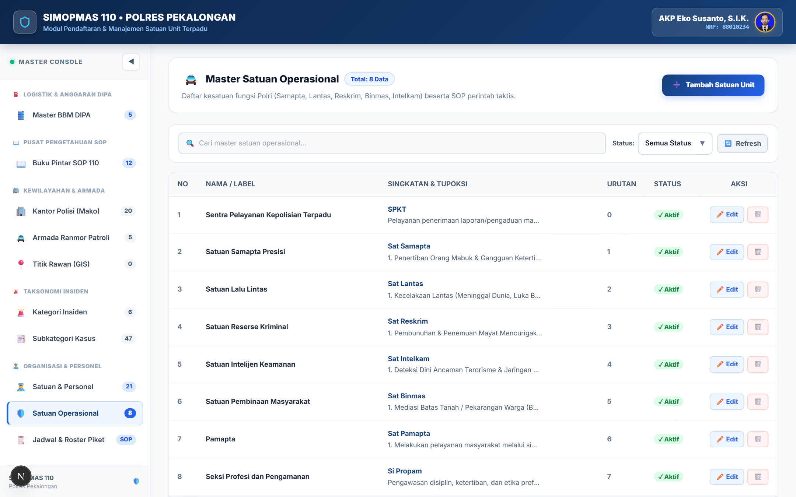

- **Fungsi & Kegunaan:** Mengelola master unit kesatuan operasional Polri di lingkungan Polres Pekalongan (Samapta, Lantas, Reskrim, Intelkam, Binmas, Polairud).
- **Tutorial Penggunaan Langkah Demi Langkah:**
  1. Klik menu **Satuan Operasional** pada bilah sisi.
  2. Layar menyajikan daftar satuan kerja operasional aktif.
  3. Klik tombol **[Edit]** untuk mengubah nama satuan atau menyetel kode warna lencana.
  4. Tekan tombol **[Simpan]**.
- **Bedah Formulir Input & Validasi:**
  - **Kode Satuan (Wajib unik):** Huruf kecil tanpa spasi (misal: `sabhara`, `lantas`, `reskrim`, `intel`, `binmas`).
  - **Nama Satuan Operasional (Wajib):** Nama satuan resmi (misal: *Satuan Samapta*, *Satuan Lalu Lintas*).
  - **Warna Lencana Visual (Wajib):** Kode warna untuk membedakan badge kesatuan di konsol kerja.
- **Logika Kondisional & Konsekuensi Sistem:**
  - Mengatur warna visual badge satuan di tabel personel, konsol operator CAD, dan penanda mobil patroli di peta taktis.

---

### 3.10 Menu 10: Jadwal & Roster Piket (`/console/piket`)

  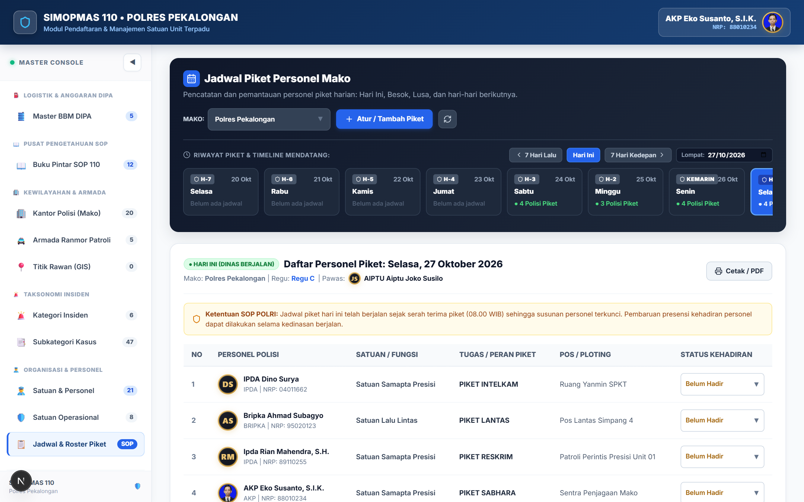

- **Fungsi & Kegunaan:** Mengelola manajemen roster dinas jaga Mako 1x24 jam (Regu A, B, C) dan pencatatan Surat Perintah (Sprin) penugasan resmi Kapolres.
- **Tutorial Penggunaan Langkah Demi Langkah:**
  1. Klik menu **Jadwal & Roster Piket** pada bilah sisi.
  2. Klik tombol **[+ Buat Roster Piket Baru]**.
  3. Masukkan nomor Sprin, tanggal dinas, pilih regu dinas (Regu A/B/C), shift jaga, serta tunjuk pejabat Pawas, Padal, dan Ka SPKT harian.
  4. Tekan tombol **[Simpan Roster]**.
- **Bedah Formulir Input & Validasi:**
  - **Nomor Surat Perintah Tugas (Sprin) (Wajib):** Format resmi kedinasan Polri (misal: `Sprin/120/X/PAM.3.3./2026`).
  - **Tanggal Pelaksanaan Dinas (Date picker):** Tanggal kalender dinas jaga.
  - **Regu Dinas Jaga (Dropdown):** `REGU_A`, `REGU_B`, atau `REGU_C`.
  - **Jenis Shift (Dropdown):** `1x24_JAM`, `SHIFT_PAGI`, `SHIFT_MALAM`.
  - **Pejabat Perwira Pengawas (Pawas) (Dropdown Wajib):** Perwira berpangkat Ipda hingga Kompol yang ditunjuk mengawasi Mako.
  - **Pejabat Perwira Pengendali (Padal) & Kepala SPKT (Dropdown).**
- **Logika Kondisional & Konsekuensi Sistem:**
  - Menentukan siapa nama perwira yang sah secara hukum untuk menandatangani pengesahan berkas perkara (*Dossier Lock*) pada tanggal dinas tersebut.

---

### 3.11 Menu 11: Lokasi Selesai TKP/RS (`/console/lokasi_penyelesaian`)

  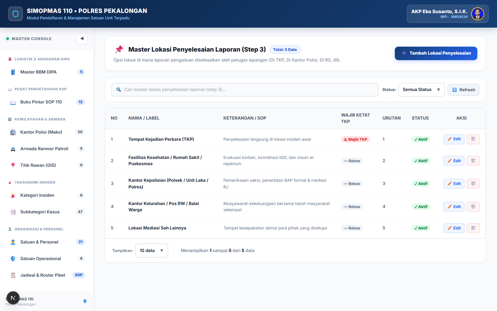

- **Fungsi & Kegunaan:** Standarisasi opsi lokasi fisik tempat penyelesaian akhir penanganan perkara oleh personel lapangan di modul mobile.
- **Tutorial Penggunaan Langkah Demi Langkah:**
  1. Klik menu **Lokasi Selesai (TKP/RS)** di bawah grup *Master Lanjutan*.
  2. Layar menyajikan opsi: *Tempat Kejadian Perkara (TKP), Kantor Polisi (Polres/Polsek), Rumah Sakit / Puskesmas, Kantor Balai Desa / Kelurahan*.
  3. Klik **[Edit]** untuk mengubah deskripsi atau klik **[+ Tambah Lokasi]** untuk opsi baru.
  4. Tekan tombol **[Simpan]**.
- **Bedah Formulir Input & Validasi:**
  - **Kode Lokasi (Wajib unik):** `TKP`, `KANTOR_POLISI`, `RUMAH_SAKIT`, `KANTOR_KELURAHAN`.
  - **Label Nama Lokasi (Wajib):** Teks nama lokasi yang tampil di aplikasi mobile petugas.
- **Logika Kondisional & Konsekuensi Sistem:**
  - Opsi yang berstatus aktif di modul ini otomatis muncul pada dropdown pilihan lokasi penyelesaian di ponsel petugas patroli lapangan saat menyelesaikan laporan.

---

### 3.12 Menu 12: Dokumen Bukti BAP (`/console/dokumen_penyelesaian`)

  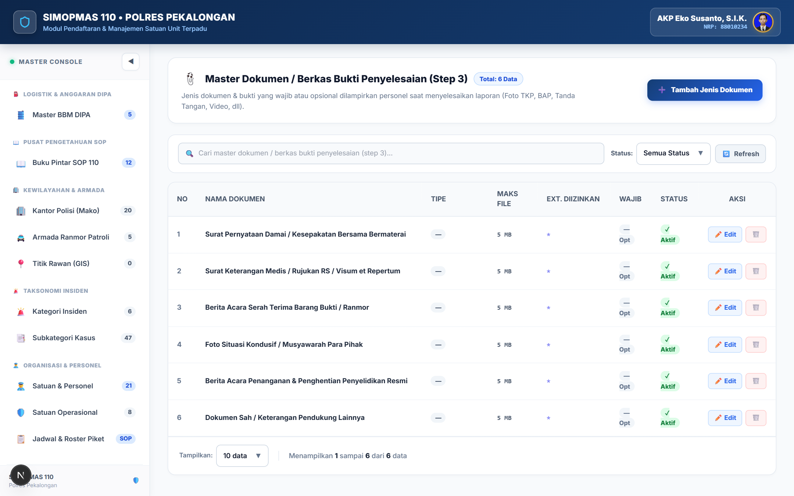

- **Fungsi & Kegunaan:** Standarisasi opsi berkas legalitas dan alat bukti penyelesaian perkara kepolisian di lapangan.
- **Tutorial Penggunaan Langkah Demi Langkah:**
  1. Klik menu **Dokumen Bukti BAP** pada bilah sisi.
  2. Layar menyajikan standar dokumen: *Surat Kesepakatan Damai Bermaterai (`BAP_DAMAI`), Berita Acara Serah Terima Barang Bukti (`SERAH_TERIMA_BB`), Foto Dokumentasi Kondusif (`DOKUMENTASI_KONDUSIF`)*.
  3. Tekan **[Simpan]** setelah menyetel kewajiban lampiran fisik.
- **Bedah Formulir Input & Validasi:**
  - **Kode Dokumen (Wajib unik):** `BAP_DAMAI`, `SERAH_TERIMA_BB`, `DOKUMENTASI_KONDUSIF`.
  - **Nama Dokumen Legalitas (Wajib):** Nama berkas resmi.
  - **Syarat Wajib Lampiran Fisik (Toggle Ya / Tidak):** Menentukan apakah wajib upload foto berkas.
- **Logika Kondisional & Konsekuensi Sistem:**
  - *Jika toggle disetel Wajib Lampiran Fisik:* Personel patroli di lapangan **tidak akan bisa mengklik tombol Selesaikan Laporan** sebelum mengambil dan mengunggah foto fisik dokumen tersebut via kamera HP.

---

### 3.13 Menu 13: Kategori Titik Rawan (`/console/hotspot_cat`)

  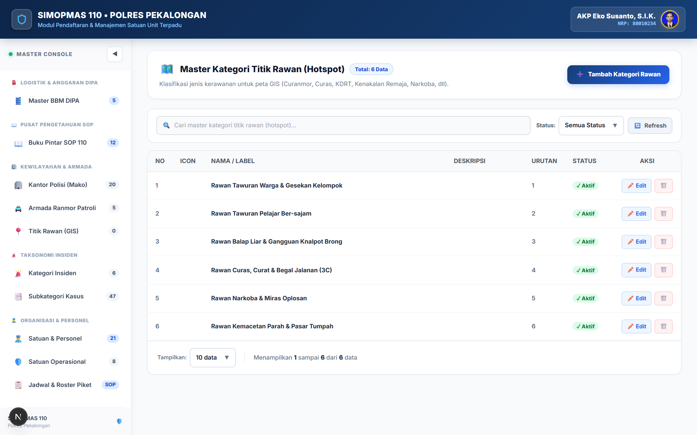

- **Fungsi & Kegunaan:** Pengelompokan jenis ancaman kerawanan kamtibmas wilayah Kabupaten Pekalongan.
- **Tutorial Penggunaan Langkah Demi Langkah:**
  1. Klik menu **Kategori Titik Rawan** pada bilah sisi.
  2. Kelola daftar klasifikasi: *Kejahatan Jalanan 3C, Tawuran Pelajar / Antar-Desa, Balap Liar, Peredaran Miras & Narkoba*.
  3. Atur level bahaya default dan rekomendasi pola patroli.
  4. Tekan tombol **[Simpan]**.
- **Bedah Formulir Input & Validasi:**
  - **Kode Kategori Rawan (Wajib unik):** `3C`, `TAWURAN`, `BALAP_LIAR`, `NARKOBA`.
  - **Nama Kategori Kerawanan (Wajib):** Teks label kategori.
  - **Level Bahaya Default (Dropdown):** Siaga 1, Siaga 2, Siaga 3.
- **Logika Kondisional & Konsekuensi Sistem:**
  - Menjadi relasi induk bagi pendaftaran titik rawan GIS pada Menu 5 (`hotspot`).

---

### 3.14 Menu 14: Status Kedinasan (`/console/duty`)

  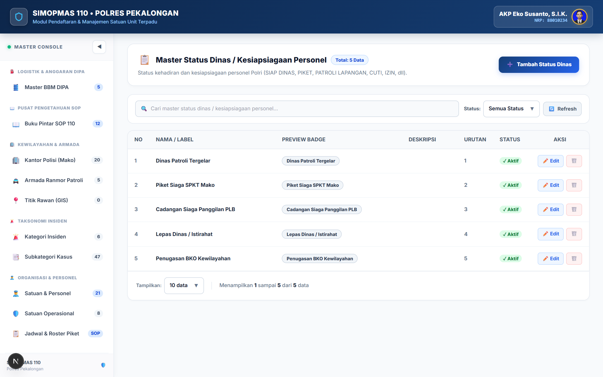

- **Fungsi & Kegunaan:** Standarisasi status kesiapsiagaan operasional harian anggota Polri (Dinas Patroli Aktif, Piket Penjagaan SPKT, Cadangan Mako, Lepas Dinas).
- **Tutorial Penggunaan Langkah Demi Langkah:**
  1. Klik menu **Status Kedinasan** pada bilah sisi.
  2. Kelola opsi status kesiagaan anggota.
  3. Setel toggle ketersediaan penugasan/disposisi untuk menentukan apakah anggota dengan status tersebut boleh menerima panggilan tugas darurat.
  4. Tekan tombol **[Simpan]**.
- **Bedah Formulir Input & Validasi:**
  - **Kode Status Dinas (Wajib unik):** `DINAS_PATROLI`, `PIKET_SPKT`, `CADANGAN_MAKO`, `LEPAS_DINAS`.
  - **Label Status Kedinasan (Wajib):** Nama status operasional.
  - **Ketersediaan Disposisi (Toggle Ya / Tidak):** Apakah sistem boleh melimpahkan tiket tugas ke anggota berstatus ini.
- **Logika Kondisional & Konsekuensi Sistem:**
  - *Jika status disetel Lepas Dinas (Ketersediaan Disposisi = Tidak):* Anggota yang berstatus tersebut **secara otomatis disaring (exclude) dan tidak akan tampil di daftar penugasan cepat Operator CAD 110**, mencegah penugasan ke anggota yang sedang istirahat dinas.

---

## BAB 4: PANDUAN LENGKAP PORTAL WARGA & LIVE TRACKING RADAR

Portal Pengaduan Mandiri Warga (`/warga`) dan Pelacakan Radar Langsung (`/tracking`) merupakan manifestasi transparansi publik dan pelayanan berkeadilan Polri Presisi. Masyarakat Kabupaten Pekalongan dapat melapor secara mandiri melalui smartphone tanpa perlu mengunduh aplikasi di toko aplikasi dan tanpa perlu login kedinasan.

  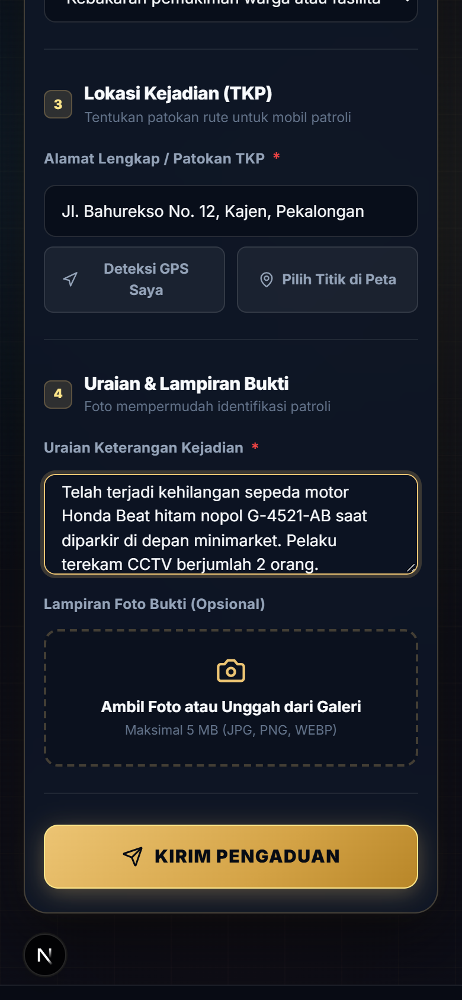

Bab ini membedah seluruh 7 modul dan alur interaksi layanan warga secara tuntas dari hulu ke hilir: mulai dari pengisian formulir laporan, penekanan tombol darurat SOS 5 detik, penentuan titik TKP pada peta satelit interaktif, konfirmasi penerbitan tiket resmi, pelacakan live telemetri mobil polisi yang mendekat via gelombang sonar radar, obrolan darurat 2-arah (Live Chat), hingga evaluasi mutu kepuasan publik (IKM):

---

### 4.1 Modul 1: Formulir Pengaduan Mandiri Warga Presisi 110 (`/warga`)

  

- **Fungsi & Kegunaan:** Pintu gerbang pelaporan mandiri masyarakat tanpa login untuk melaporkan gangguan kamtibmas, kriminalitas, kecelakaan lalu lintas, dan bencana alam secara cepat dan terenkripsi.
- **Tutorial Penggunaan Langkah Demi Langkah:**
  1. Buka peramban smartphone (Google Chrome, Safari, atau Samsung Internet) dan akses tautan resmi: `https://simapres-nu.vercel.app/warga`.
  2. **Bagian 1 (Identitas Pelapor):**
     - Masukkan **Nama Lengkap** sesuai KTP pada kolom nama.
     - Masukkan **Nomor WhatsApp / HP Aktif** yang dapat dihubungi petugas.
  3. **Bagian 2 (Spesifikasi Jenis Kasus):**
     - Buka menu pilihan *Jenis Kasus / Peristiwa*.
     - Pilih subkategori perkara yang dilaporkan (misal: *Pencurian Sepeda Motor R2, Tawuran Warga, Laka Lantas Berat, Pohon Tumbang*). Sistem secara otomatis mengelompokkan opsi berdasarkan kategori induk.
  4. **Bagian 3 (Tingkat Urgensi Kejadian):**
     - 🔴 **DARURAT (High Priority):** Korban jiwa, ancaman senjata tajam, laka berat.
     - 🟠 **SEDANG (Medium Priority):** Pencurian biasa, miras, gangguan kamtibmas lingkungan.
     - 🔵 **NORMAL (Low Priority):** Konsultasi batas tanah, informasi tilang, kehilangan barang.
  5. **Bagian 4 (Lokasi Kejadian TKP):**
     - Ketikkan alamat jalan, RT/RW, atau nama desa pada kolom alamat.
     - Tekan tombol **[ 📍 Deteksi GPS Saya ]** untuk mengunci koordinat sensor ponsel otomatis.
  6. **Bagian 5 (Uraian & Lampiran Bukti):**
     - Ketik kronologi singkat kejadian pada kotak uraian (minimal 10 karakter).
     - Tekan tombol **[ 📷 Lampirkan Foto Situasi ]** jika Anda memiliki foto kondisi TKP.
  7. **Eksekusi Pengiriman:** Tekan tombol merah besar:  
     $\\mathbf{[ 🚨 Kirim Laporan Darurat 110 ]}$
- **Kamus Formulir Input & Validasi Aturan:**
  - **Nama Lengkap Pelapor (Wajib):** Teks minimal 3 karakter huruf.
  - **Nomor WhatsApp / HP Aktif (Wajib):** Format nomor Indonesia (minimal 9-14 digit angka, diawali angka 08 atau 62).
  - **Jenis Kasus / Subkategori (Wajib):** Pilihan dari 47 subkategori pangkalan data kepolisian.
  - **Tingkat Urgensi (Radio Button Wajib):** `DARURAT`, `SEDANG`, atau `NORMAL`.
  - **Alamat Lokasi TKP (Wajib):** Teks nama jalan atau patokan gedung minimal 5 karakter.
  - **Titik Koordinat GPS (Wajib angka):** Nilai Latitude & Longitude presisi 6 desimal.
  - **Uraian Kejadian (Wajib):** Teks keterangan fakta kejadian minimal 10 karakter.
  - **Foto Bukti Situasi (Opsional):** Berkas gambar format JPG/PNG/WebP maksimal ukuran 5 MB.
- **Logika Kondisional & Konsekuensi Sistem:**
  - *Jika nama kurang dari 3 karakter:* Muncul notifikasi merah: `"Nama lengkap pelapor wajib diisi (minimal 3 karakter)."`
  - *Jika nomor WhatsApp kurang dari 9 digit atau bukan angka:* Muncul notifikasi merah: `"Nomor kontak WhatsApp / HP pelapor wajib diisi minimal 9–14 digit."`
  - *Jika uraian kejadian kurang dari 10 karakter:* Muncul notifikasi merah: `"Uraian keterangan kejadian wajib diisi (minimal 10 karakter)."`
  - *Jika koordinat GPS belum ditentukan:* Sistem otomatis memperingatkan warga untuk mengaktifkan izin lokasi peramban.
  - *Saat tombol kirim ditekan:* Sistem mengeksekusi Server Action `createComplaintAction`, menyimpan data di tabel `complaints` dengan status `MENUNGGU` (Tahap 1), menerbitkan nomor tiket resmi kriptografis (`#C110-YYYYMMDD-XXXX`), mengirimkan notifikasi dinas via WhatsApp Gateway, dan mengalihkan antarmuka ponsel pelapor ke **Halaman Konfirmasi Berhasil (Modul 4.4)**.

---

### 4.2 Modul 2: Fitur Tombol Darurat SOS Cepat (*Panic Button SOS*)

  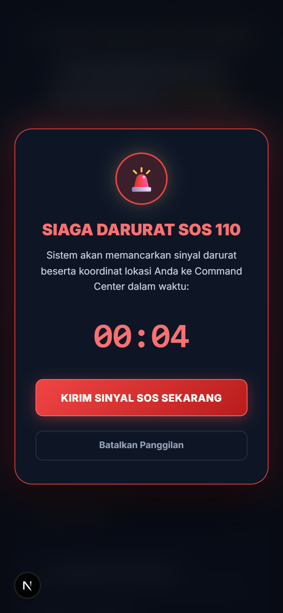

- **Fungsi & Kegunaan:** Tombol darurat khusus situasi hidup-atau-mati (*Life-Threatening Emergency*) saat warga dalam bahaya nyata dan tidak sempat mengetik formulir panjang (misal sedang disekap, dibuntuti begal jalanan, atau terjebak kebakaran rumah).
- **Tutorial Penggunaan Langkah Demi Langkah:**
  1. Pada bagian atas portal `/warga`, tekan tombol darurat merah menyala:  
     $\\mathbf{[ 🚨 PANGGILAN DARURAT SOS ]}$
  2. Layar membuka **Modal Darurat SOS** beranimasi sirine dengan lingkaran denyut merah dan hitung mundur waktu selama **5 detik** (*5s Countdown Timer*).
  3. Selama 5 detik, sensor GPS ponsel secara otomatis mengunci titik koordinat presisi pelapor di latar belakang.
  4. Jika tombol tidak sengaja tertekan, warga dapat menekan tombol **[ Batalkan ]** sebelum hitung mundur habis.
  5. Setelah hitung mundur 5 detik selesai (atau warga menekan tombol **[ Kirim Sekarang ]**), sinyal marabahaya SOS langsung disiarkan ke Command Center 110.
- **Logika Kondisional & Konsekuensi Sistem:**
  - *Jika warga menekan tombol [Batalkan] sebelum 5 detik:* Timer berhenti, modal tertutup, dan tidak ada tiket darurat yang dikirimkan ke polisi.
  - *Jika hitung mundur habis (0 detik) atau tombol [Kirim Sekarang] ditekan:*
    - Sistem langsung menerbitkan tiket darurat berkode `KEDARURATAN & BAHAYA JIWA (SOS)` dengan tingkat urgensi mutlak `DARURAT`.
    - Di ruang Call Center 110 Polres Pekalongan, **suara sirine patwal mobil polisi looping seketika berbunyi nyaring**.
    - Di konsol Operator CAD dan Pawas, kartu tiket merah berstatus `DARURAT_SOS` langsung melompat ke urutan paling atas antrean operasional.
    - Layar ponsel warga langsung dialihkan ke Halaman Konfirmasi Tiket Resmi dan membuka radar pelacakan armada terdekat.

---

### 4.3 Modul 3: Peta Penentu Titik Presisi (*MiniMap Picker Leaflet*)

  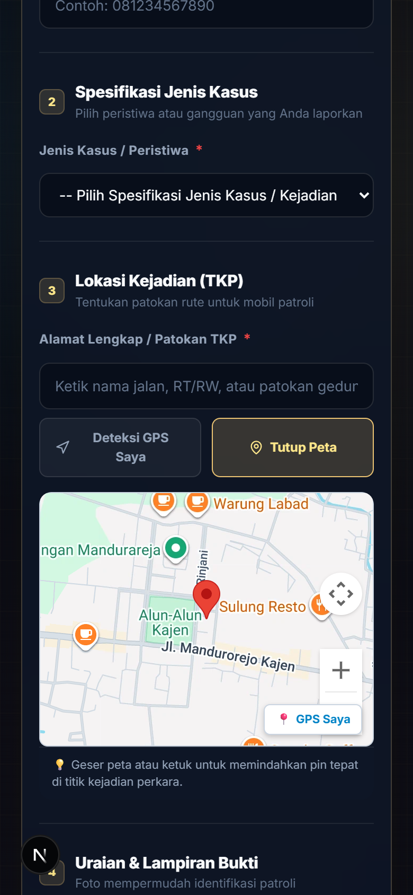

- **Fungsi & Kegunaan:** Memungkinkan warga menentukan dan mengunci titik koordinat tempat kejadian perkara (Latitude & Longitude) secara visual di atas peta interaktif satelit/jalan raya.
- **Tutorial Penggunaan Langkah Demi Langkah:**
  1. Tekan tombol **[ 📍 Deteksi GPS Saya ]** untuk mengunci posisi GPS perangkat secara instan menggunakan sensor ponsel.
  2. Jika pelapor melaporkan peristiwa di tempat lain, tekan tombol **[ Pilih Titik di Peta ]**.
  3. Peta interaktif Leaflet terbuka dengan pin penanda merah di tengah layar.
  4. Geser peta (*pan & zoom*) hingga ujung pin penanda merah berada tepat di atas gang, jalan, atau patokan lokasi kejadian yang dimaksud.
  5. Sistem secara otomatis memperbarui koordinat angka dan mengisi kotak teks alamat TKP.
- **Logika Kondisional & Konsekuensi Sistem:**
  - *Jika izin GPS peramban diblokir oleh warga:* Muncul pesan: `"Gagal mendeteksi koordinat GPS otomatis. Pastikan izin lokasi (GPS) pada peramban Anda telah diizinkan."`
  - *Jika titik di peta digeser oleh warga:* Nilai latitude dan longitude langsung ter-update secara reaktif dan alamat teks disesuaikan melalui reverse-geocoding.
  - Titik koordinat yang dikunci di peta ini menjadi acuan mutlak rute navigasi Google Maps bagi mobil dinas patroli yang meluncur dan menjadi dasar audit jarak tempuh BBM DIPA.

---

### 4.4 Modul 4: Halaman Konfirmasi Laporan Berhasil & Ringkasan Tiket Resmi

  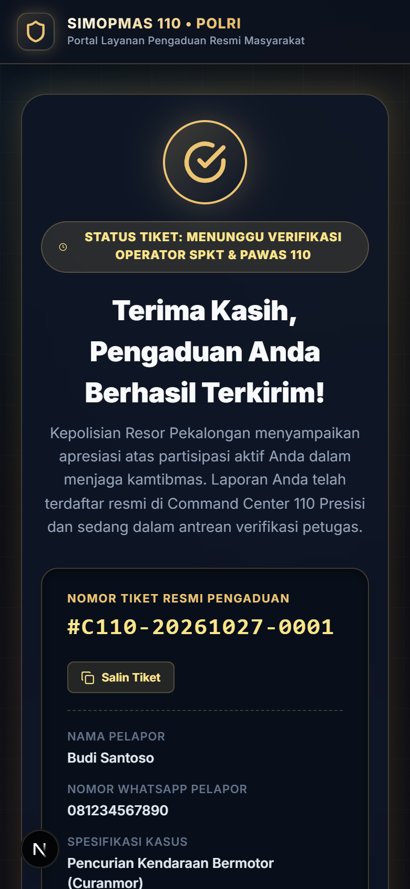

- **Fungsi & Kegunaan:** Memberikan tanda bukti penerimaan laporan resmi kedinasan Polri kepada warga yang memuat nomor registrasi tiket, rincian perkara, serta instruksi pemantauan selanjutnya.
- **Elemen Antarmuka & Informasi Resmi:**
  1. **Lencana Emas Presisi (Gold Crest):** Lambang verifikasi resmi kepolisian.
  2. **Status Pill Tiket:** `STATUS TIKET: MENUNGGU VERIFIKASI OPERATOR SPKT & PAWAS 110`.
  3. **Kotak Kartu Tiket Resmi:**
     - **Nomor Tiket Resmi:** Kode tiket alfanumerik unik (misal: `#C110-20261027-0001`).
     - **Tombol [Salin Tiket]:** Menyalin nomor tiket ke clipboard ponsel (berubah menjadi label hijau *"Tersalin!"*).
     - Rincian Nama Pelapor, Nomor WhatsApp, Jenis Kasus, Jam Pengaduan WIB, dan Alamat TKP.
  4. **Instruksi SOP 1 (Verifikasi Petugas):** Penjelasan bahwa laporan sedang ditinjau oleh Operator SPKT dan Perwira Pengawas (Pawas) untuk segera didisposisikan ke mobil patroli terdekat.
  5. **Instruksi SOP 2 (Pantau WhatsApp):** Pengingat bahwa tautan radar pelacakan live dan konfirmasi petugas dikirimkan berkala ke WhatsApp pelapor.
  6. **Tombol Aksi Taktis:**
     - Tombol Emas: **[ 📡 Buka Live Radar Pelacakan ]** (membuka radar telemetri).
     - Tombol Teks: **[ + Buat Pengaduan Lain ]** (mereset form ke laporan baru).
- **Logika Kondisional & Konsekuensi Sistem:**
  - *Jika tombol [Salin Tiket] ditekan:* Nomor tiket tersimpan di clipboard HP pelapor untuk memudahkan pengecekan status di kemudian hari.
  - *Jika tombol [Buka Live Radar Pelacakan] ditekan:* Layar berpindah ke modul radar telemetri mobil patroli (`/tracking`).

---

### 4.5 Modul 5: Layar Pencarian Tiket Pelacakan Radar Publik (`/tracking`)

  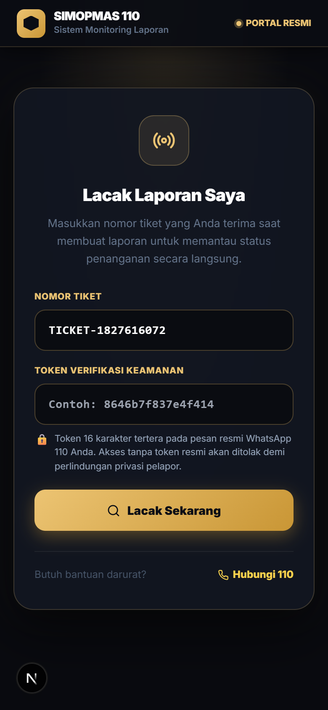

- **Fungsi & Kegunaan:** Pintu masuk mandiri bagi masyarakat untuk mengecek posisi mobil patroli atau status penanganan aduannya kapan saja hanya dengan memasukkan nomor tiket resmi.
- **Tutorial Penggunaan Langkah Demi Langkah:**
  1. Akses tautan publik: `https://simapres-nu.vercel.app/tracking`.
  2. Ketikkan nomor tiket resmi Anda (contoh: `#C110-20261027-0001` atau `TICKET-1883781772`) pada kolom pencarian.
  3. Masukkan kode token otorisasi (opsional, jika diterima via WhatsApp).
  4. Tekan tombol emas: **[ 🔍 Lacak Status Aduan ]**.
- **Bedah Formulir Input & Validasi:**
  - **Nomor Tiket Aduan (Wajib):** Kode unik alfanumerik laporan 110.
  - **Token Otorisasi (Opsional):** Kunci token kriptografis pelapor utama.
- **Logika Kondisional & Konsekuensi Sistem:**
  - *Jika nomor tiket tidak terdaftar di database (HTTP 404):* Muncul pesan peringatan merah: `"Nomor tiket [XXXX] tidak ditemukan dalam pangkalan data SIMOPMAS 110. Periksa kembali nomor tiket Anda!"`.
  - *Jika token pelacakan salah/tidak sah (HTTP 403 Forbidden):* Muncul pesan: `"Akses Ditolak: Token verifikasi pelacakan tidak valid atau tidak terdaftar."`
  - *Jika nomor tiket sah dan penanganan sedang berjalan:* Sistem membuka sambungan streaming data langsung (*Server-Sent Events / SSE*) dan menampilkan **Radar Taktis Live Telemetri (Modul 4.6)**.
  - *Jika perkara diselesaikan di meja operator tanpa pengerahan mobil:* Sistem otomatis mengalihkan layar ke **Lembar Evaluasi Mutu Operator 110 (Modul 4.7)**.

---

### 4.6 Modul 6: Radar Taktis Live Telemetri Mobil Polisi (`CitizenLiveRadarTracker`)

  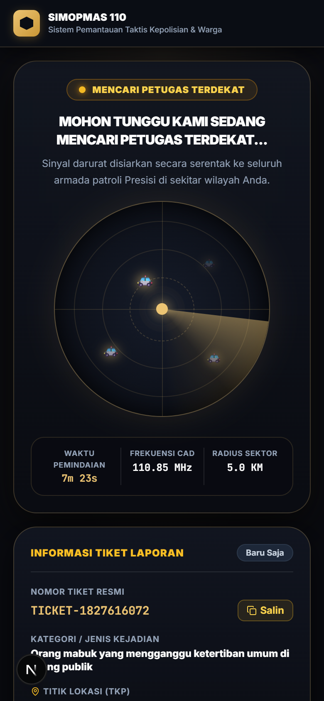

- **Fungsi & Kegunaan:** Menyajikan transparansi operasional kepolisian secara real-time kepada pelapor dengan memvisualisasikan pergerakan armada mobil patroli yang sedang meluncur menuju lokasi TKP.
- **Fitur Taktis & Elemen Antarmuka:**
  1. **Lingkaran Radar Sonar Dinamis:** Animasi radar hijau berputar yang memancarkan sinyal deteksi keberadaan mobil patroli.
  2. **Indikator Tahapan Kasus Real-Time:** Menampilkan tahapan penanganan secara transparan (*MENUNGGU ➔ VERIFIKASI CAD ➔ DISPOSISI ➔ MELUNCUR / DEPARTED ➔ TIBA DI TKP / ARRIVED ➔ SELESAI*).
  3. **Telemetri Jarak Mobil ke TKP:** Jarak riil mobil dinas patroli ke lokasi pelapor dalam satuan meter / kilometer yang diperbarui secara otomatis setiap 5 detik menggunakan formula Haversine.
  4. **Estimasi Waktu Tiba (ETA):** Hitung mundur perkiraan menit mobil tiba di lokasi berdasarkan kecepatan GPS ranmor.
  5. **Bilah Obrolan Darurat 2-Arah (Live Chat):** Fitur pesan teks terenkripsi langsung antara warga pelapor dan petugas kepolisian di dalam mobil patroli.
- **Logika Kondisional & Konsekuensi Sistem:**
  - *Saat status masih MENUNGGU atau DISPOSISI:* Radar menampilkan pesan *"Laporan Anda Sedang Diverifikasi oleh Operator Sentra 110"*.
  - *Saat petugas patroli menekan tombol Meluncur (`DEPARTED`):* Radar aktif memancarkan gelombang sonar, ikon mobil polisi bergerak di peta, dan jarak tempuh meter/km menyusut secara dinamis.
  - *Saat petugas patroli menekan tombol Tiba (`ARRIVED`):* Radar mengunci status `"Petugas Kepolisian Telah Tiba di Lokasi Kejadian (TKP)"`.

---

### 4.7 Modul 7: Evaluasi Pelayanan Operator & Indeks Kepuasan Masyarakat (IKM)

  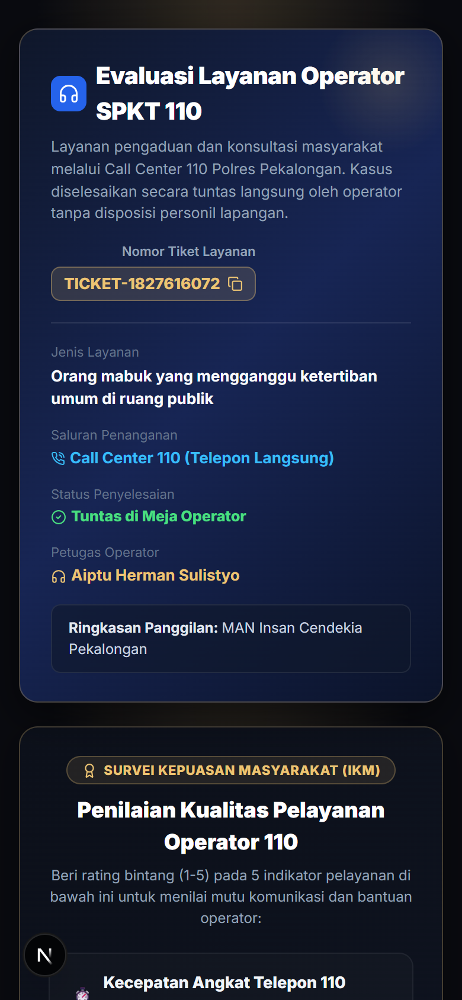

- **Fungsi & Kegunaan:** Instrumen penilaian kepuasan masyarakat terhadap mutu layanan kepolisian untuk menjaga akuntabilitas dan objektivitas Program Presisi Kapolri.
- **Dua Model Kuesioner Evaluasi Publik:**
  1. **Kuesioner Mutu Pelayanan Operator 110 (5 Dimensi):**  
     Diberikan kepada penelepon jika laporan diselesaikan melalui meja operator (*Layanan Informasi / SOP Poin 4.E*):
     - *1. Kecepatan Respon:* Kecepatan operator menjawab panggilan telepon.
     - *2. Keramahan Suara:* Kesopanan dan nada bicara operator saat melayani.
     - *3. Kejelasan Informasi SOP:* Kemudahan pemahaman atas syarat panduan yang diberikan.
     - *4. Sikap Empati:* Kesungguhan operator dalam mendengarkan keluhan warga.
     - *5. Solutif:* Ketepatan solusi yang diberikan dalam menjawab kebutuhan penelepon.
  2. **Survei Kepuasan Penanganan Lapangan (IKM Bintang 1–5):**  
     Diberikan kepada pelapor setelah penanganan di TKP dinyatakan selesai:
     - ⭐ 1–2 (Tidak Puas): Membuka kolom alasan ketidakpuasan sebagai materi evaluasi dinas.
     - ⭐ 3 (Cukup Puas).
     - ⭐ 4–5 (Sangat Puas): Menyajikan tag apresiasi instan (*"Respon Cepat"*, *"Petugas Ramah & Humanis"*, *"Masalah Teratasi Secara Adil"*).
- **Logika Kondisional & Konsekuensi Sistem:**
  - Penilaian bintang dan jawaban kuesioner warga tersimpan di tabel database `citizen_reviews`.
  - Data ini secara otomatis mengalkulasi nilai komposit **Indeks Kepuasan Masyarakat (IKM)** pada dashboard Leaderboard Anev Pimpinan (Tier 1 Polsek, Tier 2 Personel, dan Tier 3 Operator 110) secara real-time.

---

## BAB 5: PANDUAN LENGKAP KONSOL OPERATOR CAD 110

Operator CAD (Computer-Aided Dispatch) bertugas di ruang Call Center SPKT untuk menangani setiap panggilan darurat 110 yang masuk.

  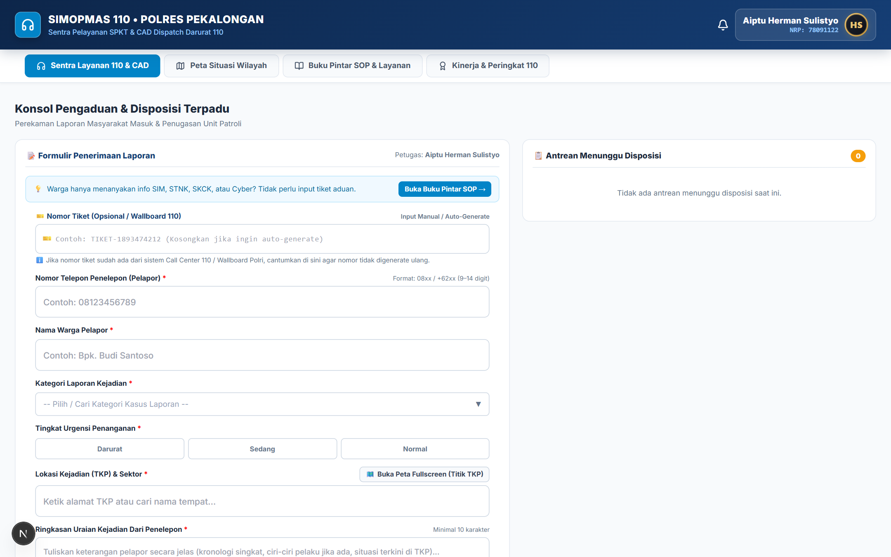

### 5.1 Anatomi Antarmuka Konsol CAD 110
1. **Header Konsol:** Menampilkan identitas operator, nama Mako pangkalan, jam digital presisi WIB, dan indikator status koneksi gateway WhatsApp.
2. **Panel Kiri (Antrean Aduan Masuk):** Kartu-kartu tiket aduan yang masuk secara real-time, dilengkapi label warna urgensi:
   - 🔴 **Merah (DARURAT):** SLA tiba di TKP $\le 10$ menit.
   - 🟠 **Oranye (SEDANG):** SLA tiba di TKP $\le 20$ menit.
   - 🔵 **Biru (NORMAL):** SLA tiba di TKP $\le 30$ menit.
3. **Panel Tengah (Formulir Fast-Intake):** Bidang pencatatan identitas penelepon dan perincian kejadian.
4. **Panel Kanan (Peta Taktis CAD):** Peta interaktif penempatan pin lokasi TKP, poligon batas wilayah hukum Polsek, dan posisi mobil patroli siaga terdekat.

---

### 5.2 Alur Penanganan Panggilan Masuk Langkah Demi Langkah
1. **Langkah 1: Input Nomor Telepon & Cek Histori**  
   Ketik nomor telepon penelepon pada kolom kontak.  
   - *Jika nomor pernah melapor sebelumnya:* Muncul lencana kuning *"Pelapor Berulang"* beserta riwayat 3 laporan terakhir.
2. **Langkah 2: Input Identitas & Klasifikasi Kasus**  
   Masukkan nama penelepon, pilih kategori kasus (Kriminalitas, Kamtibmas, Lakalantas), dan tentukan subkategori perkara.
3. **Langkah 3: Pencarian Alamat & Penempatan Pin TKP**  
   Ketikkan nama jalan atau nama desa pada kolom pencarian. Mesin geocoding lokal secara otomatis menampilkan saran alamat resmi, menempatkan pin merah di peta CAD, dan mengisi kolom alamat fisik.

---

### 5.3 Arsitektur 3 Cabang Pembuatan Tiket & Diagram Alur Keputusan CAD

Modul pembuatan tiket pengaduan pada formulir Fast-Intake CAD 110 dirancang berdasarkan **Prinsip Ketepatan Jalur Respon (*Right-Routing Principle*)**. Sistem tidak memperlakukan seluruh aduan secara seragam, melainkan membaginya secara cerdas ke dalam **3 (tiga) cabang alur kerja (*workflow*) yang saling berkaitan dengan fungsi, validasi logika, dan konsekuensi operasional yang berbeda**:

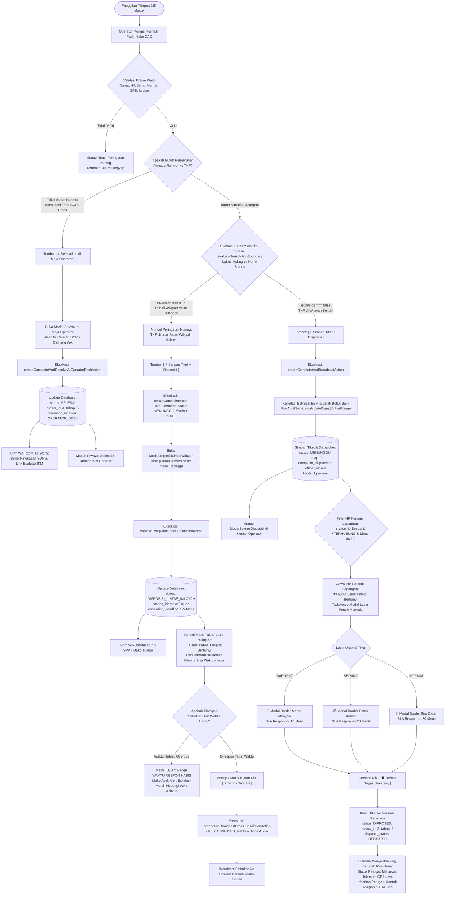

---

### 5.3.1 Cabang 1: Selesaikan di Meja Operator (Desk Resolution / Non-Lapang)
Jika panggilan 110 yang masuk bersifat konsultasi hukum, permohonan informasi SIM/SKCK, klarifikasi isu hoaks, aduan yang tuntas via mediasi telepon, atau panggilan iseng (*prank call*):
1. **Langkah Kerja Operator:**
   - Operator merujuk ke tab **Buku Pintar SOP Digital** ([`TabBukuPintarSop.tsx`](file:///c:/Users/Pongo/Downloads/SIMAPRES/src/components/console/pawas/tabs/TabBukuPintarSop.tsx)) untuk memberikan skrip jawaban kedinasan dan tarif PNBP resmi.
   - Di bagian bawah formulir Fast-Intake, operator menekan tombol:  
     $$\mathbf{[\ 📞\ Selesaikan\ di\ Meja\ Operator\ /\ Konseling\ 110\ ]}$$
   - Muncul jendela modal penyelesaian meja: operator **wajib mengisi catatan petunjuk SOP** yang diberikan dan memastikan opsi centang WhatsApp evaluasi aktif.
   - Operator menekan tombol **[ ✅ Konfirmasi & Selesaikan di Meja ]**.
2. **Kondisi & Konsekuensi Sistem:**
   - Server Action `createComplaintAndResolveAtOperatorDeskAction` menyimpan tiket langsung berstatus **`SELESAI` (Tahap 5)** dengan kode lokasi `OPERATOR_DESK`.
   - **Nol Pengerahan Armada:** Sistem tidak menerbitkan baris penugasan `complaint_dispatches`, sehingga **tidak ada bahan bakar dinas yang terpakai** dan tidak mengganggu kesiapsiagaan mobil patroli di lapangan.
   - **Evaluasi Warga:** Warga otomatis menerima WhatsApp resmi berisi ringkasan arahan dan tautan kuesioner mutu operator 5 dimensi (Kecepatan, Keramahan, Kejelasan SOP, Empati, Solutif).
   - Tiket langsung masuk ke tab **Riwayat Selesai** dan menambah metrik KPI operator (+1).

---

### 5.3.2 Cabang 2: Tiket Lintas Wilayah (Cross-Jurisdiction E-Routing Boundary)
Jika titik koordinat TKP berada di luar wilayah hukum Mako operator (misal laporan masuk ke Polres Pekalongan namun lokasi kejadian berada di wilayah Kabupaten Batang atau Kota Pekalongan):
1. **Langkah Kerja Operator:**
   - Begitu pin lokasi TKP diletakkan di peta atau alamat dimasukkan, modul spasial `evaluateJurisdictionBoundary` mendeteksi jarak TKP ke Mako tetangga lebih dekat.
   - Muncul **Kotak Peringatan Kuning/Oranye**:  
     `"⚠️ PERINGATAN: Titik TKP berada di luar batas wilayah hukum operasional Anda! Disarankan melimpahkan tugas ke Mako terdekat."`
   - Operator menekan tombol aksi utama:  
     $$\mathbf{[\ ⚡\ Simpan\ Tiket\ +\ Disposisi\ ]}$$
   - Sistem **seketika membuka jendela *Modal Disposisi Lintas Wilayah*** ([`ModalDisposisiLintasWilayah.tsx`](file:///c:/Users/Pongo/Downloads/SIMAPRES/src/components/console/pawas/modals/ModalDisposisiLintasWilayah.tsx)) yang menghitung radius GPS Haversine terdekat ke seluruh Mako tetangga.
   - Operator memilih Mako Tujuan (misal Polresta Batang), memeriksa alasan pengalihan, lalu menekan **[ Kirim Disposisi Lintas Wilayah ]**.
2. **Kondisi & Konsekuensi Sistem:**
   - Server Action `transferComplaintCrossJurisdictionAction` memperbarui status tiket menjadi **`DISPOSISI_LINTAS_WILAYAH`** dan memindahkan `station_id` ke Mako Tujuan.
   - **Timer Eskalasi Respon:** Dihitung otomatis selama **3 Menit (Darurat)** atau **5 Menit (Sedang)**.
   - **Respon di Mako Tujuan (misal Batang):**
     - Komputer ruang piket Mako Tujuan menangkap tiket via *silent auto-polling* 4 detik.
     - **Suara sirine patwal looping langsung menyala kencang**.
     - Bagian atas konsol menampilkan **Banner Oranye Berkedip** dengan hitung mundur live `⏱️ Sisa Waktu: mm:ss` dan tombol `[ ⚡ Terima Tiket Ini ]`.
     - Saat petugas Mako Tujuan mengklik tombol terima, status berubah ke **`DIPROSES` (Tahap 2)**, sirine mati, dan tugas disiarkan terbuka (*open broadcast*) ke seluruh personel piket dinas Mako Tujuan.
   - **Respon Jika Overdue (Lewat 3 Menit):** Banner Mako Tujuan berubah merah pekat: `⚠️ WAKTU RESPON HABIS`. Konsol Mako Asal memunculkan alert eskalasi merah dengan tombol darurat WhatsApp ke Ka SPKT tujuan dan opsi penarikan kembali tiket.
   - **Transparansi Warga:** Tautan pelacakan `/tracking` warga secara transparan menampilkan nama Mako penanggung jawab tanpa membebani warga dengan pesan ganda.

---

### 5.3.3 Cabang 3: Disposisi Siaga / Open Broadcast Lokal (In-Jurisdiction Broadcast)
Jika titik koordinat TKP berada di dalam wilayah hukum Mako operator sendiri (`isOutside === false`):
1. **Langkah Kerja Operator:**
   - Operator memverifikasi kelengkapan identitas pelapor, kategori, urgensi (Darurat/Sedang/Normal), dan titik TKP.
   - Operator menekan tombol aksi utama:  
     $$\mathbf{[\ ⚡\ Simpan\ Tiket\ +\ Disposisi\ ]}$$
2. **Kondisi & Konsekuensi Sistem:**
   - Server Action `createComplaintAndBroadcastAction` mengeksekusi transaksi terpadu:
     - Menyimpan tiket dengan status **`MENUNGGU` (Tahap 1: Disiarkan ke Armada)**.
     - Mengalkulasi audit konsumsi BBM pulang-pergi TKP via `FuelAuditService`.
     - Mengaktifkan timer eskalasi respon (3 menit Darurat / 5 menit Sedang).
     - Menerbitkan baris penugasan terbuka `complaint_dispatches` dengan `officer_id: null` dan `personnel_quota: 1` (*first-come, first-served*).
     - Mengirimkan pesan WhatsApp dinas ke Ka SPKT / Petugas Piket SPKT hari ini.
   - Muncul jendela modal konfirmasi sukses broadcast ([`ModalSuksesDisposisi.tsx`](file:///c:/Users/Pongo/Downloads/SIMAPRES/src/components/console/pawas/modals/ModalSuksesDisposisi.tsx)) di layar operator.
3. **Respon Reaktif Gawai Personel Lapangan (Mobile Console):**
   - Kueri `findAssignedToOfficer` menangkap tiket broadcast terbuka untuk seluruh personel pada stasiun tersebut.
   - Pada gawai HP personel yang berstatus **`• TERHUBUNG`** dan saklar dinas **`AKTIF`**:
     - Pemutar audio darurat seketika membunyikan **suara sirine patwal looping**.
     - Dialog layar penuh **[`TaskAcceptModal.tsx`](file:///c:/Users/Pongo/Downloads/SIMAPRES/src/components/console/personil/components/TaskAcceptModal.tsx)** menyala otomatis dengan kode warna urgensi:
       - 🔴 **DARURAT (Merah Menyala):** Border merah berdenyut, ditujukan untuk curas, laka berat, kebakaran, tawuran, atau bahaya jiwa.
       - 🟡 **SEDANG (Kuning/Emas Amber):** Border emas amber, ditujukan untuk kemacetan parah atau keributan warga standar.
       - 🔵 **NORMAL (Biru Cerah):** Border biru cerah untuk aduan kamtibmas ringan.
   - Personel menekan tombol **`[ 🛡️ Terima Tugas Sekarang ]`**:
     - Status tiket diperbarui menjadi **`DIPROSES` (Tahap 2: Menuju TKP)**.
     - Tiket terkunci (*locked*) eksklusif ke personel penerima.
4. **Respon Real-Time Radar Warga (`/tracking`):**
   - Radar live warga yang tadinya berstatus *"Mencari Petugas Terdekat"* seketika beralih menampilkan identitas lengkap petugas (foto, nama, pangkat, nomor HP), rute jalan, telemetri live GPS mobil patroli, dan estimasi waktu tiba (ETA).

---

### 5.5 Tindakan Taktis pada Kartu Antrean Laporan (Panel Kanan)
Pada panel antrean aduan masuk (*Antrean Menunggu Disposisi*), setiap kartu tiket dilengkapi 3 tombol tindakan cepat:
1. **Tombol Biru `[ Teruskan Tugas -> ]`**:  
   Membuka modal disposisi manual ke armada satuan fungsi (Samapta, Lantas, Reskrim, Intelkam, Binmas).
2. **Tombol Garis Hijau `[ ✓ Selesai ]`**:  
   Menyelesaikan tiket langsung di meja operator jika aduan telah tuntas tertangani tanpa perlu unit lapangan.
3. **Tombol Garis Merah `[ ✕ Tolak ]`**:  
   Menolak aduan yang terbukti merupakan panggilan palsu (*prank call*), nomor spam, atau informasi fiktif, disertai kewajiban mengisi alasan penolakan kedinasan.

---

## BAB 6: PANDUAN RESPON CEPAT SPKT POLSEK KEWILAYAHAN

Modul ini memandu petugas jaga piket SPKT di Polsek jajaran saat menerima limpahan perkara dari Sentra 110 Polres Pekalongan.

### 6.1 Respon Hardware & Visual Saat Laporan Masuk
1. Begitu Polres melimpahkan tiket ke Polsek Anda:
   - Komputer ruang piket SPKT Polsek membunyikan **suara sirine patwal mobil polisi secara terus-menerus (looping)** dengan volume kencang.
   - Bagian atas layar konsol menampilkan **Banner Oranye Berkedip** yang memuat: Nomor Tiket, Lokasi TKP, Nama Pelapor, dan Indikator Timer Hitung Mundur 5 Menit.
   - WhatsApp dinas Ka SPKT Polsek menerima pesan pemberitahuan limpahan darurat.

### 6.2 Prosedur Eksekusi Penerimaan:
Petugas piket SPKT Polsek wajib segera menekan tombol hijau di banner alarm:
$$\mathbf{[\ ⚡\ Terima\ \&\ Disposisikan\ ]}$$

#### Konsekuensi Sistem Seketika Setelah Tombol Ditekan:
- Suara sirine patwal mobil polisi **langsung mati seketika**.
- Banner alarm oranye berkedip **lenyap total dari layar**.
- Status laporan resmi beralih dari `DISPOSISI_LINTAS_WILAYAH` menjadi **`DIPROSES` (Tahap 2: Sedang Ditangani / Disiarkan ke Personel Armada Patroli)**.
- Tiket keluar sepenuhnya dari antrean *"Menunggu Disposisi"* (jumlah antrean menunggu kembali menjadi `0`).
- Tiket berpindah ke daftar penanganan operasional aktif di Peta Situasi Wilayah.
- Penugasan langsung disiarkan ke unit patroli Samapta Polsek untuk segera bergerak menuju TKP.

### 6.3 Penanganan Kondisi Khusus di Mako Asal (Over-SLA 5 Menit):
Jika petugas jaga Polsek tujuan tidak merespons dalam rentang waktu 5 menit:
1. Di layar konsol Operator CAD Mako Asal (Polres), muncul **Banner Alarm Merah Berkedip** bertuliskan:  
   `"🚨 ESKALASI: Polsek tujuan belum memberikan respon dalam 5 menit! Segera ambil tindakan pengalihan atau pengerahan mandiri."`
2. **Dua Opsi Tindakan Operator Mako Asal:**
   - **Opsi A (Tombol [ Alihkan > ]):** Membuka kembali modal E-Routing untuk mengalihkan limpahan ke Polsek tetangga alternatif kedua.
   - **Opsi B (Tombol [ Ambil Alih Mandiri ]):** Menarik kembali tiket penugasan ke jajaran Polres dan langsung mengerahkan unit patroli Samapta Polres ke lokasi kejadian.

---

## BAB 7: PANDUAN PERSONEL PATROLI LAPANGAN

Konsol mobile dirancang khusus untuk kenyamanan operasional personel di dalam kendaraan patroli dengan tata letak tombol besar (*Big-Tap Target*).

  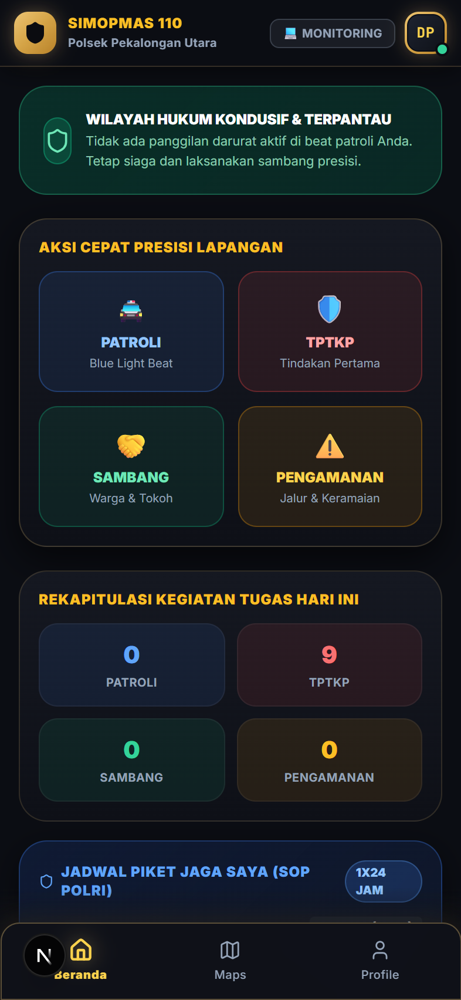

### 7.1 Prosedur Operasional Personel Langkah Demi Langkah:

#### Langkah 1: Penerimaan Tugas (One-Tap Quick Accept)
- Anggota menerima notifikasi penugasan via pesan WhatsApp kedinasan.
- Anggota menekan tautan pada pesan WhatsApp atau membuka tab beranda konsol mobile di ponsel dinas.
- Tekan tombol **[ Quick Accept Tugas ]** untuk mengonfirmasi kesiapan dinas.

#### Langkah 2: Check-In Kendaraan Dinas via Scan QR Code Stiker Mobil
- Sebelum mobil meluncur, buka menu kamera scan armada di aplikasi.
- Arahkan kamera ponsel ke stiker fisik QR Code yang tertempel pada dashboard mobil patroli dinas (contoh: mobil `R4-SAMAPTA-81`).
- Sistem mengonfirmasi: *"Armada [R4-SAMAPTA-81] Berhasil Terhubung"*. Ranmor resmi terikat pada tiket penugasan untuk audit bahan bakar DIPA.

#### Langkah 3: Meluncur ke TKP (`DEPARTED`)
- Anggota menekan tombol besar: **[ 🚀 Meluncur ke TKP ]**.
- *Konsekuensi Logika:*
  - Status penugasan beralih menjadi `DEPARTED`.
  - Timestamp waktu keberangkatan dicatat permanen.
  - GPS ponsel anggota mulai memancarkan koordinat langsung ke layar radar pelapor warga.

#### Langkah 4: Tiba di TKP (`ARRIVED`)
- Sesampainya di lokasi kejadian perkara, segera tekan tombol: **[ 📍 Tiba di TKP ]**.
- *Konsekuensi Logika:*
  - Status penugasan beralih menjadi `ARRIVED`.
  - Waktu tiba dikunci permanen di sistem sebagai dasar evaluasi *Response Time* Presisi Mabes Polri.

#### Langkah 5: Pengambilan Foto Bukti Kamera Watermark Anti-Fraud
- Anggota menekan tombol **[ 📷 Ambil Foto TKP ]**.
- Kamera in-app mengambil gambar situasi TKP, kondisi korban, atau barang bukti.
- Mesin kamera secara otomatis menempelkan cap teks legalitas permanen (*Watermark*) pada piksel foto yang memuat:
  `POLRES PEKALONGAN | NRP: 92031145 (Bripka Dedi Prasetyo) | TIKET: #C110-20261027-0001 | WAKTU: 27/10/2026 02:45:10 WIB | GPS: -6.985123, 109.654321`
- Foto ini menjadi alat bukti sah kedinasan yang anti-manipulasi (tidak dapat dipalsukan menggunakan foto lama dari galeri HP).

#### Langkah 6: Penambahan Rekan Regu Lapangan (Buddy System)
- Sesuai SOP keselamatan anggota Polri di lapangan, patroli wajib dijalankan minimal oleh 2 personel (*Buddy System*).
- Tekan tombol **[ 👥 Tambah Rekan Regu ]**.
- Masukkan Nama Lengkap dan NRP rekan pendamping dinas Anda (contoh: `BRIPTU Danang - 94010234`).
- Nama rekan regu otomatis tercatat dalam berkas penugasan dan lembar pertanggungjawaban operasional dinas.

#### Langkah 7: Penyelesaian Perkara & Unggah Berkas BAP Damai
- Setelah perkara selesai ditangani (dimediasi secara kekeluargaan atau diamankan):
  1. Pilih **Tipe Lokasi Penyelesaian:** `TKP`, `KANTOR_POLISI`, `RUMAH_SAKIT`, atau `KANTOR_KELURAHAN`.
  2. Pilih **Tipe Dokumen Legalitas:** `BAP_DAMAI`, `SERAH_TERIMA_BB`, atau `DOKUMENTASI_KONDUSIF`.
  3. Ambil foto dokumen fisik surat kesepakatan damai bermaterai yang telah ditandatangani para pihak.
  4. Ketik resume tindakan kepolisian pada kolom ringkasan.
  5. Tekan tombol: **[ Selesaikan Laporan ]**.
  6. Berkas perkara secara otomatis terkirim ke antrean validasi Perwira Pengawas (Pawas).

---

## BAB 8: PANDUAN PERWIRA PENGAWAS KOMANDO (PAWAS) & VALIDASI DOSSIER 4-FASE

Perwira Pengawas (Pawas) memegang kendali tertinggi pengawasan mutu operasional, kepatuhan SOP anggota, kesiapsiagaan penjagaan Mako, dan pengesahan legalitas perkara.

  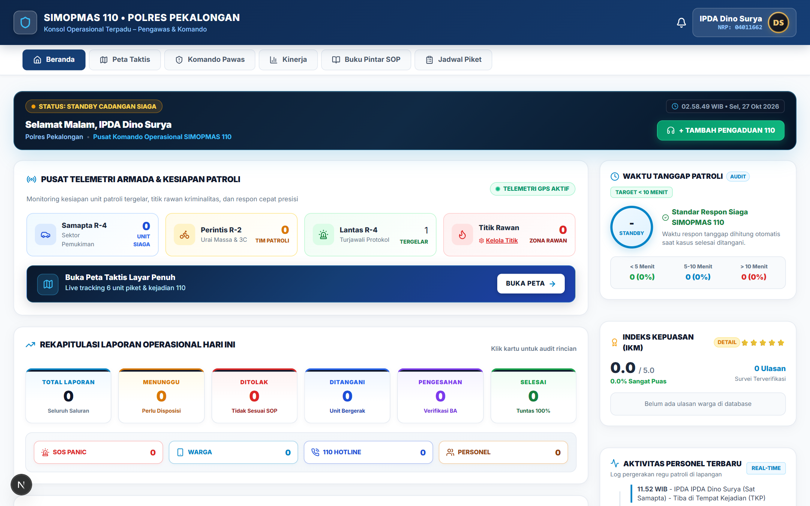

### 8.1 Pemantauan Peta Situasi Taktis & Radar Patroli Live
Pada tab **Peta Taktis Operasional**, Pawas dapat memantau kendali wilayah se-Kabupaten Pekalongan secara visual:
1. **Layer Markas Komando:** Menampilkan lokasi fisik Polres Pekalongan dan 20 Polsek jajaran lengkap dengan status kesiagaan Mako.
2. **Layer Insiden Berjalan:** Menampilkan titik-titik kejadian yang sedang berlangsung, berkode warna urgensi (Merah/Oranye/Biru).
3. **Layer Armada Patroli Bergerak:**
   - Ikon mobil dinas patroli bergerak secara real-time mengikuti pergerakan GPS kendaraan.
   - Mengklik ikon mobil menampilkan: Nomor Lambung, Kecepatan Ranmor (KM/Jam), Nama Pengemudi, dan Rute Navigasi Google Directions menuju TKP.
4. **Layer Titik Rawan Kamtibmas (Hotspots):** Menampilkan titik rawan 3C (Curat, Curas, Curanmor), tawuran pelajar, dan balap liar serta jadwal waktu rawannya.

---

### 8.2 Validasi Dossier Berkas Perkara 4-Fase (Dossier Lock)

  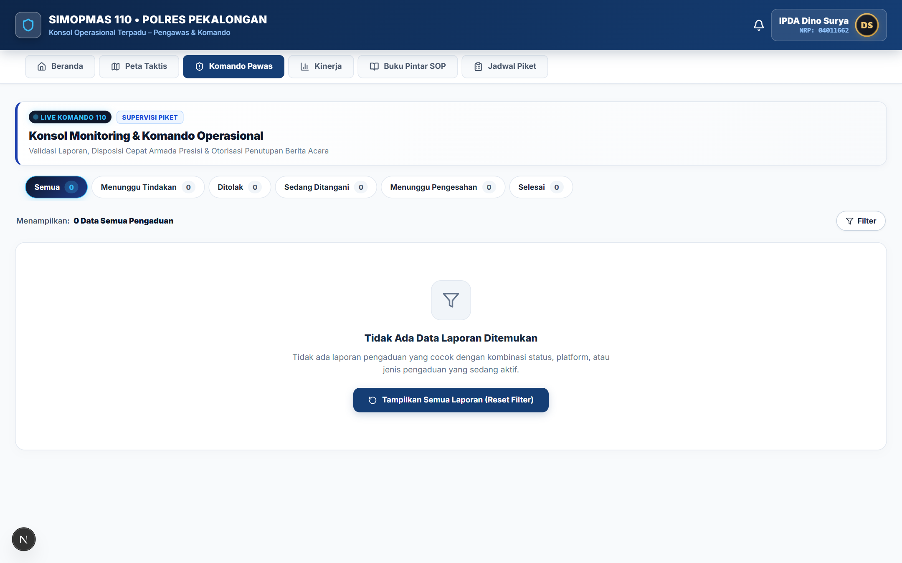

Setiap laporan yang diselesaikan oleh personel lapangan wajib melalui audit validasi 4-Fase oleh Pawas:
1. **Fase 1 (Audit Intake Data):** Memeriksa keabsahan identitas pelapor, kesesuaian kategori kasus, dan kebenaran alamat TKP.
2. **Fase 2 (Audit Response Time Disposisi):** Memeriksa apakah waktu tanggap anggota sejak panggilan diterima hingga tiba di lokasi memenuhi standar SLA Presisi ($\le 15$ menit).
3. **Fase 3 (Audit Bukti Foto Watermark):** Memeriksa foto dokumentasi penanganan di TKP (memastikan cap stempel permanen NRP, waktu WIB, dan koordinat GPS valid).
4. **Fase 4 (Audit Dokumen Penyelesaian):** Memeriksa fisik foto surat Berita Acara Mediasi Damai bermaterai atau Berita Acara Serah Terima Barang Bukti.

#### Logika Keputusan Pawas:
- **Jika berkas memenuhi standar:** Pawas menekan tombol **[ Sahkan Dossier & Tutup Kasus ]**.
  - *Konsekuensi Logika:* Status laporan resmi beralih menjadi **`SELESAI` (Tahap 4)**. Seluruh berkas terkunci permanen (*Dossier Locked*), data tidak dapat diubah lagi, dan otomatis masuk ke antrean verifikasi Seksi Keuangan untuk pencairan anggaran BBM DIPA.
- **Jika berkas tidak lengkap (misal foto buram atau BAP belum ditandatangani):** Pawas menolak pengesahan dengan menyertakan catatan instruksi perbaikan kepada anggota penindak.

---

### 8.3 Roster Piket Dinas Jaga, Pengecekan Ruang Tahanan & Senpi Inventaris

  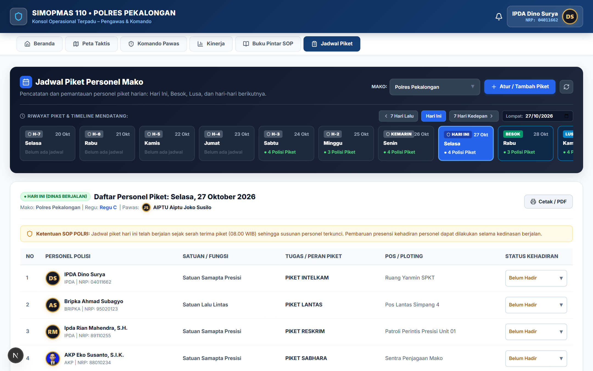

Pada tab **Plotting Piket Jaga Mako**, Pawas mengelola mutasi serah terima dinas harian:
1. **Input Surat Perintah Tugas (Sprin):** Memasukkan Nomor Sprin Kapolres, tanggal dinas, regu dinas (Regu A, B, atau C), dan shift dinas (1x24 Jam).
2. **Penetapan Pejabat Utama Piket:** Memilih nama Perwira Pengawas (Pawas), Perwira Pengendali (Padal), dan Kepala SPKT harian.
3. **Audit Pengecekan Ruang Tahanan Mako (Wajib):**
   - Memasukkan jumlah tahanan: Pria, Wanita, Anak-anak, dan Titipan Kejaksaan/Pengadilan.
   - Memverifikasi kondisi fisik kesehatan seluruh tahanan serta audit kekuatan gembok, teralis, dan ventilasi sel tahanan.
4. **Audit Pengecekan Barang Inventaris Kedinasan (Wajib):**
   - Memasukkan jumlah pucuk senjata api dinas inventaris penjagaan (Revolver Taurus, Senapan V2 Sabhara).
   - Memasukkan jumlah butir amunisi tajam dan amunisi karet.
   - Memeriksa kesiapan ranmor patroli dinas, rompi anti-peluru level III-A, borgol, dan handy talky (HT).
5. Menekan tombol **[ Simpan Roster & Berita Acara Jaga ]** untuk membukukan catatan mutasi serah terima jaga ke dalam arsip database kedinasan.

---

## BAB 9: PANDUAN BIRO LOGISTIK & SEKSI KEUANGAN (AUDIT BBM DIPA & CETAK SPJ A4 SAH)

Bagian Logistik dan Seksi Keuangan (Si-Keu) bertanggung jawab atas akuntabilitas pengeluaran anggaran bahan bakar minyak (BBM) dinas patroli Presisi 110.

  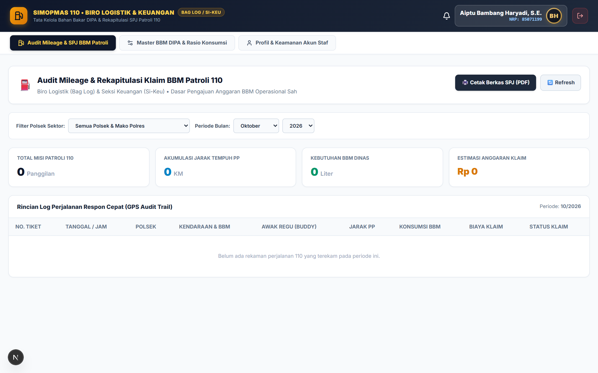

### 9.1 Formula Komputasi Jarak Tempuh & Anggaran BBM DIPA
Sistem SIMAPRES 110 menghitung penggunaan bahan bakar secara otomatis berbasis telemetri spasial presisi:
1. **Perhitungan Jarak Tempuh Jalan Raya Bolak-Balik (Round-Trip KM):**
   $$\text{Total Jarak (KM)} = 2 \times \text{Jarak Garis Lurus Mako ke TKP} \times 1.25\ (\text{Faktor Kelokan Tortuosity Jalan})$$
2. **Perhitungan Konsumsi Volume Liter Bahan Bakar:**
   $$\text{Volume BBM (Liter)} = \frac{\text{Total Jarak Tempuh (KM)}}{\text{Rasio Efisiensi Km/L Kendaraan}}$$
3. **Perhitungan Estimasi Anggaran Riil (Rupiah DIPA):**
   $$\text{Estimasi Biaya (Rp)} = \text{Volume BBM (Liter)} \times \text{Master Pagu Harga BBM DIPA Resmi}$$

---

### 9.2 Alur Verifikasi Klaim Bertingkat (Claim Workflow)
Setiap tiket yang telah disahkan oleh Pawas akan tampil pada tabel rekapitulasi audit BBM:
- **`UNCLAIMED` (Default):** Berkas selesai di lapangan, menunggu verifikasi staf logistik.
- **`DIAJUKAN_BAGLOG`:** Staf logistik telah memeriksa kewajaran rute dan mengajukan nota dinas pencairan.
- **`DISETUJUI_BAGLOG`:** Kasubbag Log / Kasi Keuangan menyetujui klaim anggaran BBM.
- **`DICAIRKAN`:** Dana penggantian BBM dinas telah diserahkan secara sah kepada unit patroli.
- **`DITOLAK`:** Ditolak apabila terdeteksi anomali rute atau penyalahgunaan kendaraan di luar surat perintah tugas.

---

### 9.3 Prosedur Cetak Dokumen SPJ Format A4 Standar Resmi Polri
1. Pada baris penugasan yang telah disetujui (`DISETUJUI_BAGLOG`), staf mengklik tombol:  
   $$\mathbf{[\ 🖨️\ Cetak\ Lembar\ SPJ\ ]}$$
2. Sistem menerbitkan dokumen Surat Pertanggungjawaban (SPJ) resmi berstandar format A4 kedinasan Polri:
   - Memuat Kop Surat Resmi Kepolisian Negara Republik Indonesia.
   - Memuat rincian tabel perkara: Nomor Tiket, Tanggal Penugasan, Nomor Lambung Ranmor, Plat Nopol Dinas, Jarak Tempuh Pulang-Pergi (KM), Volume Konsumsi Liter, dan Total Rupiah DIPA.
   - Dilengkapi kolom tanda tangan pengesahan resmi ganda:  
     - **Pihak 1:** Perwira Pengawas (Pawas) Piket Harian.
     - **Pihak 2:** Kepala Seksi Keuangan (Kasi Keu) / Kasubbag Logistik.
3. Dokumen dapat langsung dicetak ke printer dinas atau disimpan dalam format PDF sebagai lampiran laporan pertanggungjawaban keuangan negara.

---

## BAB 10: PANDUAN PIMPINAN (KAPOLRES & WAKAPOLRES) UNTUK AUDIT KINERJA BAWAHAN

Kapolres, Wakapolres, dan para Pejabat Utama (PJU) menggunakan dashboard pimpinan sebagai instrumen pengawasan berbasis data objektif untuk memimpin rapat Analisis dan Evaluasi (Anev) mingguan.

  

### 10.1 Audit Tier 1: Peringkat Kinerja 20 Polsek Jajaran
Pimpinan dapat mengevaluasi peringkat seluruh Polsek se-Kabupaten Pekalongan berdasarkan 4 metrik utama:
1. **Average Response Time (ART):** Rata-rata kecepatan waktu tiba anggota di TKP sejak panggilan telepon 110 diterima.
2. **Tingkat Kepatuhan SLA Presisi Mabes Polri:**
   - 🟢 **Hijau (Sangat Baik):** Rata-rata waktu tiba di TKP $\le 15$ menit.
   - 🟡 **Kuning (Waspada):** Rata-rata waktu tiba di TKP antara $16 - 30$ menit.
   - 🔴 **Merah (Melanggar SOP):** Rata-rata waktu tiba di TKP $> 30$ menit.
3. **Persentase Penyelesaian Perkara (Case Clearance Rate):** Rasio kasus tuntas dibanding total kasus yang masuk.
4. **Indeks Kepuasan Masyarakat (IKM):** Nilai bintang rata-rata dari masyarakat pelapor.
5. **Tombol Intervensi Pimpinan:**  
   Jika ditemukan Polsek berindikator merah, Kapolres dapat langsung mengklik ikon telepon dinas di samping nama Polsek untuk melakukan panggilan teguran operasional langsung ke ponsel Kapolsek terkait.

---

### 10.2 Audit Tier 2: Peringkat Personel Berprestasi (Personel Presisi)
- Menampilkan daftar anggota polisi yang paling aktif dan berdedikasi tinggi berdasarkan volume penanganan laporan terbanyak serta rating bintang ulasan tertinggi dari masyarakat.
- Data ini menjadi dasar objektif pimpinan dalam memberikan piagam penghargaan (*Reward*), promosi jabatan kedinasan, atau rotasi pembinaan (*Punishment*).

---

### 10.3 Audit Tier 3: Evaluasi Kinerja Operator Call Center 110
- Menilai kecepatan operator dalam menginput formulir Fast-Intake CAD (standar $\le 2$ menit per panggilan).
- Menilai keramahan dan kejelasan informasi operator berdasarkan kuesioner warga 5 dimensi.
- Menerbitkan predikat kedinasan: **Operator Teladan 110** vs **Perlu Evaluasi SOP**.

---

### 10.4 Filter Waktu Operasional Reaktif
Pimpinan dapat mengubah rentang evaluasi dengan 1 klik pada tombol filter:
- **Harian:** Evaluasi piket 1x24 jam terakhir.
- **Mingguan:** Bahan paparan rapat Anev hari Senin bersama para Kapolsek jajaran.
- **Bulanan / Kalender:** Laporan berkala mutasi dinas ke Polda Jawa Tengah dan Mabes Polri.  
Data terkomputasi secara instan di layar tanpa perlu memuat ulang halaman.

---

## BAB 11: PANDUAN PENANGANAN KENDALA OPERASIONAL (USER TROUBLESHOOTING & FAQ)

### Q1: Petugas lupa kata sandi login, bagaimana solusinya?
- **Jawaban:** Hubungi Superadmin atau Perwira Pengawas (Pawas) Mako. Superadmin dapat mereset kata sandi akun NRP Anda kembali ke kata sandi standar kedinasan (`polripresisi2026`) melalui modul `/console/unit`.

### Q2: Mengapa suara sirine patwal tidak berbunyi di komputer SPKT Polsek saat ada aduan masuk?
- **Penyebab:** Kebijakan keamanan peramban modern (Google Chrome / Microsoft Edge) memblokir audio otomatis (*Autoplay Policy*) sebelum ada interaksi fisik dari pengguna pada halaman web.
- **Solusi Cepat:** Petugas jaga SPKT cukup melakukan **1 kali klik di sembarang area layar konsol** setelah browser dibuka. Klik ini membuka kunci audio (*AudioContext Unlock*), sehingga setiap sirine darurat yang masuk berikutnya dijamin berbunyi nyaring.

### Q3: Sinyal GPS ponsel pelapor atau petugas tidak akurat / titik pin melenceng?
- **Solusi:** Pastikan fitur GPS ponsel disetel ke mode *Akurasi Tinggi (High Accuracy Mode)*. Jika berada di dalam ruangan beratap beton tebal, geser pin penanda di peta secara manual tepat di atas nama jalan atau patokan desa yang benar.

### Q4: Kamera in-app watermark gelap atau gagal mengambil foto?
- **Penyebab:** Peramban belum diberikan izin akses kamera.
- **Solusi:** Klik ikon gembok di sebelah kiri bilah URL peramban, pilih *Site Settings (Setelan Situs)*, lalu ubah izin Kamera menjadi **Allow (Izinkan)**. Muat ulang halaman (`Ctrl + F5`).

### Q5: Pesan WhatsApp notifikasi dinas tidak masuk ke ponsel petugas?
- **Penyebab:** Microservice gateway Baileys terputus atau nomor ponsel belum berformat standar internasional.
- **Solusi:** Pastikan nomor HP yang terdaftar diawali angka `62` (contoh: `6281234567890`, bukan diawali `08`). Pastikan terminal server menjalankan service WhatsApp gateway (`npm run wa`).

---

## LAMPIRAN: DIREKTORI KONTAK DINAS 20 POLSEK JAJARAN & MATRIKS SLA PRESISI

### Matriks Target Waktu Tanggap (SLA Presisi Mabes Polri):
- Waktu Penerimaan Panggilan Telepon (Operator CAD): $\le 2$ Menit.
- Waktu Disposisi Mako ke Unit Lapangan: $\le 3$ Menit.
- Waktu Tiba di TKP (Response Time): $\le 15$ Menit (🟢 Hijau - Presisi).
- Batas Maksimum Toleransi Kemacetan Jalan: $\le 30$ Menit (🟡 Kuning - Waspada).
- Pelanggaran Standar Operasional: $> 30$ Menit (🔴 Merah - Wajib Diperiksa Pawas).

### Direktori Kontak Meja SPKT 20 Polsek Jajaran Polres Pekalongan:
1. **Polsek Kajen (Pusat):** Meja Piket SPKT (0285) 381110
2. **Polsek Kedungwuni:** Meja Piket SPKT (0285) 785110
3. **Polsek Wiradesa:** Meja Piket SPKT (0285) 441110
4. **Polsek Bojong:** Meja Piket SPKT (0285) 448110
5. **Polsek Sragi:** Meja Piket SPKT (0285) 446110
6. **Polsek Kesesi:** Meja Piket SPKT (0285) 447110
7. **Polsek Doro:** Meja Piket SPKT (0285) 791110
8. **Polsek Karanganyar:** Meja Piket SPKT (0285) 385110
9. **Polsek Wonopringgo:** Meja Piket SPKT (0285) 787110
10. **Polsek Buaran:** Meja Piket SPKT (0285) 421110
11. **Polsek Tirto:** Meja Piket SPKT (0285) 422110
12. **Polsek Siwalan:** Meja Piket SPKT (0285) 449110
13. **Polsek Paninggaran:** Meja Piket SPKT (0285) 571110
14. **Polsek Kandangserang:** Meja Piket SPKT (0285) 572110
15. **Polsek Lebakbarang:** Meja Piket SPKT (0285) 573110
16. **Polsek Petungkriyono:** Meja Piket SPKT (0285) 574110
17. **Polsek Talun:** Meja Piket SPKT (0285) 792110
18. **Polsek Karangdadap:** Meja Piket SPKT (0285) 789110
19. **Polsek Wonokerto:** Meja Piket SPKT (0285) 445110
20. **Polsek Pekalongan Selatan (Perbatasan):** Meja Piket SPKT (0285) 424110
