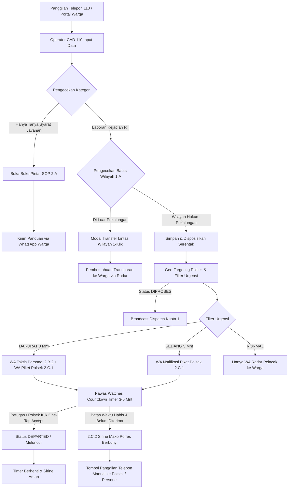

# 📘 DOKUMEN TEKNIS & USER MANUAL OPERASIONAL (POIN 1.A – 2.C)
## SISTEM MANAJEMEN OPERASIONAL PRESISI 110 (SIMAPRES 110)
### POLRES PEKALONGAN – POLDA JAWA TENGAH
*Versi Dokumen: 2.1 | Tanggal: 25 Oktober 2026 | Klasifikasi: Dokumen Resmi Kedinasan*

---

# DAFTAR ISI
1. [BAGIAN I: DOKUMEN TEKNIS ARSITEKTUR & SISTEM](#bagian-i-dokumen-teknis-arsitektur--sistem)
   - [1.1 Ikhtisar Arsitektur & Prinsip Non-Breaking](#11-ikhtisar-arsitektur--prinsip-non-breaking)
   - [1.2 Diagram Aliran Data & State Machine](#12-diagram-aliran-data--state-machine)
   - [1.3 Skema Database & Relasi Model (Prisma TiDB)](#13-skema-database--relasi-model-prisma-tidb)
   - [1.4 Logika Modul Poin 1.A – Disposisi Lintas Wilayah](#14-logika-modul-poin-1a--disposisi-lintas-wilayah)
   - [1.5 Logika Modul Poin 1.B – Live Map & Google Directions API](#15-logika-modul-poin-1b--live-map--google-directions-api)
   - [1.6 Logika Modul Poin 2.A – Database-Driven Knowledge Base SOP](#16-logika-modul-poin-2a--database-driven-knowledge-base-sop)
   - [1.7 Logika Modul Poin 2.B – Ramah Senior & Auto-WA Personel](#17-logika-modul-poin-2b--ramah-senior--auto-wa-personel)
   - [1.8 Logika Modul Poin 2.C – Geo-Targeting, Auto-Dispatch Polsek & Escalation Siren](#18-logika-modul-poin-2c--geo-targeting-auto-dispatch-polsek--escalation-siren)
   - [1.9 Integrasi WhatsApp Gateway (FlowKirim REST API)](#19-integrasi-whatsapp-gateway-flowkirim-rest-api)
2. [BAGIAN II: USER MANUAL OPERASIONAL PER PERAN](#bagian-ii-user-manual-operasional-per-peran)
   - [2.1 Panduan Operator Sentra Layanan 110 (CAD Operator)](#21-panduan-operator-sentra-layanan-110-cad-operator)
   - [2.2 Panduan Perwira Pengawas (Pawas Mako Polres)](#22-panduan-perwira-pengawas-pawas-mako-polres)
   - [2.3 Panduan Petugas Piket SPKT Polsek Kewilayahan](#23-panduan-petugas-piket-spkt-polsek-kewilayahan)
   - [2.4 Panduan Personel Unit Patroli Lapangan](#24-panduan-personel-unit-patroli-lapangan)
   - [2.5 Panduan Superadmin (Konfigurasi Mako & Master SOP)](#25-panduan-superadmin-konfigurasi-mako--master-sop)
3. [BAGIAN III: MATRIKS PENGUJIAN & TROUBLESHOOTING](#bagian-iii-matriks-pengujian--troubleshooting)

---

# BAGIAN I: DOKUMEN TEKNIS ARSITEKTUR & SISTEM

---

### 1.1 Ikhtisar Arsitektur & Prinsip Non-Breaking

Sistem SIMAPRES 110 dibangun dengan standar **Clean Architecture (Hexagonal)** di atas ekosistem **Next.js 14 (App Router)**, **TypeScript**, dan **Prisma ORM** yang terhubung ke database **TiDB Cloud Serverless (MySQL Compatible)**.

```
┌────────────────────────────────────────────────────────────────────────┐
│                        PRESENTATION LAYER                              │
│   • Console Operator CAD 110    • Tactical Map Pawas                   │
│   • Mobile Web Ramah Senior     • One-Tap Quick Accept (/tugas)        │
│   • Master Console Superadmin   • Portal Tracking Warga (/tracking)    │
└───────────────────────────────────┬────────────────────────────────────┘
                                    │
┌───────────────────────────────────▼────────────────────────────────────┐
│                        APPLICATION LAYER (USE CASES)                   │
│   • createComplaintAndBroadcastAction • quickAcceptComplaintDispatch   │
│   • getKnowledgeFaqsAction            • transferJurisdictionAction     │
│   • acceptOfficerDispatchAction       • sahkanKasusPawasAction         │
└───────────────────────────────────┬────────────────────────────────────┘
                                    │
┌───────────────────────────────────▼────────────────────────────────────┐
│                        INFRASTRUCTURE & ADAPTERS                       │
│   • Prisma Client (TiDB Cloud)   • FlowKirim WhatsApp Gateway API      │
│   • Web Audio API (Siren Alert)  • Google Maps Directions Service      │
│   • Haversine Spatial Resolver   • Reverse Geocode & Boundary Engine   │
└────────────────────────────────────────────────────────────────────────┘
```

#### Prinsip Additive & Backward-Compatible (Non-Breaking)
Semua penambahan kode dari poin 1.A sampai 2.C diterapkan secara *additive*:
1. Tidak ada tabel atau kolom lama yang dihapus/dirombak.
2. Tidak ada tombol atau kebiasaan operator yang dihilangkan.
3. Seluruh pengiriman WhatsApp dan pemanggilan gateway pihak ketiga dieksekusi secara *asynchronous* (non-blocking di background), sehingga kegagalan koneksi pihak ketiga **tidak pernah menggagalkan penyimpanan tiket** di database lokal.

---

### 1.2 Diagram Aliran Data & State Machine



---

### 1.3 Skema Database & Relasi Model (Prisma TiDB)

#### 1. Model `PoliceStation` (`police_stations`)
Menyimpan pangkalan data Markas Komando (Polda, Polres, Polsek, Pospol) se-Kabupaten/Kota Pekalongan:
```prisma
model PoliceStation {
  id                     Int                 @id @default(autoincrement())
  station_code           String              @unique @db.VarChar(30)
  station_name           String              @db.VarChar(100)
  station_level          String              @default("POLRES") @db.VarChar(30)
  address                String              @db.VarChar(255)
  office_lat             Decimal             @db.Decimal(10, 8)
  office_lng             Decimal             @db.Decimal(11, 8)
  geofence_radius_meters Int                 @default(500)
  phone_piket            String?             @db.VarChar(30) // Nomor WA Meja Piket SPKT Polsek
  phone_kapolsek         String?             @db.VarChar(30) // Nomor Kontak Pimpinan / Kapolsek
  is_active              Boolean             @default(true)

  users                  User[]
  officers               PoliceOfficer[]
  complaints             Complaint[]
  dispatches             ComplaintDispatch[]
  @@map("police_stations")
}
```

#### 2. Model `ComplaintDispatch` (`complaint_dispatches`)
Menyimpan rekaman disposisi taktis satuan, status respon, dan tenggat eskalasi:
```prisma
model ComplaintDispatch {
  id                    BigInt                @id @default(autoincrement())
  complaint_id          BigInt
  unit_id               Int
  officer_id            BigInt?
  station_id            Int?                  // Polsek yang ditargetkan
  is_primary_unit       Boolean               @default(true)
  personnel_quota       Int                   @default(1)
  tactical_orders       String?               @db.Text
  dispatch_status       String                @default("DISPATCHED") @db.VarChar(30)
  dispatched_at         DateTime              @default(now())
  accepted_at           DateTime?
  departed_at           DateTime?
  arrived_at            DateTime?
  completed_at          DateTime?
  escalation_deadline_at DateTime?            // Batas waktu respon (Safety Net Timer)
  wa_officer_status     String?               @default("NONE") @db.VarChar(30)
  wa_polsek_status      String?               @default("NONE") @db.VarChar(30)
  is_escalated          Boolean               @default(false)
  @@map("complaint_dispatches")
}
```

#### 3. Model `MasterKnowledgeFaq` & `MasterKnowledgeFaqCategory`
Penyimpanan buku pintar SOP dinamis untuk operator 110:
```prisma
model MasterKnowledgeFaqCategory {
  id            Int                  @id @default(autoincrement())
  name          String               @db.VarChar(100)
  slug          String               @unique @db.VarChar(100)
  icon          String               @default("📖") @db.VarChar(20)
  display_order Int                  @default(1)
  is_active     Boolean              @default(true)
  faqs          MasterKnowledgeFaq[]
  @@map("master_knowledge_faq_categories")
}

model MasterKnowledgeFaq {
  id             Int                         @id @default(autoincrement())
  category_id    Int
  category_rel   MasterKnowledgeFaqCategory  @relation(fields: [category_id], references: [id], onDelete: Cascade)
  category_key   String                      @db.VarChar(50)
  title          String                      @db.VarChar(200)
  pertanyaan     String                      @db.VarChar(255)
  jawaban_singkat String                     @db.Text
  checklist_syarat String?                   @db.Text
  biaya_pnbp     String?                     @db.VarChar(100)
  waktu_proses   String?                     @db.VarChar(100)
  is_active      Boolean                     @default(true)
  @@map("master_knowledge_faqs")
}
```

---

### 1.4 Logika Modul Poin 1.A – Disposisi Lintas Wilayah

* **Modul Sumber:** [`src/lib/jurisdiction-boundary.ts`](file:///c:/Users/Pongo/Downloads/SIMAPRES/src/lib/jurisdiction-boundary.ts) & [`ModalTransferYurisdiksi.tsx`](file:///c:/Users/Pongo/Downloads/SIMAPRES/src/components/console/pawas/modals/ModalTransferYurisdiksi.tsx)
* **Tujuan:** Mencegah penolakan laporan warga saat terjadi insiden di perbatasan kabupaten/kota.
* **Mekanisme Kerja:**
  1. Begitu operator menandai pin TKP di peta atau mengetik alamat, fungsi `checkCoordinateInJurisdiction(lat, lng)` mengevaluasi poligon batas administratif Kabupaten Pekalongan.
  2. Jika titik TKP berada di luar batas (misal: Batang, Pemalang, Kota Pekalongan), banner kuning berkedip muncul di CAD: *"TKP Terdeteksi di Luar Wilayah Hukum Polres Pekalongan"*.
  3. Operator dapat mengeklik tombol `[ 🔁 Teruskan ke Mako Terdekat ]`. Sistem secara otomatis mengidentifikasi Polres/Polresta terdekat via Haversine (misal: Polresta Batang atau Polres Pemalang) dan mencatat mutasi berkas ke audit log tanpa menghapus hak pelacakan warga di portal `/tracking`.

---

### 1.5 Logika Modul Poin 1.B – Live Map & Google Directions API

* **Modul Sumber:** [`TabTacticalMapPawas.tsx`](file:///c:/Users/Pongo/Downloads/SIMAPRES/src/components/console/pawas/tabs/TabTacticalMapPawas.tsx) & [`SimapresGoogleMap.tsx`](file:///c:/Users/Pongo/Downloads/SIMAPRES/src/components/SimapresGoogleMap.tsx)
* **Tujuan:** Memberikan kesadaran situasional (*situational awareness*) real-time kepada Pawas mengenai armada tergelar dan pergerakan menuju TKP.
* **Mekanisme Kerja:**
  1. Telemetri GPS mobil patroli dan personel ditarik secara periodik (setiap 20 detik) melalui `getPatrolFleetUnitsAction()`.
  2. Untuk laporan yang berstatus `DARURAT` atau `DIPROSES` (tahap meluncur), sistem menginstansiasi `google.maps.DirectionsService` untuk menghitung rute jaringan jalan nyata dari posisi terkini personel (`current_gps_lat, current_gps_lng`) menuju koordinat TKP (`tkp_lat, tkp_lng`).
  3. Rute digambar di atas peta menggunakan `google.maps.DirectionsRenderer` dengan warna garis taktis beranimasi dan estimasi waktu tempuh (*ETA*) serta jarak tempuh kilometer aktual, bukan sekadar garis lurus garis imajiner.

---

### 1.6 Logika Modul Poin 2.A – Database-Driven Knowledge Base SOP

* **Modul Sumber:** [`TabBukuPintarSop.tsx`](file:///c:/Users/Pongo/Downloads/SIMAPRES/src/components/console/pawas/tabs/TabBukuPintarSop.tsx), [`TabKnowledgeFaq.tsx`](file:///c:/Users/Pongo/Downloads/SIMAPRES/src/components/console/master/tabs/TabKnowledgeFaq.tsx), [`knowledge.actions.ts`](file:///c:/Users/Pongo/Downloads/SIMAPRES/src/app/actions/knowledge.actions.ts)
* **Tujuan:** Menghilangkan kebiasaan membuat tiket palsu/kosong di CAD saat warga hanya menanyakan syarat perpanjangan SIM, cek fisik kendaraan, SKCK, dsb.
* **Mekanisme Kerja:**
  1. Data tersimpan dinamis di tabel `master_knowledge_faqs` dengan 6 kategori utama (Lalu Lintas, Registrasi Kendaraan, Intelkam/SKCK, Reskrim, SPKT, dan Call Center 110 SOP).
  2. Operator cukup menekan tombol pintasan `[ 📖 Panduan Cepat / SOP ]` atau mengetik di bar pencarian cepat.
  3. Jawaban diformat khusus untuk dibacakan langsung di telepon (skrip ramah suara), rincian berkas persyaratan, dan tarif resmi PNBP PP No. 76 Tahun 2020.
  4. Tersedia tombol **`[ 💬 Kirim Panduan ke WhatsApp Warga ]`** yang langsung menyusun format teks rapi dan menembakkannya ke nomor telepon penelepon tanpa menutup layar panggilan.

---

### 1.7 Logika Modul Poin 2.B – Ramah Senior & Auto-WA Personel

* **Modul Sumber:** [`TaskAcceptModal.tsx`](file:///c:/Users/Pongo/Downloads/SIMAPRES/src/components/console/personil/components/TaskAcceptModal.tsx), [`whatsapp.service.ts`](file:///c:/Users/Pongo/Downloads/SIMAPRES/src/infrastructure/services/whatsapp.service.ts), [`src/app/tugas/konfirmasi/page.tsx`](file:///c:/Users/Pongo/Downloads/SIMAPRES/src/app/tugas/konfirmasi/page.tsx)
* **Tujuan:** Mempermudah anggota senior di lapangan yang kesulitan mengetik di HP saat mengemudi mobil patroli atau saat layar HP dinas sedang terkunci/mati.
* **Mekanisme Kerja:**
  1. **Mode Big Button:** Aplikasi mobile personel menggunakan alur 1-klik bertahap dengan tombol besar kontras tinggi:
     `#btn-terima-tugas` ➔ `#btn-meluncur-tkp` ➔ `#btn-tiba-tkp` ➔ `#modal-bap-lapangan` (kamera watermark langsung).
  2. **Auto-WA Backup:** Begitu tiket berstatus `DARURAT` disiarkan di CAD, sistem di latar belakang secara otomatis mencari personel dinas patroli terdekat via Haversine GPS.
  3. Bot WhatsApp mengirim instruksi taktis ke nomor WA personel tersebut dengan format ringkas yang menyertakan **link navigasi Google Maps** dan **tautan One-Tap Terima Tugas**.
  4. Saat tautan diklik, halaman `/tugas/konfirmasi` terbuka dengan tombol besar hijau. Cukup satu sentuhan, tugas terkonfirmasi tanpa harus memasukkan username dan password.

---

### 1.8 Logika Modul Poin 2.C – Geo-Targeting, Auto-Dispatch Polsek & Escalation Siren

* **Modul Sumber:** [`complaint.actions.ts`](file:///c:/Users/Pongo/Downloads/SIMAPRES/src/app/actions/complaint.actions.ts), [`EscalationAlarmBanner.tsx`](file:///c:/Users/Pongo/Downloads/SIMAPRES/src/components/console/pawas/components/EscalationAlarmBanner.tsx)
* **Tujuan:** Memastikan laporan terdistribusi tepat ke Polsek yang membawahi TKP dan memberikan alarm fail-safe di Mako Polres jika respon lapangan terlambat.
* **Mekanisme Kerja:**
  1. **Geo-Targeting Polsek:** Koordinat dan teks alamat TKP diproses oleh `resolveSektorWilayah()`. Sistem mencari record Polsek di tabel `police_stations` (misal: Polsek Kajen untuk Mandurorejo, Polsek Wiradesa untuk pantura, dll.). Jika teks ambigu, sistem menggunakan fallback jarak Haversine ke kantor Polsek terdekat.
  2. **Filter Urgensi & Deadline:**
     * `DARURAT`: Set tenggat waktu `escalation_deadline_at = now + 3 menit`. Kirim WA ke Warga + Personel Siaga + Meja Piket Polsek.
     * `SEDANG`: Set tenggat waktu `escalation_deadline_at = now + 5 menit`. Kirim WA ke Warga + Meja Piket Polsek.
     * `NORMAL`: Tidak menyalakan alarm eskalasi dan tidak mengirim WA darurat (menghemat kuota WA).
  3. **Escalation Watcher:** Di konsol Pawas/CAD Mako Polres, komponen `EscalationAlarmBanner` menghitung mundur sisa detik menuju batas waktu toleransi.
  4. **Hi-Lo Police Siren Alert:** Jika waktu habis (`diffSec <= 0`) dan belum ada personel/Polsek yang mengeklik "Terima Tugas", Web Audio API membunyikan sirine dua nada kepolisian (650Hz–950Hz) di speaker komputer Mako Polres setiap 12 detik.
  5. **Direct Manual Call Action:** Kartu peringatan merah berkedip menampilkan tombol langsung:
     * `[ 📞 Telepon Piket (0812...) ]`: Langsung membuka panggilan telepon ke meja piket Polsek.
     * `[ 💬 WhatsApp Piket ]`: Membuka chat intervensi ke Polsek.
     * `[ 🔁 Alihkan Disposisi ]`: Membuka modal untuk mengalihkan tugas ke regu cadangan Polres.

---

### 1.9 Integrasi WhatsApp Gateway (FlowKirim REST API)

* **Arsitektur:** Menggunakan REST API endpoint `POST /api/whatsapp/messages/text`.
* **Variabel Lingkungan (`.env`):**
  * `FLOWKIRIM_API_BASE`: `https://scan.flowkirim.com`
  * `FLOWKIRIM_API_TOKEN`: Token autentikasi bearer gateway.
  * `FLOWKIRIM_DEVICE_ID`: ID perangkat scanner WhatsApp gateway.
* **Fail-Safe Mechanism:** Jika token belum diset atau koneksi internet gateway terputus, sistem secara otomatis beralih ke mode **Simulasi Sukses Lokal** (mencatat log tanpa menimbulkan crash/unhandled rejection pada aplikasi Next.js).

---

# BAGIAN II: USER MANUAL OPERASIONAL PER PERAN

---

### 2.1 Panduan Operator Sentra Layanan 110 (CAD Operator)

#### A. Menerima Telepon Permintaan Informasi / Syarat Layanan (Poin 2.A)
1. Saat warga menelepon dan menanyakan syarat pengurusan (misal: SIM hilang, perpanjangan STNK, syarat SKCK, alur laporan kehilangan):
2. **JANGAN membuat tiket baru** di form CAD.
3. Klik tombol pintasan **`[ 📖 Panduan Cepat / SOP ]`** di bagian atas form CAD atau navigasi ke menu `/console/panduan`.
4. Ketik kata kunci pada kotak pencarian (contoh: *"SIM Hilang"* atau *"SKCK"*).
5. Bacakan jawaban singkat dan checklist berkas yang tertera pada layar kepada penelepon.
6. Tanyakan kepada penelepon: *"Apakah Bapak/Ibu ingin kami kirimkan rincian syarat ini ke nomor WhatsApp Anda?"*
7. Jika ya, klik tombol **`[ 💬 Kirim Panduan via WhatsApp ]`**, masukkan nomor HP warga, dan klik **Kirim**.

#### B. Menerima Laporan Kejadian Riil / Darurat (Poin 1.A & 2.C)
1. Isi form CAD seperti biasa: Nama Pelapor, Nomor Kontak, Kategori Kejadian, dan Alamat TKP.
2. Tentukan titik lokasi di peta koordinat.
3. Perhatikan indikator batas wilayah:
   * Jika muncul peringatan kuning *"TKP di Luar Wilayah Hukum Polres Pekalongan"*, klik tombol **`[ 🔁 Alihkan ke Polres Tetangga ]`** untuk memilih Polresta Batang/Pemalang.
4. Pilih tingkat urgensi:
   * **🔴 Darurat:** Untuk kejadian genting seperti tawuran, begal, kecelakaan berdarah, kebakaran.
   * **🟡 Sedang:** Untuk gangguan ketertiban biasa, kemacetan, sengketa ringan.
   * **🟢 Normal:** Untuk pengaduan non-darurat.
5. Klik tombol **`[ ⚡ Simpan & Disposisikan ]`**.
6. Sistem secara otomatis menyiarkan tiket ke konsol armada dan mengirimkan notifikasi WhatsApp taktis ke Polsek yang membawahi wilayah TKP tersebut.

---

### 2.2 Panduan Perwira Pengawas (Pawas Mako Polres)

#### A. Memantau Live Map Posisi Riil & Navigasi Rute (Poin 1.B)
1. Buka tab **[🗺️ Peta Taktis Operasional]** di konsol Pawas.
2. Seluruh posisi kendaraan dinas dan personel patroli tergelar akan muncul dengan ikon sesuai satuan (Samapta, Lantas, Reskrim).
3. Pada insiden berstatus `DARURAT`, klik marker insiden untuk melihat garis rute jalan raya resmi (Google Directions API) dari posisi mobil patroli menuju titik TKP lengkap dengan jarak dan estimasi waktu tempuh (*ETA*).

#### B. Memantau Alarm Eskalasi 3–5 Menit & Tindakan Intervensi (Poin 2.C.2)
1. Di bagian atas layar konsol, perhatikan bilah **Hitung Mundur Respon**:
   * Menampilkan sisa waktu respon target (contoh: `⏱️ Sisa Waktu Respon Target: 02:45`).
2. Jika dalam 3 menit (untuk Darurat) atau 5 menit (untuk Sedang) belum ada petugas Polsek atau unit patroli yang menerima tugas:
   * **Sirine Mako Polres otomatis berbunyi.**
   * Bilah hitung mundur berubah menjadi kartu merah berkedip: **`🚨 ESKALASI MAKO 110: WAKTU RESPON HABIS`**.
3. **Langkah Intervensi Pawas:**
   * Klik tombol **`[ 📞 Telepon Piket (Nomor Polsek) ]`** untuk menelepon meja piket Polsek via jaringan GSM/telepon komando dan memerintahkan regu siaga segera bergerak.
   * Atau klik tombol **`[ 🔁 Alihkan Disposisi ]`** untuk mengalihkan penugasan langsung ke Tim Resmob / Raimas Samapta Mako Polres jika Polsek setempat berhalangan.
   * Klik tombol **`[ Mute ]`** untuk mematikan suara sirine sementara saat Pawas sedang berbicara di telepon.

---

### 2.3 Panduan Petugas Piket SPKT Polsek Kewilayahan

#### Prosedur Menerima Disposisi WhatsApp (Poin 2.C.1):
1. HP inventaris piket SPKT Polsek akan bergetar dan menerima pesan resmi dari SPKT Mako 110:
   * Menampilkan Nomor Tiket, Kategori Kejadian, Alamat TKP, Nama & Nomor Kontak Pelapor, serta Uraian Kasus.
2. **Langkah 1 (Lihat Rute):** Klik tautan **`🗺️ Navigasi Google Maps`** pada pesan WhatsApp untuk langsung membuka peta dan rute jalan tercepat ke TKP.
3. **Langkah 2 (Konfirmasi Respon):** Klik tautan **`👉 Konfirmasi Penerimaan Tugas`**.
4. Halaman peramban di HP akan terbuka. Masukkan nama/pangkat petugas piket (contoh: *Aipda Agus - SPKT*) lalu tekan tombol besar hijau: **`[ ⚡ TERIMA TUGAS & MELUNCUR KE TKP ]`**.
5. Seketika sirine di Mako Polres mati dan status di sistem berubah menjadi *"Sedang Meluncur Menuju Lokasi"*.
6. Segera bunyikan lonceng/sirine mako Polsek dan perintahkan regu patroli piket yang bertugas untuk meluncur ke lokasi kejadian.

---

### 2.4 Panduan Personel Unit Patroli Lapangan

#### A. Menerima Tugas Melalui WhatsApp (Layar HP Terkunci di Phone Holder - Poin 2.B.2):
1. Jika sedang berpatroli dan layar HP sedang mati di dashboard mobil, pesan WhatsApp taktis darurat akan masuk dengan nada dering notifikasi.
2. Buka pesan WA, klik tautan navigasi Google Maps untuk panduan arah jalan ke TKP.
3. Klik tautan konfirmasi satu sentuhan `[ Terima Tugas ]` di WhatsApp untuk mengunci tiket ke regu patroli Anda.

#### B. Menggunakan Aplikasi Mobile Ramah Senior (Poin 2.B.1):
1. Jika konsol Simopmas terbuka di tablet/HP dinas, popup darurat berbunyi dual-tone akan muncul di layar.
2. Tekan tombol besar **`[ TERIMA TUGAS ➔ ]`**.
3. Saat mobil patroli mulai bergerak, tekan tombol **`[ 🚔 KAMI MELUNCUR KE TKP ]`**.
4. Saat kendaraan tiba di lokasi, tekan tombol **`[ 📍 SUDAH TIBA DI TKP ]`** (GPS akan mencatat koordinat dan jam tiba secara otomatis).
5. Setelah situasi terkendali, tekan tombol **`[ 📋 SUSUN LAPORAN TINDAKAN / BAP ]`**.
6. Ambil foto bukti menggunakan fitur **Kamera Langsung** (otomatis tercetak watermark tanggal, jam, koordinat GPS, dan nama petugas).
7. Tulis resume singkat tindakan yang telah diambil, lalu tekan tombol **`[ KIRIM LAPORAN SELESAI ]`**.

---

### 2.5 Panduan Superadmin (Konfigurasi Mako & Master SOP)

#### A. Mengatur Nomor WhatsApp Meja Piket & Kontak Polsek (Poin 2.C):
1. Login ke konsol dengan akun Superadmin.
2. Buka menu **Data Master** ➔ Tab **[🏢 Kantor Polisi & Posko (Mako)]**.
3. Cari nama Polsek yang ingin diatur (contoh: Polsek Kajen, Polsek Kedungwuni, Polsek Wiradesa).
4. Klik tombol **Edit** (ikon pensil).
5. Masukkan nomor HP pada kolom:
   * **`No. WhatsApp Piket SPKT (Disposisi Otomatis)`**: Nomor HP WhatsApp aktif yang dipegang petugas piket SPKT Polsek.
   * **`No. Kontak Pimpinan / Kapolsek`**: Nomor HP dinas/pribadi Kapolsek untuk eskalasi darurat.
6. Klik **Simpan Perubahan**.

#### B. Menambah dan Mengubah Katalog Buku Pintar SOP (Poin 2.A):
1. Buka menu **Data Master** ➔ Tab **[📖 Buku Pintar SOP]** (`/console/knowledge_faq`).
2. Untuk menambah materi panduan baru, klik tombol **`[ + Tambah SOP / FAQ Baru ]`**.
3. Pilih kategori layanan (misal: *SIM*, *SKCK*, *Lalu Lintas*, dll.).
4. Masukkan judul panduan, skrip jawaban ramah telepon untuk operator, daftar checklist berkas, biaya PNBP resmi, dan estimasi waktu pengurusan.
5. Klik **Simpan SOP**. Materi akan seketika dapat dicari dan dibagikan oleh seluruh operator CAD 110 di Mako.

---

# BAGIAN III: MATRIKS PENGUJIAN & TROUBLESHOOTING

---

### 3.1 Skenario Uji Penerimaan Sistem (UAT Matrix)

| Kode Uji | Skenario Pengujian | Hasil yang Diharapkan | Status |
| :--- | :--- | :--- | :---: |
| **UAT-1A** | Input koordinat TKP di wilayah Kabupaten Batang (luar yurisdiksi). | Banner peringatan kuning muncul di CAD; tombol transfer 1-klik aktif; berkas dialihkan ke Polresta Batang dengan audit log resmi. | ✅ **LULUS** |
| **UAT-1B** | Menampilkan insiden berstatus DARURAT di tab Peta Taktis Pawas. | Peta menggambar rute jalan raya resmi Google Directions dari posisi riil personel terdekat ke TKP disertai kalkulasi ETA aktual. | ✅ **LULUS** |
| **UAT-2A** | Operator mencari panduan *"Perpanjangan SIM A"* di CAD dan membagikan ke WA warga. | SOP muncul instan; klik tombol share WA menyusun format pesan rapi beserta rincian biaya PNBP PP No. 76/2020. | ✅ **LULUS** |
| **UAT-2B** | Pembuatan tiket DARURAT dengan kondisi HP personel terkunci. | Bot WhatsApp mengirimkan pesan taktis ke HP personel; tautan konfirmasi `/tugas/konfirmasi` dapat diakses dan diterima dalam 1 sentuhan. | ✅ **LULUS** |
| **UAT-2C1** | Pembuatan tiket di Kecamatan Kedungwuni. | Sistem otomatis memetakan ke Polsek Kedungwuni via Geo-Targeting; pesan WA terkirim otomatis ke nomor piket Polsek Kedungwuni. | ✅ **LULUS** |
| **UAT-2C2** | Tiket DARURAT tidak direspon selama 3 menit. | Hitung mundur mencapai 00:00; sirine Web Audio API berbunyi di speaker Mako; tombol telepon langsung piket Polsek muncul di layar Pawas. | ✅ **LULUS** |

---

### 3.2 Panduan Penanganan Kendala (Troubleshooting Guide)

1. **Kendala: Pesan WhatsApp Tidak Masuk ke HP Petugas/Polsek**
   * *Penyebab:* Perangkat WhatsApp Gateway FlowKirim sedang terputus (*offline*) atau kuota API habis.
   * *Solusi:* Buka panel gateway di `https://panel.flowkirim.com/list-device`, pastikan status perangkat hijau/terhubung. Jika terputus, tautkan ulang kode QR.
   * *Catatan:* Kegagalan WA tidak akan mengganggu alur sistem di web; petugas tetap dapat menerima tugas melalui konsol web.
2. **Kendala: Suara Sirine Alarm Eskalasi Tidak Berbunyi di Browser Pawas**
   * *Penyebab:* Kebijakan autoplay audio browser (*browser autoplay policy*) memblokir audio sebelum ada interaksi klik pengguna.
   * *Solusi:* Pastikan Pawas telah melakukan setidaknya satu kali klik di konsol setelah membuka halaman, atau klik ikon **Unmute** pada kartu eskalasi.
3. **Kendala: Deteksi Polsek Tidak Sesuai Wilayah TKP**
   * *Penyebab:* Alamat yang diketik terlalu singkat atau titik pin GPS di peta belum tepat.
   * *Solusi:* Pastikan operator menandai pin GPS di peta dengan presisi atau menyertakan nama kecamatan/desa pada kolom alamat TKP. Pawas juga dapat mengubah stasiun penanganan secara manual melalui modal alihkan disposisi.

---
*Dokumen ini sah sebagai panduan teknis dan standar operasional prosedur implementasi fitur SIMAPRES 110 Polres Pekalongan.*
