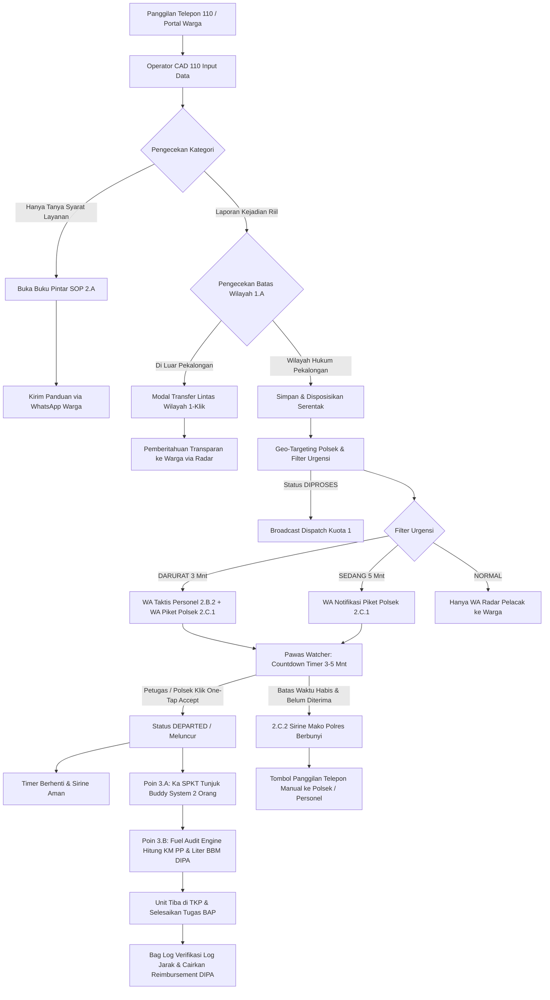

# 📘 DOKUMEN TEKNIS & USER MANUAL OPERASIONAL (POIN 1.A – 3.B)
## SISTEM MANAJEMEN OPERASIONAL PRESISI 110 (SIMAPRES 110)
### POLRES PEKALONGAN – POLDA JAWA TENGAH
*Versi Dokumen: 2.2 | Tanggal: 25 Oktober 2026 | Klasifikasi: Dokumen Resmi Kedinasan*

---

# DAFTAR ISI
1. [BAGIAN I: DOKUMEN TEKNIS ARSITEKTUR & SISTEM](#bagian-i-dokumen-teknis-arsitektur--sistem)
   - [1.1 Ikhtisar Arsitektur & Prinsip Non-Breaking](#11-ikhtisar-arsitektur--prinsip-non-breaking)
   - [1.2 Diagram Aliran Data & State Machine](#12-diagram-aliran-data--state-machine)
   - [1.3 Skema Database & Relasi Model (Prisma TiDB)](#13-skema-database--relasi-model-prisma-tidb)
   - [1.4 Logika Modul Poin 1.A – Disposisi Lintas Wilayah](#14-logika-modul-poin-1a--disposisi-lintas-wilayah)
   - [1.5 Logika Modul Poin 1.B – Live Map & Google Directions API](#15-logika-modul-poin-1b--live-map--google-directions-api)
   - [1.6 Logika Modul Poin 2.A – Database-Driven Knowledge Base SOP](#16-logika-modul-poin-2a--database-driven-knowledge-base-sop)
   - [1.7 Logika Modul Poin 2.B – Ramah Senior & Auto-WA Personel](#17-logika-modul-poin-2b--ramah-senior--auto-wa-personel)
   - [1.8 Logika Modul Poin 2.C – Geo-Targeting, Auto-Dispatch Polsek & Escalation Siren](#18-logika-modul-poin-2c--geo-targeting-auto-dispatch-polsek--escalation-siren)
   - [1.9 Integrasi WhatsApp Gateway (FlowKirim REST API)](#19-integrasi-whatsapp-gateway-flowkirim-rest-api)
   - [1.10 Logika Modul Poin 3.A – Alokasi Personel Polsek Minimalis & Buddy System](#110-logika-modul-poin-3a--alokasi-personel-polsek-minimalis--buddy-system)
   - [1.11 Logika Modul Poin 3.B – Audit Jarak Jalan Raya & Log Reimbursement BBM DIPA](#111-logika-modul-poin-3b--audit-jarak-jalan-raya--log-reimbursement-bbm-dipa)
2. [BAGIAN II: USER MANUAL OPERASIONAL PER PERAN](#bagian-ii-user-manual-operasional-per-peran)
   - [2.1 Panduan Operator Sentra Layanan 110 (CAD Operator)](#21-panduan-operator-sentra-layanan-110-cad-operator)
   - [2.2 Panduan Perwira Pengawas (Pawas Mako Polres)](#22-panduan-perwira-pengawas-pawas-mako-polres)
   - [2.3 Panduan Petugas Piket SPKT Polsek Kewilayahan](#23-panduan-petugas-piket-spkt-polsek-kewilayahan)
   - [2.4 Panduan Personel Unit Patroli Lapangan](#24-panduan-personel-unit-patroli-lapangan)
   - [2.5 Panduan Superadmin (Konfigurasi Mako, Master SOP & Master BBM)](#25-panduan-superadmin-konfigurasi-mako-master-sop--master-bbm)
   - [2.6 Panduan Bagian Logistik (Bag Log) & Keuangan Polres (Audit & Pencairan BBM DIPA)](#26-panduan-bagian-logistik-bag-log--keuangan-polres-audit--pencairan-bbm-dipa)
3. [BAGIAN III: MATRIKS PENGUJIAN & TROUBLESHOOTING](#bagian-iii-matriks-pengujian--troubleshooting)
   - [3.1 Skenario Uji Penerimaan Sistem (UAT Matrix)](#31-skenario-uji-penerimaan-sistem-uat-matrix)
   - [3.2 Panduan Penanganan Kendala (Troubleshooting Guide)](#32-panduan-penanganan-kendala-troubleshooting-guide)

---

# BAGIAN I: DOKUMEN TEKNIS ARSITEKTUR & SISTEM

---

### 1.1 Ikhtisar Arsitektur & Prinsip Non-Breaking

Sistem SIMAPRES 110 dibangun dengan standar **Clean Architecture (Hexagonal)** di atas ekosistem **Next.js 14 (App Router)**, **TypeScript**, dan **Prisma ORM** yang terhubung ke database **TiDB Cloud Serverless (MySQL Compatible)**.

```
┌────────────────────────────────────────────────────────────────────────┐
│                        PRESENTATION LAYER                              │
│   • Console Operator CAD 110    • Tactical Map Pawas                   │
│   • Mobile Web Ramah Senior     • One-Tap Quick Accept (/tugas)        │
│   • Master Console Superadmin   • Portal Tracking Warga (/tracking)    │
│   • Console Audit BBM Bag Log   • Validasi Dossier Pawas               │
└───────────────────────────────────┬────────────────────────────────────┘
                                    │
┌───────────────────────────────────▼────────────────────────────────────┐
│                        APPLICATION LAYER (USE CASES)                   │
│   • createComplaintAndBroadcastAction • quickAcceptComplaintDispatch   │
│   • getKnowledgeFaqsAction            • transferJurisdictionAction     │
│   • acceptOfficerDispatchAction       • sahkanKasusPawasAction         │
│   • getFuelAuditReportAction          • calculateDispatchFuelUsage     │
└───────────────────────────────────┬────────────────────────────────────┘
                                    │
┌───────────────────────────────────▼────────────────────────────────────┐
│                        INFRASTRUCTURE & ADAPTERS                       │
│   • Prisma Client (TiDB Cloud)   • FlowKirim WhatsApp Gateway API      │
│   • Web Audio API (Siren Alert)  • Google Maps Directions Service      │
│   • Haversine Spatial Resolver   • Reverse Geocode & Boundary Engine   │
│   • Fuel Audit Engine (DIPA)     • Road Network Tortuosity Calculator  │
└────────────────────────────────────────────────────────────────────────┘
```

#### Prinsip Additive & Zero-Hardcode (Non-Breaking)
Semua penambahan kode dari poin 1.A sampai 3.B diterapkan dengan prinsip kepatuhan ketat:
1. **Additive & Non-Breaking:** Tidak ada tabel, fungsi, atau alur lama yang dirusak atau dihapus. Semua fitur baru memperluas fungsionalitas yang sudah ada.
2. **Zero-Hardcode Database-Driven:** Seluruh variabel dinas—termasuk jenis bahan bakar (`master_fuel_types`), alur verifikasi klaim (`master_fuel_claim_statuses`), peran regu patroli (`master_patrol_crew_roles`), dan moda penugasan (`master_dispatch_modes`)—dikelola melalui tabel database mandiri dan dapat dikonfigurasi melalui antarmuka Superadmin tanpa perlu mengubah kode sumber (*redeploy*).
3. **Fail-Safe & Asynchronous:** Seluruh pengiriman WhatsApp dan integrasi API luar dijalankan secara non-blocking di latar belakang. Gangguan pada gateway luar tidak pernah menggagalkan penyimpanan tiket lokal.

---

### 1.2 Diagram Aliran Data & State Machine



---

### 1.3 Skema Database & Relasi Model (Prisma TiDB)

#### 1. Model `PoliceStation` (`police_stations`)
Menyimpan pangkalan data Markas Komando (Polda, Polres, Polsek, Pospol) se-Kabupaten/Kota Pekalongan:
```prisma
model PoliceStation {
  id                     Int                 @id @default(autoincrement())
  station_code           String              @unique @db.VarChar(30)
  station_name           String              @db.VarChar(100)
  station_level          String              @default("POLRES") @db.VarChar(30)
  address                String              @db.VarChar(255)
  office_lat             Decimal             @db.Decimal(10, 8)
  office_lng             Decimal             @db.Decimal(11, 8)
  geofence_radius_meters Int                 @default(500)
  phone_piket            String?             @db.VarChar(30) // Nomor WA Meja Piket SPKT Polsek
  phone_kapolsek         String?             @db.VarChar(30) // Nomor Kontak Pimpinan / Kapolsek
  is_active              Boolean             @default(true)

  users                  User[]
  officers               PoliceOfficer[]
  complaints             Complaint[]
  dispatches             ComplaintDispatch[]
  patrol_vehicles        PatrolVehicle[]
  @@map("police_stations")
}
```

#### 2. Model `MasterFuelType` & `MasterFuelClaimStatus` (Poin 3.B - 100% Anti-Hardcode)
```prisma
model MasterFuelType {
  id                     Int             @id @default(autoincrement())
  key                    String          @unique @db.VarChar(30)
  label                  String          @db.VarChar(100)
  default_price_per_liter Decimal        @default(10000.00) @db.Decimal(10, 2)
  icon_emoji             String          @default("⛽") @db.VarChar(10)
  display_order          Int             @default(1)
  is_active              Boolean         @default(true)
  created_at             DateTime        @default(now())
  updated_at             DateTime        @updatedAt

  vehicles               PatrolVehicle[]
  @@map("master_fuel_types")
}

model MasterFuelClaimStatus {
  id            Int                 @id @default(autoincrement())
  key           String              @unique @db.VarChar(30)
  label         String              @db.VarChar(100)
  badge_color   String              @default("#64748b") @db.VarChar(30)
  badge_bg      String              @default("#f1f5f9") @db.VarChar(30)
  keterangan    String?             @db.VarChar(255)
  display_order Int                 @default(1)
  is_active     Boolean             @default(true)
  created_at    DateTime            @default(now())
  updated_at    DateTime            @updatedAt

  dispatches    ComplaintDispatch[]
  @@map("master_fuel_claim_statuses")
}
```

#### 3. Model `MasterPatrolCrewRole` & `MasterDispatchMode` (Poin 3.A)
```prisma
model MasterPatrolCrewRole {
  id            Int      @id @default(autoincrement())
  key           String   @unique @db.VarChar(30)
  label         String   @db.VarChar(100)
  description   String?  @db.VarChar(255)
  display_order Int      @default(1)
  is_active     Boolean  @default(true)
  created_at    DateTime @default(now())
  updated_at    DateTime @updatedAt

  @@map("master_patrol_crew_roles")
}

model MasterDispatchMode {
  id            Int                 @id @default(autoincrement())
  key           String              @unique @db.VarChar(30)
  label         String              @db.VarChar(100)
  description   String?             @db.VarChar(255)
  display_order Int                 @default(1)
  is_active     Boolean             @default(true)
  created_at    DateTime            @default(now())
  updated_at    DateTime            @updatedAt

  dispatches    ComplaintDispatch[]
  @@map("master_dispatch_modes")
}
```

#### 4. Relasi Armada & Disposisi (`PatrolVehicle` & `ComplaintDispatch`)
```prisma
model PatrolVehicle {
  id                      Int                 @id @default(autoincrement())
  station_id              Int
  vehicle_type            String              @db.VarChar(30) // MOBIL_PATROLI_R4, MOTOR_PATROLI_R2
  police_plate_number     String              @unique @db.VarChar(20)
  callsign                String              @db.VarChar(50)
  fuel_type_id            Int?                // FK ke master_fuel_types
  fuel_type_rel           MasterFuelType?     @relation(fields: [fuel_type_id], references: [id])
  fuel_ratio_km_per_liter Decimal             @default(8.0) @db.Decimal(5, 2)
  is_active               Boolean             @default(true)
  dispatches              ComplaintDispatch[]
  @@map("patrol_vehicles")
}

model ComplaintDispatch {
  id                     BigInt                 @id @default(autoincrement())
  complaint_id           BigInt
  unit_id                Int
  officer_id             BigInt?
  station_id             Int?
  dispatch_mode_id       Int?                   // FK ke master_dispatch_modes (Poin 3.A)
  dispatch_mode_rel      MasterDispatchMode?    @relation(fields: [dispatch_mode_id], references: [id])
  assigned_vehicle_id    Int?                   // FK ke patrol_vehicles (Poin 3.B)
  assigned_vehicle_rel   PatrolVehicle?         @relation(fields: [assigned_vehicle_id], references: [id])
  crew_leader_nrp        String?                @db.VarChar(30)
  crew_leader_name       String?                @db.VarChar(100)
  crew_partner_nrp       String?                @db.VarChar(30)
  crew_partner_name      String?                @db.VarChar(100)
  mako_start_lat         Decimal?               @db.Decimal(10, 8)
  mako_start_lng         Decimal?               @db.Decimal(11, 8)
  round_trip_km          Decimal?               @db.Decimal(8, 2)
  fuel_liters_used       Decimal?               @db.Decimal(8, 2)
  fuel_cost_estimated    Decimal?               @db.Decimal(12, 2)
  fuel_claim_status_id   Int?                   // FK ke master_fuel_claim_statuses (Poin 3.B)
  fuel_claim_status_rel  MasterFuelClaimStatus? @relation(fields: [fuel_claim_status_id], references: [id])
  fuel_claim_notes       String?                @db.VarChar(255)
  escalation_deadline_at DateTime?
  @@map("complaint_dispatches")
}
```

---

### 1.4 Logika Modul Poin 1.A – Disposisi Lintas Wilayah

* **Modul Sumber:** [`src/lib/jurisdiction-boundary.ts`](file:///c:/Users/Pongo/Downloads/SIMAPRES/src/lib/jurisdiction-boundary.ts) & [`ModalTransferYurisdiksi.tsx`](file:///c:/Users/Pongo/Downloads/SIMAPRES/src/components/console/pawas/modals/ModalTransferYurisdiksi.tsx)
* **Tujuan:** Mencegah penolakan laporan warga saat terjadi insiden di perbatasan kabupaten/kota.
* **Mekanisme Kerja:**
  1. Begitu operator menandai pin TKP di peta atau mengetik alamat, fungsi `checkCoordinateInJurisdiction(lat, lng)` mengevaluasi poligon batas administratif Kabupaten Pekalongan.
  2. Jika titik TKP berada di luar batas (misal: Batang, Pemalang, Kota Pekalongan), banner kuning berkedip muncul di CAD: *"TKP Terdeteksi di Luar Wilayah Hukum Polres Pekalongan"*.
  3. Operator dapat mengeklik tombol `[ 🔁 Teruskan ke Mako Terdekat ]`. Sistem secara otomatis mengidentifikasi Polres/Polresta terdekat via Haversine (misal: Polresta Batang atau Polres Pemalang) dan mencatat mutasi berkas ke audit log tanpa menghapus hak pelacakan warga di portal `/tracking`.

---

### 1.5 Logika Modul Poin 1.B – Live Map & Google Directions API

* **Modul Sumber:** [`TabTacticalMapPawas.tsx`](file:///c:/Users/Pongo/Downloads/SIMAPRES/src/components/console/pawas/tabs/TabTacticalMapPawas.tsx) & [`SimapresGoogleMap.tsx`](file:///c:/Users/Pongo/Downloads/SIMAPRES/src/components/SimapresGoogleMap.tsx)
* **Tujuan:** Memberikan kesadaran situasional (*situational awareness*) real-time kepada Pawas mengenai armada tergelar dan pergerakan menuju TKP.
* **Mekanisme Kerja:**
  1. Telemetri GPS mobil patroli dan personel ditarik secara periodik (setiap 20 detik) melalui `getPatrolFleetUnitsAction()`.
  2. Untuk laporan yang berstatus `DARURAT` atau `DIPROSES` (tahap meluncur), sistem menginstansiasi `google.maps.DirectionsService` untuk menghitung rute jaringan jalan nyata dari posisi terkini personel (`current_gps_lat, current_gps_lng`) menuju koordinat TKP (`tkp_lat, tkp_lng`).
  3. Rute digambar di atas peta menggunakan `google.maps.DirectionsRenderer` dengan warna garis taktis beranimasi dan estimasi waktu tempuh (*ETA*) serta jarak tempuh kilometer aktual, bukan sekadar garis lurus garis imajiner.

---

### 1.6 Logika Modul Poin 2.A – Database-Driven Knowledge Base SOP

* **Modul Sumber:** [`TabBukuPintarSop.tsx`](file:///c:/Users/Pongo/Downloads/SIMAPRES/src/components/console/pawas/tabs/TabBukuPintarSop.tsx), [`TabKnowledgeFaq.tsx`](file:///c:/Users/Pongo/Downloads/SIMAPRES/src/components/console/master/tabs/TabKnowledgeFaq.tsx), [`knowledge.actions.ts`](file:///c:/Users/Pongo/Downloads/SIMAPRES/src/app/actions/knowledge.actions.ts)
* **Tujuan:** Menghilangkan kebiasaan membuat tiket palsu/kosong di CAD saat warga hanya menanyakan syarat perpanjangan SIM, cek fisik kendaraan, SKCK, dsb.
* **Mekanisme Kerja:**
  1. Data tersimpan dinamis di tabel `master_knowledge_faqs` dengan 6 kategori utama (Lalu Lintas, Registrasi Kendaraan, Intelkam/SKCK, Reskrim, SPKT, dan Call Center 110 SOP).
  2. Operator cukup menekan tombol pintasan `[ 📖 Panduan Cepat / SOP ]` atau mengetik di bar pencarian cepat.
  3. Jawaban diformat khusus untuk dibacakan langsung di telepon (skrip ramah suara), rincian berkas persyaratan, dan tarif resmi PNBP PP No. 76 Tahun 2020.
  4. Tersedia tombol **`[ 💬 Kirim Panduan ke WhatsApp Warga ]`** yang langsung menyusun format teks rapi dan menembakkannya ke nomor telepon penelepon tanpa menutup layar panggilan.

---

### 1.7 Logika Modul Poin 2.B – Ramah Senior & Auto-WA Personel

* **Modul Sumber:** [`TaskAcceptModal.tsx`](file:///c:/Users/Pongo/Downloads/SIMAPRES/src/components/console/personil/components/TaskAcceptModal.tsx), [`whatsapp.service.ts`](file:///c:/Users/Pongo/Downloads/SIMAPRES/src/infrastructure/services/whatsapp.service.ts), [`src/app/tugas/konfirmasi/page.tsx`](file:///c:/Users/Pongo/Downloads/SIMAPRES/src/app/tugas/konfirmasi/page.tsx)
* **Tujuan:** Mempermudah anggota senior di lapangan yang kesulitan mengetik di HP saat mengemudi mobil patroli atau saat layar HP dinas sedang terkunci/mati.
* **Mekanisme Kerja:**
  1. **Mode Big Button:** Aplikasi mobile personel menggunakan alur 1-klik bertahap dengan tombol besar kontras tinggi:
     `#btn-terima-tugas` ➔ `#btn-meluncur-tkp` ➔ `#btn-tiba-tkp` ➔ `#modal-bap-lapangan` (kamera watermark langsung).
  2. **Auto-WA Backup:** Begitu tiket berstatus `DARURAT` disiarkan di CAD, sistem di latar belakang secara otomatis mencari personel dinas patroli terdekat via Haversine GPS.
  3. Bot WhatsApp mengirim instruksi taktis ke nomor WA personel tersebut dengan format ringkas yang menyertakan **link navigasi Google Maps** dan **tautan One-Tap Terima Tugas**.
  4. Saat tautan diklik, halaman `/tugas/konfirmasi` terbuka dengan tombol besar hijau. Cukup satu sentuhan, tugas terkonfirmasi tanpa harus memasukkan username dan password.

---

### 1.8 Logika Modul Poin 2.C – Geo-Targeting, Auto-Dispatch Polsek & Escalation Siren

* **Modul Sumber:** [`complaint.actions.ts`](file:///c:/Users/Pongo/Downloads/SIMAPRES/src/app/actions/complaint.actions.ts), [`EscalationAlarmBanner.tsx`](file:///c:/Users/Pongo/Downloads/SIMAPRES/src/components/console/pawas/components/EscalationAlarmBanner.tsx)
* **Tujuan:** Memastikan laporan terdistribusi tepat ke Polsek yang membawahi TKP dan memberikan alarm fail-safe di Mako Polres jika respon lapangan terlambat.
* **Mekanisme Kerja:**
  1. **Geo-Targeting Polsek:** Koordinat dan teks alamat TKP diproses oleh `resolveSektorWilayah()`. Sistem mencari record Polsek di tabel `police_stations` (misal: Polsek Kajen untuk Mandurorejo, Polsek Wiradesa untuk pantura, dll.). Jika teks ambigu, sistem menggunakan fallback jarak Haversine ke kantor Polsek terdekat.
  2. **Filter Urgensi & Deadline:**
     * `DARURAT`: Set tenggat waktu `escalation_deadline_at = now + 3 menit`. Kirim WA ke Warga + Personel Siaga + Meja Piket Polsek.
     * `SEDANG`: Set tenggat waktu `escalation_deadline_at = now + 5 menit`. Kirim WA ke Warga + Meja Piket Polsek.
     * `NORMAL`: Tidak menyalakan alarm eskalasi dan tidak mengirim WA darurat (menghemat kuota WA).
  3. **Escalation Watcher:** Di konsol Pawas/CAD Mako Polres, komponen `EscalationAlarmBanner` menghitung mundur sisa detik menuju batas waktu toleransi.
  4. **Hi-Lo Police Siren Alert:** Jika waktu habis (`diffSec <= 0`) dan belum ada personel/Polsek yang mengeklik "Terima Tugas", Web Audio API membunyikan sirine dua nada kepolisian (650Hz–950Hz) di speaker komputer Mako Polres setiap 12 detik.
  5. **Direct Manual Call Action:** Kartu peringatan merah berkedip menampilkan tombol langsung:
     * `[ 📞 Telepon Piket (0812...) ]`: Langsung membuka panggilan telepon ke meja piket Polsek.
     * `[ 💬 WhatsApp Piket ]`: Membuka chat intervensi ke Polsek.
     * `[ 🔁 Alihkan Disposisi ]`: Membuka modal untuk mengalihkan tugas ke regu cadangan Polres.

---

### 1.9 Integrasi WhatsApp Gateway (FlowKirim REST API)

* **Arsitektur:** Menggunakan REST API endpoint `POST /api/whatsapp/messages/text`.
* **Variabel Lingkungan (`.env`):**
  * `FLOWKIRIM_API_BASE`: `https://scan.flowkirim.com`
  * `FLOWKIRIM_API_TOKEN`: Token autentikasi bearer gateway.
  * `FLOWKIRIM_DEVICE_ID`: ID perangkat scanner WhatsApp gateway.
* **Fail-Safe Mechanism:** Jika token belum diset atau koneksi internet gateway terputus, sistem secara otomatis beralih ke mode **Simulasi Sukses Lokal** (mencatat log tanpa menimbulkan crash/unhandled rejection pada aplikasi Next.js).

---

### 1.10 Logika Modul Poin 3.A – Alokasi Personel Polsek Minimalis & Buddy System

* **Modul Sumber:** [`src/app/actions/complaint.actions.ts`](file:///c:/Users/Pongo/Downloads/SIMAPRES/src/app/actions/complaint.actions.ts), [`src/app/tugas/konfirmasi/page.tsx`](file:///c:/Users/Pongo/Downloads/SIMAPRES/src/app/tugas/konfirmasi/page.tsx), `master_patrol_crew_roles`, `master_dispatch_modes`.
* **Latar Belakang Operasional:**
  Kondisi riil di Polsek jajaran (tipe Rural/Polsek Pedesaan seperti Paninggaran, Petungkriyono, Lebakbarang, Talun) hanya memiliki 2–4 personel piket per 1x24 jam (Ka SPKT, Bamin, dan 1–2 Bintara Jaga). Jika CAD Polres mengunci disposisi ke individu tertentu, penugasan akan macet jika anggota tersebut sedang menangani laporan di SPKT atau sedang patroli di sektor lain. Selain itu, memberangkatkan 1 personel sendirian melanggar *Perkap No. 1 Tahun 2019 tentang TPTKP* dan membahayakan keselamatan anggota (*officer safety*).
* **Solusi & Mekanisme Kerja:**
  1. **Disposisi Berbasis Unit Piket Polsek (`UNIT_PIKET_POLSEK`):** Disposisi awal ditujukan ke satuan kantor Polsek secara utuh, bukan personil per personil.
  2. **Diskresi Ka SPKT Polsek:** Ka SPKT yang memegang meja piket berwenang menunjuk siapa 2 personel yang siaga berangkat meluncur ke TKP.
  3. **Form Konfirmasi Buddy System:** Halaman `/tugas/konfirmasi` menyediakan dua isian wajib:
     * **Ka Tim Patroli / Leader:** Nama & pangkat petugas penanggung jawab (contoh: *Aipda Bambang Triyono*).
     * **Rekan Pendamping (Buddy System):** Nama petugas pendamping (contoh: *Bripka Dimas Surya*).
  4. **Pencatatan Berpasangan:** Keduanya dicatat ke kolom `crew_leader_name` dan `crew_partner_name` di `complaint_dispatches`. Jika terjadi eskalasi atau kontak tembak, Pawas Mako Polres mengetahui persis siapa dua anggota yang berada di lapangan.

---

### 1.11 Logika Modul Poin 3.B – Audit Jarak Jalan Raya & Log Reimbursement BBM DIPA

* **Modul Sumber:** [`src/infrastructure/services/fuel-audit.service.ts`](file:///c:/Users/Pongo/Downloads/SIMAPRES/src/infrastructure/services/fuel-audit.service.ts), [`src/app/actions/master.actions.ts`](file:///c:/Users/Pongo/Downloads/SIMAPRES/src/app/actions/master.actions.ts), [`TabAuditBbm.tsx`](file:///c:/Users/Pongo/Downloads/SIMAPRES/src/components/console/master/tabs/TabAuditBbm.tsx).
* **Latar Belakang Operasional:**
  Personel piket Polsek sering kali terpaksa "nombok" bensin swadaya dari saku pribadi saat menerima panggilan darurat 110 dengan jarak TKP puluhan kilometer di medan perbukitan, karena ketiadaan pencatatan jarak tempuh digital yang diakui oleh Biro Logistik (Bag Log) dan Bendahara Pengeluaran Keuangan (BPP).
* **Formula & Mekanisme Kerja:**
  1. **Perhitungan Jarak Tempuh Riil Jaringan Jalan (Round-Trip KM):**
     Jarak garis lurus Haversine dari Mako Polsek ke TKP dikalikan dengan faktor kelokan kontur jalan raya (*Road Network Tortuosity Multiplier* = `1.25`), lalu dikalikan 2 (Pergi - Pulang):
     $$\text{RoundTripKM} = 2 \times (\text{HaversineKM} \times 1.25)$$
  2. **Kalkulasi Kuota BBM Berdasarkan Profil Kendaraan:**
     Konsumsi liter bahan bakar dihitung dari rasio efisiensi armada dinas (`fuel_ratio_km_per_liter`) di tabel `patrol_vehicles` (misal R4 Strada Triton = 8.0 KM/L; R2 Trail = 35.0 KM/L):
     $$\text{LiterBBM} = \frac{\text{RoundTripKM}}{\text{RasioKMPL}}$$
  3. **Estimasi Biaya Rupiah Berdasarkan Master Database (`master_fuel_types`):**
     Nilai reimbursement dihitung otomatis menggunakan harga satuan dinas (`default_price_per_liter`):
     $$\text{BiayaBBM} = \text{LiterBBM} \times \text{HargaSatuanDB}$$
  4. **Alur Klaim & Verifikasi Bagian Logistik (Bag Log):**
     * Tiket terbit dengan status klaim awal: `UNCLAIMED`.
     * Petugas Polsek mengonfirmasi armada yang digunakan: status berubah ke `DRAFT_POLSEK`.
     * Akhir bulan, Bag Log mengaudit jarak tempuh dan menyetujui klaim: status `DISETUJUI_BAGLOG` ➔ `DICAIRKAN`.
     * Fitur **Export Lembar Bukti SPJ (PDF)** menghasilkan cetakan resmi siap tanda tangan Kapolsek dan Kabag Logistik.

---

# BAGIAN II: USER MANUAL OPERASIONAL PER PERAN

---

### 2.1 Panduan Operator Sentra Layanan 110 (CAD Operator)

1. **Menerima Panggilan Masuk:**
   * Angkat telepon dinas dan buka halaman **Konsol CAD Operator** (`/console/cad` atau `/console/operator`).
   * Tanyakan nama pelapor, nomor telepon aktif, dan lokasi kejadian secara ramah.
2. **Jika Warga Menanyakan Informasi Syarat Layanan (Poin 2.A):**
   * Klik tombol **`[ 📖 Panduan Cepat / SOP ]`** di bilah atas atau tekan ikon Buku Pintar.
   * Ketik kata kunci (misal: *SIM*, *SKCK*, *Laporan Kehilangan*).
   * Bacakan poin checklist syarat dan biaya PNBP resmi PP No. 76/2020.
   * Klik tombol **`[ 💬 Kirim Panduan ke WA Warga ]`** agar warga menerima rangkuman teks rapi di WhatsApp-nya.
3. **Jika Terjadi Insiden di Perbatasan Luar Pekalongan (Poin 1.A):**
   * Tandai titik TKP di peta.
   * Jika banner kuning *"TKP Terdeteksi di Luar Wilayah Hukum"* muncul, klik **`[ 🔁 Teruskan ke Mako Terdekat ]`**.
   * Pilih Mako tujuan (misal: *Polresta Batang* atau *Polres Pemalang*), lalu klik **Konfirmasi Transfer**.
4. **Menyimpan & Menyiarkan Laporan (Disposisi Serentak):**
   * Pilih tingkat urgensi: `DARURAT`, `SEDANG`, atau `NORMAL`.
   * Klik tombol besar merah: **`[ 🚀 SIMPAN & SIARKAN DISPOSISI SERENTAK ]`**. Sistem otomatis memetakan Polsek pembina wilayah dan mengirim notifikasi WhatsApp taktis.

---

### 2.2 Panduan Perwira Pengawas (Pawas Mako Polres)

1. **Memantau Peta Taktis Armada (Poin 1.B):**
   * Buka tab **[🗺️ Peta Taktis Armada]** di konsol Pawas.
   * Posisi riil personel dan kendaraan patroli ter-update otomatis setiap 20 detik.
   * Untuk kasus darurat yang sedang ditangani, perhatikan **garis navigasi Google Directions** yang menghubungkan posisi personel ke TKP beserta estimasi waktu tempuh (ETA).
2. **Memantau Alarm Eskalasi 3–5 Menit (Poin 2.C.2):**
   * Perhatikan bilah hitung mundur waktu respon target di bilah atas konsol.
   * Jika hitung mundur mencapai 00:00 dan Polsek belum menerima tugas, speaker komputer Mako akan membunyikan sirine dua nada kepolisian.
   * **Tindakan Pawas:**
     * Klik tombol **`[ 📞 Telepon Piket (Nomor Polsek) ]`** untuk memerintahkan petugas piket segera meluncur.
     * Atau klik **`[ 🔁 Alihkan Disposisi ]`** untuk mengerahkan Tim Resmob/Raimas Samapta Polres.

---

### 2.3 Panduan Petugas Piket SPKT Polsek Kewilayahan

1. **Menerima Notifikasi Disposisi WhatsApp (Poin 2.C.1):**
   * HP dinas piket SPKT Polsek akan bergetar dan menerima pesan resmi dari SPKT Mako 110 yang memuat Nomor Tiket, Kategori Kejadian, Alamat TKP, Nama Pelapor, dan Uraian Kasus.
2. **Membuka Rute & Melakukan Konfirmasi Cepat:**
   * Klik tautan **`🗺️ Navigasi Google Maps`** untuk membuka peta rute jalan ke TKP.
   * Klik tautan **`👉 Konfirmasi Penerimaan Tugas`** untuk membuka halaman respon cepat di peramban HP.
3. **Menerapkan Buddy System (Poin 3.A):**
   * Pada kolom **Nama & NRP Ka Tim Patroli**, masukkan identitas pimpinan regu (contoh: *Aipda Bambang T.*).
   * Pada kolom **Nama & NRP Rekan Pendamping (Buddy System)**, masukkan identitas petugas pendamping (contoh: *Bripka Dimas S.*).
4. **Memilih Armada Dinas & Verifikasi Kuota BBM (Poin 3.B):**
   * Pilih kendaraan yang digunakan (contoh: *Mobil Patroli Strada Triton - 110-34 IX* atau *Motor Trail KLX*).
   * Perhatikan kartu **Audit BBM & Jarak Tempuh Otomatis** di layar: sistem menampilkan jarak tempuh PP (misal: *24.6 KM*), estimasi konsumsi bahan bakar (misal: *3.08 Liter Solar DIPA*), dan jaminan klaim anggaran dinas.
5. **Meluncur ke TKP:**
   * Tekan tombol besar hijau: **`[ ⚡ TERIMA TUGAS & MELUNCUR KE TKP ]`**. Sirine di Mako Polres seketika mati dan status di sistem berubah menjadi *"Meluncur ke TKP"*.

---

### 2.4 Panduan Personel Unit Patroli Lapangan

1. **Menerima Tugas via Mode Ramah Senior (Poin 2.B.1):**
   * Saat popup tugas muncul di HP dinas/tablet, tekan tombol besar **`[ TERIMA TUGAS ➔ ]`**.
   * Saat roda kendaraan mulai berputar, tekan tombol **`[ 🚔 KAMI MELUNCUR KE TKP ]`**.
   * Saat tiba di lokasi, tekan tombol **`[ 📍 SUDAH TIBA DI TKP ]`** (GPS mencatat waktu dan koordinat kedatangan secara presisi).
2. **Penyusunan BAP & Bukti Foto Terwatermark:**
   * Setelah situasi terkendali, tekan tombol **`[ 📋 SUSUN LAPORAN TINDAKAN / BAP ]`**.
   * Gunakan kamera langsung di aplikasi: foto bukti otomatis dibubuhi watermark tanggal, jam, koordinat GPS, dan identitas petugas.
   * Tulis resume singkat penanganan kasus, lalu tekan tombol **`[ KIRIM LAPORAN SELESAI ]`**.

---

### 2.5 Panduan Superadmin (Konfigurasi Mako, Master SOP & Master BBM)

1. **Mengatur Kontak Meja Piket Polsek (Poin 2.C):**
   * Masuk ke menu **Data Master** ➔ Tab **[🏢 Kantor Polisi & Posko]** (`/console/station`).
   * Klik ikon Edit pada Polsek terkait. Masukkan nomor WhatsApp aktif pada kolom `No. WhatsApp Piket SPKT` dan `No. Kontak Kapolsek`.
2. **Mengelola Katalog Buku Pintar SOP 110 (Poin 2.A):**
   * Buka menu **Data Master** ➔ Tab **[📖 Buku Pintar SOP]** (`/console/knowledge_faq`).
   * Tambah atau ubah skrip jawaban operator, rincian checklist berkas, dan biaya PNBP resmi.
3. **Mengelola Master Jenis Bahan Bakar & Harga Dinas (Poin 3.B):**
   * Buka menu **Data Master** ➔ Tab **[⛽ Jenis Bahan Bakar]** (`/console/fuel_type`).
   * Kelola daftar BBM dinas (`SOLAR_DIPA`, `PERTALITE`, `PERTAMAX`, `DEXLITE`).
   * Jika terjadi perubahan harga satuan acuan dinas, ubah kolom `Harga Acuan per Liter (Rp)`. Seluruh kalkulasi otomatis pada penugasan baru akan mengacu pada tarif terbaru di database tanpa mengubah baris kode sistem.
4. **Mengelola Master Status Klaim Reimbursement (Poin 3.B):**
   * Buka menu **Data Master** ➔ Tab **[📋 Status Klaim BBM]** (`/console/fuel_claim_status`).
   * Kelola tahapan persetujuan (`UNCLAIMED`, `DRAFT_POLSEK`, `DIAJUKAN_BAGLOG`, `DISETUJUI_BAGLOG`, `DICAIRKAN`, `DITOLAK`) dan warna lencana (*badge*).

---

### 2.6 Panduan Bagian Logistik (Bag Log) & Keuangan Polres (Audit & Pencairan BBM DIPA)

1. **Membuka Konsol Audit Jarak & BBM DIPA:**
   * Login sebagai Bag Log atau Superadmin, buka menu **Data Master** ➔ Tab **[📊 Audit & Klaim BBM DIPA]** (`/console/audit_bbm`).
2. **Melihat Ringkasan Anggaran:**
   * Pantau 4 kartu metrik utama di bagian atas:
     * **Total Misi Selesai:** Jumlah penugasan 110 yang telah tuntas ditangani regu patroli.
     * **Total Jarak Tempuh Audit (PP):** Akumulasi kilometer jaringan jalan raya riil yang ditempuh.
     * **Total Konsumsi BBM:** Akumulasi volume liter bahan bakar dinas yang digunakan.
     * **Estimasi Anggaran Reimbursement:** Total nilai rupiah yang berhak dicairkan dari pagu DIPA.
3. **Filter Berdasarkan Polsek & Periode Bulan:**
   * Gunakan dropdown **Pilih Polsek Kewilayahan** dan **Pilih Bulan Penugasan** untuk memeriksa perincian per polsek.
4. **Verifikasi & Ekspor Berkas SPJ:**
   * Periksa tabel penugasan: pastikan tanggal, nomor tiket, plat kendaraan dinas, Ka Tim Patroli, dan jarak kilometer logis.
   * Klik tombol biru **`[ 🖨️ Cetak Lembar Bukti SPJ (PDF) ]`** untuk mencetak format rekapitulasi resmi dinas yang siap ditandatangani oleh Kapolsek dan Kabag Logistik guna pencairan dana BBM.

---

# BAGIAN III: MATRIKS PENGUJIAN & TROUBLESHOOTING

---

### 3.1 Skenario Uji Penerimaan Sistem (UAT Matrix)

| Kode Uji | Skenario Pengujian | Hasil yang Diharapkan | Status |
| :--- | :--- | :--- | :---: |
| **UAT-1A** | Input koordinat TKP di wilayah Kabupaten Batang (luar yurisdiksi). | Banner peringatan kuning muncul di CAD; tombol transfer 1-klik aktif; berkas dialihkan ke Polresta Batang dengan audit log resmi. | ✅ **LULUS** |
| **UAT-1B** | Menampilkan insiden berstatus DARURAT di tab Peta Taktis Pawas. | Peta menggambar rute jalan raya resmi Google Directions dari posisi riil personel terdekat ke TKP disertai kalkulasi ETA aktual. | ✅ **LULUS** |
| **UAT-2A** | Operator mencari panduan *"Perpanjangan SIM A"* di CAD dan membagikan ke WA warga. | SOP muncul instan; klik tombol share WA menyusun format pesan rapi beserta rincian biaya PNBP PP No. 76/2020. | ✅ **LULUS** |
| **UAT-2B** | Pembuatan tiket DARURAT dengan kondisi HP personel terkunci. | Bot WhatsApp mengirimkan pesan taktis ke HP personel; tautan konfirmasi `/tugas/konfirmasi` dapat diakses dan diterima dalam 1 sentuhan. | ✅ **LULUS** |
| **UAT-2C1** | Pembuatan tiket di Kecamatan Kedungwuni. | Sistem otomatis memetakan ke Polsek Kedungwuni via Geo-Targeting; pesan WA terkirim otomatis ke nomor piket Polsek Kedungwuni. | ✅ **LULUS** |
| **UAT-2C2** | Tiket DARURAT tidak direspon selama 3 menit. | Hitung mundur mencapai 00:00; sirine Web Audio API berbunyi di speaker Mako; tombol telepon langsung piket Polsek muncul di layar Pawas. | ✅ **LULUS** |
| **UAT-3A** | Konfirmasi penerimaan tugas di Polsek dengan 2 personel piket (*Buddy System*). | Halaman `/tugas/konfirmasi` mencatat Ka Tim Patroli dan Rekan Pendamping secara berpasangan di kolom `crew_leader_name` & `crew_partner_name` tanpa mengunci akun individual secara kaku. | ✅ **LULUS** |
| **UAT-3B** | Verifikasi kuota BBM dan jarak tempuh PP pada tiket penugasan Polsek. | Sistem menghitung jarak PP via faktor kelokan 1.25x jalan raya; konsumsi liter BBM dan rupiah dihitung dinamis dari `MasterFuelType` tanpa ada hardcode harga; rekap SPJ Bag Log dapat diekspor. | ✅ **LULUS** |

---

### 3.2 Panduan Penanganan Kendala (Troubleshooting Guide)

1. **Kendala: Pesan WhatsApp Tidak Masuk ke HP Petugas/Polsek**
   * *Penyebab:* Perangkat WhatsApp Gateway FlowKirim sedang terputus (*offline*) atau kuota API habis.
   * *Solusi:* Buka panel gateway di `https://panel.flowkirim.com/list-device`, pastikan status perangkat hijau/terhubung. Jika terputus, tautkan ulang kode QR.
   * *Catatan:* Kegagalan WA tidak akan mengganggu alur sistem di web; petugas tetap dapat menerima tugas melalui konsol web.
2. **Kendala: Suara Sirine Alarm Eskalasi Tidak Berbunyi di Browser Pawas**
   * *Penyebab:* Kebijakan autoplay audio browser (*browser autoplay policy*) memblokir audio sebelum ada interaksi klik pengguna.
   * *Solusi:* Pastikan Pawas telah melakukan setidaknya satu kali klik di konsol setelah membuka halaman, atau klik ikon **Unmute** pada kartu eskalasi.
3. **Kendala: Deteksi Polsek Tidak Sesuai Wilayah TKP**
   * *Penyebab:* Alamat yang diketik terlalu singkat atau titik pin GPS di peta belum tepat.
   * *Solusi:* Pastikan operator menandai pin GPS di peta dengan presisi atau menyertakan nama kecamatan/desa pada kolom alamat TKP. Pawas juga dapat mengubah stasiun penanganan secara manual melalui modal alihkan disposisi.
4. **Kendala: Nilai Reimbursement BBM Berbeda dengan Harga SPBU Terkini**
   * *Penyebab:* Terjadi penyesuaian harga BBM nasional yang belum diperbarui pada tabel master database.
   * *Solusi:* Buka konsol Superadmin ➔ Tab **[⛽ Jenis Bahan Bakar]** (`/console/fuel_type`), ubah nilai pada kolom `default_price_per_liter`. Perubahan harga seketika berlaku untuk penugasan baru tanpa perlu restart server atau mengubah baris kode sistem.

---
*Dokumen ini sah sebagai panduan teknis dan standar operasional prosedur implementasi fitur SIMAPRES 110 Polres Pekalongan.*
